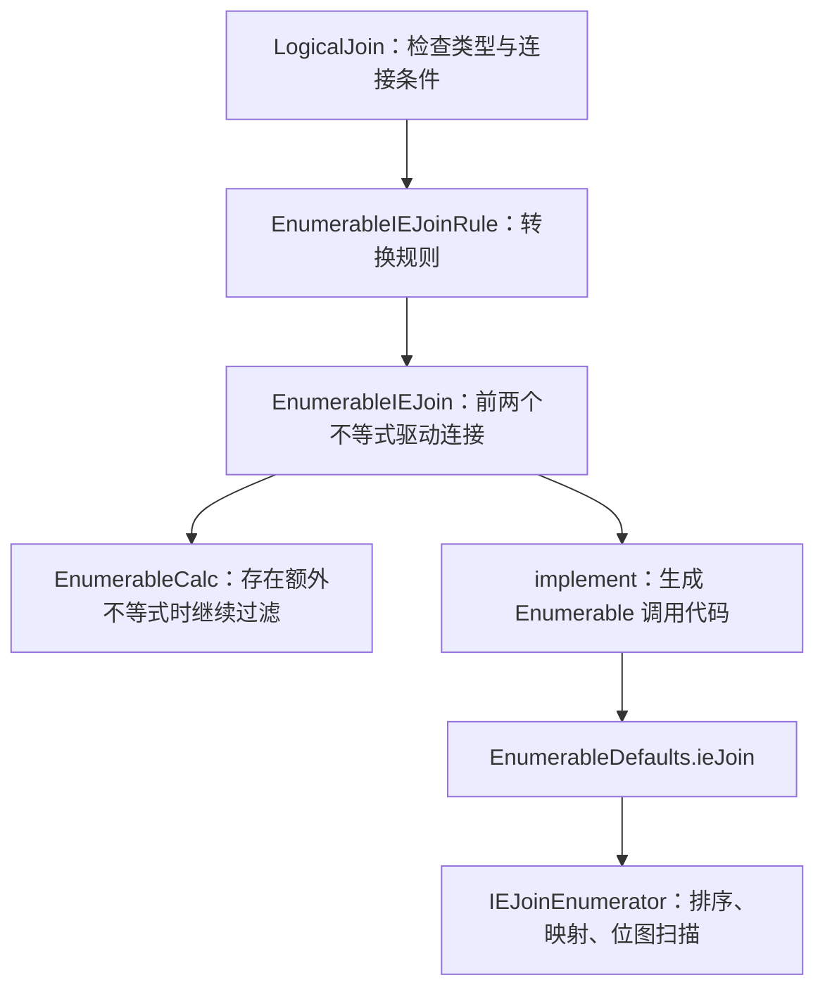

## 前言

在数据库中，等值连接通常可以通过 Hash Join 高效处理。如果把连接条件换成两条不等式，例如找出「运行时间更长，但收入反而更少」的两笔交易，执行器应该如何处理？

2015 年，Zuhair Khayyat 等人在论文 [Lightning Fast and Space Efficient Inequality Joins](https://www.vldb.org/pvldb/vol8/p2074-khayyat.pdf) 中提出了 IEJoin，用排序数组、位置映射和位图来处理这类连接。论文发表于 *PVLDB* 第 8 卷第 13 期，页码为 2074–2085。最近的 [CALCITE-7755](https://issues.apache.org/jira/browse/CALCITE-7755) 则将这一算法引入了 Calcite 的 Enumerable 执行器。

这项工作后来扩展为 [Fast and scalable inequality joins](https://doi.org/10.1007/s00778-016-0441-6)，刊于 *The VLDB Journal* 26(1):125–150（2017），进一步讨论了选择率估计、多谓词及多表连接优化和增量处理。作者还在 2017 年单独发布了[勘误](https://www.vldb.org/pvldb/vol10/p985-quianeruiz-errata.pdf)，修正原文中的排序条件等细节。因此，下面以 2015 年论文解释算法，用勘误核对边界处理，再结合期刊扩展版讨论优化空间。

笔者在阅读这些材料时，更关心的是一个具体问题：**两条不等式分别都能通过排序缩小范围，为什么把它们放到一起，反而需要一种专门的 Join 算法？** 本文先用一组数据把这个问题推导清楚，再沿着 Calcite 的转换规则、物理算子和运行时代码，看看论文中的思路如何落地。

> 本文源码分析固定在 CALCITE-7755 对应的提交 [152a4208](https://github.com/apache/calcite/commit/152a4208c54ecbcea74b9555644f804f764912eb)。截至 2026-10-27，Jira 标记为 Resolved / Fixed，Fix Version 为 1.43.0；该版本尚未发布，官网最新正式版本仍为 [1.42.0](https://calcite.apache.org/downloads/)。阅读时需要区分已合入的实现与正式版本中的能力。

## 两条不等式为什么难处理

沿用论文中东西海岸云交易的业务含义，我们准备两张小表。下面的数据由本文构造，目的是完整展示算法过程。

左表 `east` 记录交易运行时长 `dur` 和收入 `rev`：

| id | dur | rev |
| --- | ---: | ---: |
| e1 | 5 | 12 |
| e2 | 8 | 9 |
| e3 | 10 | 15 |

右表 `west` 的对应字段分别叫 `time` 和 `cost`：

| id | time | cost |
| --- | ---: | ---: |
| w1 | 6 | 7 |
| w2 | 9 | 11 |
| w3 | 12 | 10 |
| w4 | 7 | 14 |

我们希望找出西海岸运行得更久、收入却更少的交易对：

```sql
SELECT e.id AS east_id, w.id AS west_id
FROM east e
JOIN west w
  ON e.dur < w.time
 AND e.rev > w.cost;
```

对于 `e1=(5,12)`，`w1`、`w2`、`w3` 都满足条件；`w4` 虽然运行更久，但收入 14 大于 12，因此不能匹配。`e2` 没有匹配项，`e3` 则只匹配 `w3`。最终结果共 4 行：

```text
east_id  west_id
e1       w1
e1       w2
e1       w3
e3       w3
```

这里没有等值连接键，无法像普通 Hash Join 那样，用一个相等的键直接找到候选桶。最直接的处理方式是 Nested Loop Join：依次枚举左表和右表的每一对行，再判断两个条件是否同时成立。示例只需要检查 `3 × 4 = 12` 对数据；如果两边各有一百万行，就有一万亿对潜在组合。

这不意味着执行器一定会先把一万亿行笛卡尔积全部存下来。嵌套循环也可以边比较边输出，问题在于它仍然要检查大量最终无法匹配的数据对。CALCITE-7755 要改善的正是 Enumerable 执行器中这类逐对判断的开销。

如果只有 `e.dur < w.time`，事情会简单一些。将右表按 `time` 升序排列后，满足某个 `e.dur` 的数据必然是一个连续的后缀。例如 `e2.dur=8`，只需要考虑 `w2.time=9` 和 `w3.time=12`。

但第二条不等式使用的是另一列。按 `time` 排好的后缀中，`cost` 并不有序，我们仍然需要逐行检查 `e.rev > w.cost`。反过来，按 `cost` 排序，也无法直接判断运行时间。

因此，我们真正需要的是：找到满足第一个排序范围，同时也满足第二个排序范围的行。这两个范围属于不同的排序顺序，IEJoin 要做的就是把它们联系起来。

## 把两个排序范围放到同一组位置上

论文先给出了分别处理两张表的算法，又在第 4.2 节提出了合并数组的优化 `Union Arrays`。Calcite 的实现采用了后一种思路，因此下面也按合并数组展开。这里的合并会保留每一行以及它来自哪一侧的信息，不进行 SQL `UNION` 的去重操作。

### 第一次排序：把运行时间条件变成后缀

将两张表的连接键放进同一个数组。左表的 `dur` 和右表的 `time` 共同构成第一个排序键，按升序排列，得到 `firstOrder`：

| firstOrder 位置 | 行 | 来源 | 第一个键：dur / time | 第二个键：rev / cost |
| ---: | --- | --- | ---: | ---: |
| 0 | e1 | 左表 | 5 | 12 |
| 1 | w1 | 右表 | 6 | 7 |
| 2 | w4 | 右表 | 7 | 14 |
| 3 | e2 | 左表 | 8 | 9 |
| 4 | w2 | 右表 | 9 | 11 |
| 5 | e3 | 左表 | 10 | 15 |
| 6 | w3 | 右表 | 12 | 10 |

先忽略相同键值的边界处理，某个左表行右边的右表行，都满足第一条不等式。例如 `e2` 在位置 3，它右边的右表行只有 `w2` 和 `w3`。

不过，这个数组还不能判断收入条件。我们还需要为同一批行建立第二种顺序。

### 第二次排序：让收入条件随着扫描自动成立

将第二个键 `rev / cost` 也按升序排列，得到 `secondOrder`：

| secondOrder 位置 | 行 | 第二个键：rev / cost | 对应的 firstOrder 位置 |
| ---: | --- | ---: | ---: |
| 0 | w1 | 7 | 1 |
| 1 | e2 | 9 | 3 |
| 2 | w3 | 10 | 6 |
| 3 | w2 | 11 | 4 |
| 4 | e1 | 12 | 0 |
| 5 | w4 | 14 | 2 |
| 6 | e3 | 15 | 5 |

如果从上往下扫描这个数组，当我们访问某个左表行时，之前访问过的右表行，其 `cost` 都小于当前的 `rev`，也就满足第二条不等式。

例如扫描到 `e1.rev=12` 时，已经经过 `w1.cost=7`、`w3.cost=10` 和 `w2.cost=11`，这三行都满足收入条件；`w4.cost=14` 还没有经过，因此不应该参与匹配。

我们现在有了两个条件各自的表达方式：运行时间条件要求行位于 `firstOrder` 的某个后缀中，收入条件要求右表行已经在 `secondOrder` 中被访问过。接下来的问题是，如何快速判断它们是否指向同一行？

上表最后一列已经给出了答案。建立一个置换数组 `permutation`，记录 `secondOrder` 中的每一行在 `firstOrder` 中的位置：

```text
firstOrder:   e1  w1  w4  e2  w2  e3  w3
位置:          0   1   2   3   4   5   6

secondOrder:  w1  e2  w3  w2  e1  w4  e3
permutation:   1   3   6   4   0   2   5
```

例如 `permutation[2]=6`，表示第二种顺序中的 `w3`，位于第一种顺序的位置 6。这个映射使用的是行身份，即便两行的键值相同，也必须保留各自的位置。

### 位图：记住已经满足收入条件的右表行

建立一个与 `firstOrder` 对齐的位图 `activeRights`，初始全部为 0。位图中的 1 表示：这个位置是一行右表数据，并且已经在第二种顺序中被访问过。

按照 `permutation` 扫描时，遇到右表行，就将它在 `firstOrder` 中对应的位设置为 1；遇到左表行，就只查找该行位置之后的置位项。整个过程如下，位图从左到右分别对应位置 0 到 6：

| 扫描的行 | firstOrder 位置 | 操作后的位图 | 当前输出 |
| --- | ---: | --- | --- |
| w1 | 1 | `0100000` | 将位置 1 置位 |
| e2 | 3 | `0100000` | 位置 3 之后没有 1，无结果 |
| w3 | 6 | `0100001` | 将位置 6 置位 |
| w2 | 4 | `0100101` | 将位置 4 置位 |
| e1 | 0 | `0100101` | `(e1,w1)`、`(e1,w2)`、`(e1,w3)` |
| w4 | 2 | `0110101` | 将位置 2 置位 |
| e3 | 5 | `0110101` | `(e3,w3)` |

我们重点看一下 `e1`。此时位图中的位置 1、4、6 为 1，说明 `w1`、`w2`、`w3` 已经满足收入条件；这三个位置又都大于 `e1` 的位置 0，因此同时满足运行时间条件，可以直接输出。

再看没有结果的 `e2`。扫描到它时，`w1` 已经置位，说明 `w1.cost < e2.rev`；但 `w1` 位于位置 1，在 `e2` 的位置 3 之前，因此被运行时间条件排除。`w2` 和 `w3` 虽然位于正确的后缀中，却还没有被置位，因此被收入条件排除。

这就是 IEJoin 在这个例子中省掉逐对比较的原因：**一个条件由扫描进度维护，另一个条件由位置范围维护，位图负责在同一组位置上求交。** 它没有先生成两个庞大的候选结果集再做集合交运算。

### 对照论文中的四数组算法

再回头看原论文第 3.1 节的 Algorithm 1，就能理解那些辅助数组各自的用途了。基础版本分别为左右表建立两种排序顺序，因此有 `L1`、`L1'`、`L2`、`L2'` 四个数组。`P` 和 `P'` 在各自表内映射两种顺序，`O1` 和 `O2` 则记录从左表键值到右表有序数组的范围边界，最后在右表位图中枚举匹配项。

第 4.2 节的合并数组优化，将左右表相同用途的数组合并。这样，跨表范围判断也可以使用统一的位置，省去两个偏移数组，但需要额外保留行来源，排除同侧组合。前面的 `firstOrder`、`permutation` 和 `activeRights` 正是这种写法。辅助结构变少后，扫描时需要访问的数据也更集中，这也是原文讨论合并数组时关注缓存局部性的原因。

## 相等值、重复行与 NULL 怎么处理

前面的例子没有相同键值，因此升序和扫描范围比较容易理解。真正实现时，仅仅知道升序还是降序还不够。

这里先提醒准备对照伪代码实现的读者：2015 年原文 Algorithm 1 和 Algorithm 2 的排序条件存在错误。以第一组键为例，原文把 `>` 和 `<=` 放进同一个降序分支，作者在勘误中改为 `>` 和 `>=`；`<` 和 `<=` 对应升序。下面的表格依据 Calcite 的合并数组实现，不照搬原文有误的分支。

假设有 `e.dur=7`、`w.time=7`。对于严格小于 `<`，这一对不能匹配。如果第一种顺序把左表行放在右表行之前，后缀扫描就会误把右表行包含进来。Calcite 的做法是：第一种顺序中，相同键值遇到严格比较时，将右表行排在左表行之前；遇到包含等号的比较时，顺序反过来。

第二种顺序的要求恰好相反。对于 `e.rev > w.cost`，相同键值的右表行必须排在左表行后面，避免提前置位；对于 `>=`，右表行则应先置位。

在 Calcite 的合并数组实现中，四种操作符对应的排序规则如下。表中两种排序分别针对各自的不等式，不要求两条不等式使用相同操作符：

| 操作符：左键 op 右键 | firstOrder 方向 | firstOrder 同键顺序 | secondOrder 方向 | secondOrder 同键顺序 |
| --- | --- | --- | --- | --- |
| `<` | 升序 | 右表在前 | 降序 | 左表在前 |
| `<=` | 升序 | 左表在前 | 降序 | 右表在前 |
| `>` | 降序 | 右表在前 | 升序 | 左表在前 |
| `>=` | 降序 | 左表在前 | 升序 | 右表在前 |

这样，无论使用哪个操作符，运行时都可以沿用「访问过的右表行置位，左表行查找自身位置之后的置位项」这一套流程。相等边界的语义在排序时就已经安排好了，详见 [`IEJoinEnumerator#entryComparator`](https://github.com/apache/calcite/blob/152a4208c54ecbcea74b9555644f804f764912eb/linq4j/src/main/java/org/apache/calcite/linq4j/IEJoinEnumerator.java)。

重复键也不能去重。假如再增加一行与 `w1` 键值完全相同的交易，SQL 连接通常需要保留它带来的额外结果。当前实现为每行保存独立的 `Entry` 和 `rowIndex`，两行会占据不同的位置，因而能够分别输出。

勘误还补充了论文中 `IESelfJoin` 的重复值处理：第一属性相同时继续按第二属性排序，两者都相同时再按行 ID 排序。这与当前 Calcite 使用左右来源处理同键边界的合并数组实现，应分别理解。两者都说明了一件事：键值相等时的次序会影响算法语义，不能任意打乱，也不能直接去重。

对于 `NULL`，当前实现会在读入时排除任意一个驱动键为 `NULL` 的行。这里处理的是内连接，普通不等式与 `NULL` 比较不会得到 `TRUE`，排除这些行符合 SQL 语义。但外连接还要补充未匹配行，不能直接套用同样的处理方式。

## 论文怎样继续减少扫描和数据搬运

### 给位图增加一层分块摘要

前面的例子中，位图只有 7 位，直接查找置位项就足够了。如果位图有几千万位，大部分却都是 0，每处理一个左表行都扫描很长的空白区域，仍然会浪费时间。

原论文第 4.1 节的做法，是为位图再建立一层更小的位图。将底层位图切成固定长度的块，每块只用一个摘要位表示其中是否出现过 1。例如，下面的示意位图每 4 位分一块：

```text
块编号:     0     1     2     3
底层位图:  0000  0100  0000  0001
摘要位图:    0     1     0     1
```

如果查找范围从位置 8 开始，摘要已经说明块 2 全为 0，可以跳过；只有块 3 需要继续检查。底层某一位被设置为 1 时，相应的摘要位也置为 1。摘要只回答「这个块是否可能包含结果」，具体结果仍然由底层位图决定。

原文将这一结构命名为 Bloom Filter，2017 年勘误明确将其更正为 BitMap index。它通过固定块与摘要位的一一对应跳过空块，不需要通常布隆过滤器中的多次哈希。这一点也帮助我们区分论文与 Calcite：本文分析的 Calcite 提交直接调用 `BitSet.nextSetBit`，没有另建论文中的这层分块摘要。

### 分布式执行先筛选分块，再连接原始行

原论文第 5 节还讨论了分布式 IEJoin。数据量超过单机处理能力后，仅仅将所有分块两两交给 IEJoin，仍可能产生大量无用任务，因此论文先利用每个分块的键值最小值、最大值排除不可能匹配的分块对。

以本文的 `e.dur < w.time` 为例，假设一个左表分块的运行时长范围是 `[20,30]`，一个右表分块的运行时长范围是 `[5,18]`。即使拿左块最小值 20 与右块最大值 18 比较，也不满足条件，两个分块之间就不可能产生结果。第二条 `e.rev > w.cost` 同样可以检查：如果左块收入最大值仍不大于右块收入最小值，也可以排除这一块对。

通过范围检查，只能说明某个分块对「可能匹配」，块内两列值的组合仍要交给 IEJoin 精确判断。处理时主要传递连接键和行 ID，局部 Join 输出行 ID 对，最后再根据 ID 取回原始行，减少宽行在网络中的搬运。这是论文提出的分布式执行方法，下面介绍的 Calcite Enumerable 算子负责本地执行，两者的能力范围需要分开看。

## Calcite 如何把 SQL 变成 IEJoin

理解了位图扫描后，再看 Calcite 的实现就容易一些。CALCITE-7755 没有增加 SQL 语法，也没有引入新的逻辑 Join 类型，而是在已有 `LogicalJoin` 的基础上增加一种物理实现。



图中 `EnumerableCalc` 表示物理计划中的上层算子，`implement` 以下则是 IEJoin 自身的代码生成和运行路径。下面分别看这两部分。

### 转换规则会接受哪些条件

[`EnumerableIEJoinRule#convert`](https://github.com/apache/calcite/blob/152a4208c54ecbcea74b9555644f804f764912eb/core/src/main/java/org/apache/calcite/adapter/enumerable/EnumerableIEJoinRule.java) 首先限制 Join 的形态：必须是内连接，不能携带关联变量或系统字段。接着拆分 `AND` 连接的条件，至少需要两个合取项。

容易忽略的是，它会检查拆分后的每一个合取项。对于规则直接收到的 `LogicalJoin`，所有条件都必须是支持的跨输入字段不等式，不能认为只要找到两条不等式，其余任意条件都能自动作为残余谓词处理：

```java
for (int i = 0; i < conjunctions.size(); i++) {
  final EnumerableIEJoin.Condition condition =
      EnumerableIEJoin.analyzeConjunction(conjunctions.get(i), leftFieldCount);
  if (condition == null) {
    return null;
  }
  if (i < 2
      && !EnumerableIEJoin.supportsKeyTypes(
          join.getLeft(), join.getRight(), condition)) {
    return null;
  }
}
```

其中，`analyzeConjunction` 要求两边都是 `RexInputRef`，而且分别来自左右输入。它支持 `<`、`<=`、`>`、`>=`，也会规范化左右操作数顺序。例如写成 `w.time > e.dur`，会被识别成左输入键与右输入键之间的小于关系。

但 `e.dur + 1 < w.time` 的一侧是表达式，并非直接字段引用，无法被这一方法识别。前面的投影、类型转换等优化可能改变规则最终看到的表达式，因此判断能否使用 IEJoin，应以优化后的节点和实际执行计划为准。

规则通过检查后，会使用前两个合取项创建 `EnumerableIEJoin`；如果还有第三个、第四个不等式，就在上面增加 `EnumerableCalc`，继续判断剩余条件。当前代码按拆分后的顺序取前两个条件，没有在这里根据选择率搜索最佳组合。

例如下面的三条件连接，在字段和类型满足要求时，可以由前两条不等式驱动，最后再判断 `cores`：

```sql
ON e.dur < w.time
AND e.rev > w.cost
AND e.cores >= w.cores
```

如果第三条换成 `e.cores = w.cores`，该 Join 条件整体就不满足这条转换规则的检查。选择性很强的等值条件本身也可能让 Hash Join 更合适，不能仅凭出现两条不等式，就认定 IEJoin 应当被选中。

### 为什么浮点数没有被选为驱动键

前两个条件还会调用 `supportsKeyTypes` 检查字段类型。当前实现要求每对左右键在忽略可空性后类型相同，并接受布尔、受支持的精确数值、字符、二进制、日期时间和时间间隔等类型；无符号数值、近似数值以及 `ANY` 不在当前驱动键支持范围内。

浮点数的限制尤其值得注意。IEJoin 把比较语义编码进了排序位置，要求排序比较器与 SQL 谓词的比较语义一致。`NaN`、正零和负零会让排序顺序与直接执行 `<`、`<=`、`>`、`>=` 的结果出现差别，不能简单地将它们当作普通有序值处理。

这一限制针对的是驱动键。前两个条件通过检查后，额外的不等式交给 `EnumerableCalc` 执行，因此额外条件可以使用近似数值。提交中的 [`ieJoinWithApproximateRemainingPredicate`](https://github.com/apache/calcite/blob/152a4208c54ecbcea74b9555644f804f764912eb/core/src/test/java/org/apache/calcite/test/enumerable/EnumerableIEJoinTest.java) 测试就验证了这种情况。

### 从物理算子到位图枚举

[`EnumerableIEJoin#implement`](https://github.com/apache/calcite/blob/152a4208c54ecbcea74b9555644f804f764912eb/core/src/main/java/org/apache/calcite/adapter/enumerable/EnumerableIEJoin.java) 会生成两侧输入的执行代码，以及四个取键函数、两个比较器、两个操作符和一个结果拼接函数，再调用 `EnumerableDefaults.ieJoin`。

其中，比较器决定键之间的大小关系，`IEJoinEnumerator` 再根据操作符选择排序方向和同键顺序。这也解释了为什么类型、字符排序规则等信息必须在代码生成阶段得到正确处理。

运行时的核心状态与前面的推导一一对应：

| 字段 | 作用 |
| --- | --- |
| `leftRows` / `rightRows` | 缓存原始输入行，输出时通过行号取回 |
| `firstOrder` | 合并输入后，按第一条不等式排列的行条目 |
| `permutation` | 从第二种顺序的位置映射到第一种顺序的位置 |
| `activeRights` | 已在第二种顺序中访问过的右表行，使用 `BitSet` 保存 |
| `currentLeft` / `nextBit` | 当前正在输出匹配结果的左表行，以及下一次位图查找起点 |

下面是 `moveNext` 中决定如何推进扫描的一段源码，省略了正在输出当前左表行结果的分支：

```java
final int firstPosition = permutation[secondPosition++];
final Entry<TKey1, TKey2> entry = firstOrder.get(firstPosition);
if (entry.isLeft) {
  currentLeft = entry;
  nextBit = firstPosition + 1;
} else {
  activeRights.set(firstPosition);
}
```

随后通过 `activeRights.nextSetBit(nextBit)` 找到候选位置，取回左右输入行并调用 `resultSelector` 输出。这与例子中的过程一致：右表行负责置位，左表行负责从自身位置之后枚举结果。

这里需要区分输入和输出的行为。构造枚举器时，它会完整读取两侧输入，缓存非空键对应的原始行并完成排序；匹配结果则随着 `moveNext` 逐行生成，没有先缓存全部连接结果。因此，当前实现的输入准备是阻塞的，结果输出是按需推进的。即使上层只要少量结果，首次输出前仍然需要完成输入读取和排序。

论文讨论了更丰富的执行方式，但这个提交中的枚举器没有磁盘溢写路径。评估内存时，除了线性规模的位置数组和位图，还要算上两侧输入行的缓存，不能将总内存简单理解为「每行只需要一个 bit」。

### 优化器为什么会选择它

有了物理算子，还需要让优化器能够比较它与其他实现的代价。`EnumerableIEJoin#computeSelfCost` 获取左右输入和 Join 输出的估算行数后，使用下面的公式计算代价：

```java
final double inputRows = leftRows + rightRows;
final double cost =
    2D * Util.nLogN(inputRows) + inputRows + outputRows;
return planner.getCostFactory().makeCost(cost, 0, 0);
```

这几个部分分别对应两次排序、线性规模的处理，以及输出匹配行的成本。源码还会对交换左右输入的等价计划增加微小差异，避免两者完全同价。这个实现把估算值放入了 `RelOptCost` 的 rows 分量，不能把这里的 rows 直接当成真实结果行数。

该规则已经加入提交中的 `EnumerableRules.ENUMERABLE_RULES` 和 `Programs.RULE_SET`，使用这些默认规则集合时，符合条件的 Join 可以参与代价比较。但自己维护规则集合的下游系统，仍然需要检查是否注册了 `EnumerableRules.ENUMERABLE_IE_JOIN_RULE`。注册后也不代表每次都选它，统计信息和其他候选计划的代价仍然会影响结果。

提交中的 `ieJoinCostAndDefaultSelection` 测试保留了其他 Join 规则，验证优化器会在相应场景选择 `EnumerableIEJoin`；另外一些小数据测试会移除 `ENUMERABLE_JOIN_RULE` 来强制覆盖 IEJoin 路径。阅读测试时，要区分算法能否正确执行，与默认情况下优化器是否选择它。

### 扩展论文如何选择驱动条件

当前规则直接取前两个不等式，但如果有第三个条件，究竟哪两个条件应该先执行？期刊扩展版的第 4 节专门讨论了这个问题，可以对照[作者公开稿](https://github.com/qcri/mourad/blob/master/pubs/vldbj2016.pdf)阅读。

它先从两张输入表中均匀随机抽样，将样本排序并切成小块，再根据所有连接键的最小值和最大值，统计可能产生结果的分块对数量。这个数量越少，意味着这组条件排除的数据通常越多。它是用来比较候选方案的估计，不能直接当成精确的连接结果行数。

对于三条不等式，可以分别估计「条件 1 与条件 2」「条件 1 与条件 3」「条件 2 与条件 3」，选择预计留下候选更少的一组驱动 IEJoin，另一条留到结果上判断。期刊论文还将这种估计用于多表连接，以贪心方式构造左深计划，优先执行过滤能力更强的连接。

这为 Calcite 当前实现提供了一个可以继续研究的方向。不过，增加抽样与组合比较本身也有规划成本，不能只看候选行数减少了多少。如果没有可靠的联合分布信息，仅仅把两条不等式各自的选择率相乘，也可能忽略两列之间的相关性。

## IEJoin 省掉了什么，又留下了什么

回到最开始的 12 对潜在组合，IEJoin 通过排序和位图求交，找到了我们需要的 4 对结果。在大输入、匹配结果相对较少时，这种方式可以减少对不匹配行的逐对谓词计算；连续数组和紧凑位图，也有利于减少数据访问开销。

但不能据此把 IEJoin 的时间复杂度直接写成 `O(N log N + K)`，其中 `N` 是总输入行数，`K` 是输出行数。论文第 3.1 节给出的基础算法最坏时间复杂度仍包含 `m × n` 项。如果所有左右行都匹配，光输出结果就已经需要处理 `m × n` 对数据。

即使结果很少，位图扫描也有成本。前面介绍的分块摘要正是为了解决扫描空白区域的问题。Calcite 当前使用 Java `BitSet.nextSetBit` 查找置位项，减少逐 bit 判断，但不同左表行仍可能重复经过位图中的空白区域。因此，上面的代价公式应当理解为规划阶段的估算，并非实际运行时间的严格上界。

原论文第 7.3 节在其单节点数据和基线系统上报告了超过一个数量级的性能优势，这说明减少无效比较具有实际价值。不过，那些是论文中的 PostgreSQL 实现与当时基线之间的实验，不能直接当作 CALCITE-7755 的性能测试结果。本文也没有对 Calcite 运行性能基准测试。

如果要在自己的系统中评估这一实现，笔者会先看过滤后剩余的输入规模和预计输出规模，再核对实际计划。当一侧已经很小，嵌套循环未必昂贵；当存在很强的等值过滤时，Hash Join 可能先把候选范围缩得更小；当两侧都很大且结果有限，两条不等式又能直接作为驱动键时，IEJoin 才更值得重点比较。

同样是两条不等式，也可以表达区间重叠。例如对于起点小于终点的非空半开区间 `[start,end)`，两个区间相交可以写成：

```sql
ON a.start_time < b.end_time
AND a.end_time > b.start_time
```

这满足 IEJoin 所处理的谓词形式，但「通用不等式连接」与「专门针对区间数据设计的连接算法」仍有不同的适用范围。区间算法还可能利用起止点之间的关系，而本文交易例子中的运行时间和收入并不存在这样的约束。

对于有多个不等式的情况，还要观察前两个驱动条件能产生多少候选行。如果这两个条件匹配很多，而第三个条件会排除绝大多数数据，上层 `EnumerableCalc` 仍要处理大量中间结果。期刊扩展版的条件选择方法，可以与前文 [Apache Calcite 统计信息和代价模型详解](https://strongduanmu.com/blog/cornerstone-of-cbo-optimization-apache-calcite-statistics-and-cost-model.html) 中讨论的基数估计一起研究。

如果输入需要持续更新，期刊扩展版第 5 节还研究了增量 IEJoin：维护已有排序结构，重点计算涉及新增或删除行的结果，而不是每次重新处理完整数据。这与当前 Calcite 枚举器重新读取、排序输入的执行方式不同，不能因为使用了同一个算法名称，就认为已经具备增量计算能力。

## 结语

IEJoin 最值得理解的地方，是如何让两个排序顺序共同参与一次结果枚举：第一次排序把一个不等式变成位置范围，第二次排序让另一个不等式随着扫描进度成立，置换数组把两种顺序映射到同一组位置，再通过位图找出同时满足条件的右表行。

CALCITE-7755 则展示了把论文算法接入查询引擎时需要补齐的工作。除了扫描本身，还要处理 SQL 的空值和重复行语义、比较器的一致性、转换规则的匹配范围、代码生成，以及优化器中的代价比较。理解了这些细节，我们再看到执行计划中的 `EnumerableIEJoin`，就能判断它由哪些条件驱动、为什么可能更快，以及还需要关注哪些成本。



笔者因为工作原因接触到 Calcite，前期学习过程中，深感 Calcite 学习资料之匮乏，因此创建了 [Calcite 从入门到精通知识星球](https://wx.zsxq.com/dweb2/index/group/51128414222814)，希望能够将学习过程中的资料和经验沉淀下来，为更多想要学习 Calcite 的朋友提供一些帮助。




欢迎关注「**端小强的博客**」微信公众号，会不定期分享日常学习和工作经验，欢迎大家关注交流。


