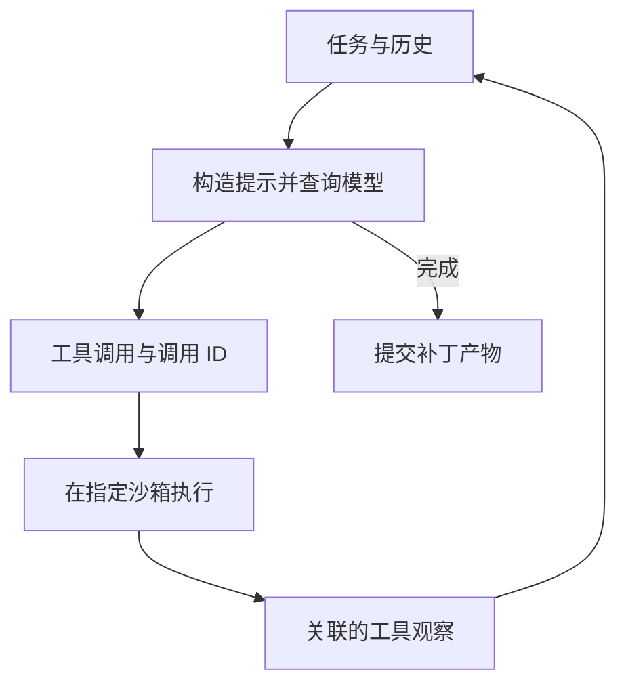

## 作业对应的任务

本页依据[官方 Assignment 1](https://github.com/cmu-agents/assignment-1/blob/main/ASSIGNMENT.md)整理，核对时间为 2026-11-08。官方课程页列出的截止日期为 **2026-09-14**，占课程总成绩 10%，独立完成。这里记录要求与实现思路，不代表已经完成实验或得到结果。

作业先搭建通用 Harness，用编程 agent 修复一个国际象棋应用；再加入上下文压缩；最后复用同一执行循环，让 ChessAgent 下棋，比较观察、模拟、程序化工具与技能的影响。

## Part 1：用 ReAct 循环修复应用

共享 `Agent` 需要维护 system、user、assistant 和 tool 消息，构造提示、查询模型、执行调用、追加对应观察，再继续执行。`Agent.finished` 表达结束状态，超过 `step_limit` 抛出规定异常。



`CodeAgent` 提供 `execute` 和 `send_message`，命令应通过指定 `Environment.execute` 进入 Modal 沙箱。一次回复可以有多个调用，每个都需返回携带原 `tool_call_id` 的观察。参数 JSON 错误、未知工具等需要转成可恢复观察，让模型处理，而非直接终止整个循环。

技能部分实现渐进披露：扫描技能目录、解析 `SKILL.md` 的 YAML 元数据，在提示中列出名称与描述，通过 `invoke_skill` 才返回全文。重复名称或缺少合法元数据应明确报错。没有技能时，不能从其他提示泄露技能中的提交协议。

实际修复由 agent 在 `/testbed` 完成，生成补丁和轨迹，再在新环境重放补丁并运行回归。不要直接修改目标 `chess_app/` 来绕过 agent。当前官方入口为：

```bash
make run-code-agent
make check-part1
```

## Part 2：压缩旧历史，保留执行依据

实现 `Agent.compact_context`，让模型生成简洁、事实性的工作记忆。摘要应保留目标、约束、文件、命令、编辑、具体结果、失败方法、测试、阻塞与下一步。只压缩旧前缀，system/task 原文和最新完整 assistant 行动及其全部工具观察继续保留。

每次新行动前接入 `maybe_compact_context()`。不要改写用于完整审计的 `api_prompt` 与 `api_responses`，否则无法对照真实执行和模型当前可见上下文。

官方实验使用 `django__django-15368`，压缩阈值为 6,000 token；另以阈值零运行完整上下文基线。压缩条件必须至少触发一次、实质减少活动上下文，并生成通过检查的补丁。生成有随机性，因此要求不等于每次都比基线轮数少。

报告比较 token 使用及取舍，区分总 API 输入、缓存和活动上下文等口径，不能仅以摘要字数断言整体成本下降。实验记录写入官方要求的 `artifacts/token-usage-analysis.md`。

## Part 3：复用循环完成下棋任务

ChessAgent 执白，服务器的确定性对手执黑。`play_move` 使用 UCI 字符串，例如 `e2e4`；真实移动会改变棋盘，并自动获得黑方回复。返回观察要包含新状态，维护 `last_state` 与 `finished`。

多次真实移动存在状态依赖，因此同批并行调用最多执行一个移动，其余作为可恢复错误返回。不能把模型一次给出的多个移动都作用到不断变化的棋盘。

接着对两个指定模型分别比较“仅棋盘”与“棋盘加合法移动”，共四个运行。记录总调用、非法调用、非法率和是否到达终局。评分检查实验及证据，并不要求得到某个固定趋势或赢棋。

`simulate_move(fen, move=None)` 只模拟状态，不改变真实棋盘；完整 FEN 表达局面，UCI 表达一手移动。`run_python(code)` 则让模型在沙箱程序中调用模拟与真实移动，组合更复杂策略。模型代码不能直接在本地 agent 进程运行。

程序执行后应重新读取真实棋盘，避免模型重放代码中已经提交的移动。运行器异常与模型代码异常也要分开：前者属于沙箱调用失败，后者可能是运行器正常返回的 `error` 字段。

最后加载 `select-move` 技能，观察明确策略是否让 agent 更有效地使用模拟和程序工具。具体实验命令和所需轨迹以官方作业文档为准。

## 提交证据与学习记录

提交的不只是源码，还包括修复补丁、完整轨迹、压缩与基线比较、观察实验及程序化工具/技能的运行证据。评分会重放补丁与已提交轨迹，不重新调用模型，缺失或不一致的证据会影响相应项目。

使用官方清单整理允许修改的源码与 `artifacts/`，补充 `AI_USAGE.md`，不要提交凭证、环境文件、任务测试或教师文件。笔记后续可以在相应部分补充自己的实现 diff、运行信息和失败分析，并明确与官方要求区分。

## 参考资料

- [官方作业说明与提交清单](https://github.com/cmu-agents/assignment-1/blob/main/ASSIGNMENT.md)
- [官方课程作业入口](https://www.cmu-agents.com/#/assignments)
