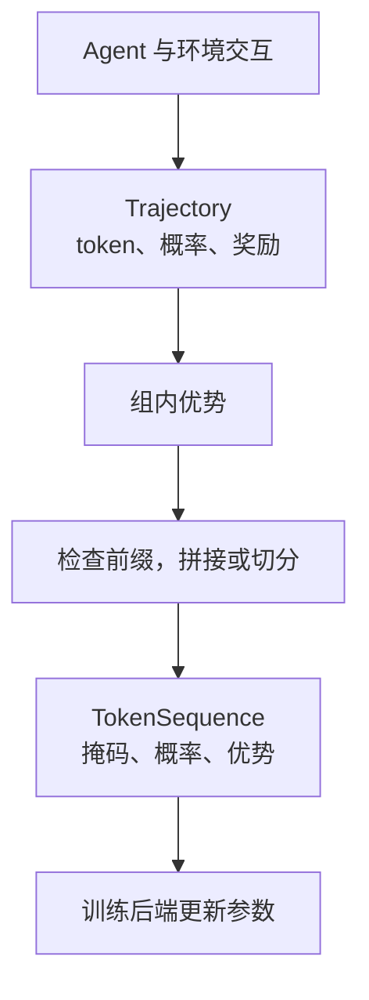

## 搭建 ScottyRL 训练流程

本页依据[官方 Assignment 3](https://github.com/cmu-agents/assignment-3/blob/main/ASSIGNMENT.md)整理，核对时间为 2026-11-08。课程页列出的截止日期为 **2026-10-29**，占课程总成绩 15%，独立完成。本文记录任务和验证思路，不包含虚构的训练曲线或实验结论。

作业要求补齐最小训练框架 `scottyrl`：处理 token 轨迹和优势，实现同步 REINFORCE/GRPO、异步 GRPO 与旧策略数据处理，再进行消融，最后训练 TextCraft-Synth agent。底层兼容 Tinker API，作业提供相应自托管部署方式。

## 两个环境分别承担什么作用

Number Search 在 `[low, high]` 中找隐藏数字，工具 `guess(n)` 返回大小关系，预算为包含最终正确猜测的二分搜索最坏次数。它便宜、反馈清楚，适合调试和消融。

TextCraft-Synth 要根据配方和初始库存完成所有目标，并在预算内调用 `finish()`；工具包括 `craft`、`get_info`、`view_inventory` 和 `finish`。它开启思维链，轨迹更长，适合最后检验复杂任务和困难划分泛化。

官方当前配方使用 Qwen3.5-4B 和 rank 32 LoRA。公开测试与数据处理可在本地运行，不需要先启动 GPU 服务；训练资源和费用属于作业执行，不是阅读这份笔记就会发生的操作。

## Part 1：轨迹怎样变成训练序列



`advantages.py` 计算组相对优势，`datagen.py` 处理 sequence extension 与样本构造。这里最容易出错的是 next-token 对齐：`n` 个 token 只有 `n−1` 个预测位置；位置 `j` 对应 `tokens[j+1]`。

当上下文长度为 `L`、生成长度为 `c` 时，生成目标范围是 `L−1:L−1+c`，而不是 `L:L+c`。mask、采样 logprob 与 advantage 都要按目标位置对齐；只有 completion token 直接参与策略损失。

后一次 prompt 若精确扩展当前累积序列，就继续拼接；否则另起样本。删除旧推理块或某些结束条件可能破坏 extension，即便配置通常保留历史，也不能假设永远成立。

## Part 2：同步 REINFORCE 与 GRPO

实现组内并发采样、分组到 batch 的转换、后端更新及同步训练循环。每次更新后刷新采样策略，下一批才来自当前模型。

官方对照中，REINFORCE 每任务采一条，GRPO 每任务采八条，都训练 50 步，并按规定周期验证。报告奖励、成功率、损失及其他标准诊断图，比较学习速度和原因。

`G=1` 的 REINFORCE 不使用组基线，因此与 `G=2、8` 的 GRPO 比较时，不是纯粹只改变组大小。REINFORCE 记录的退化组比例也不具有相同意义，应按官方要求标为 N/A。

## Part 3：异步生产与消费

Rollout worker 捕获同一个 `(policy, version)` 生成整组轨迹，放入有界队列；learner 消费时判断 staleness，更新后发布新策略。生成过程中策略可能被其他更新替换，因此版本不能在结束时随意读取最新值。

队列 `put/get` 提供背压，避免轮询。评估在捕获的策略版本上后台执行，结束时取消并等待 worker；任一任务失败时应传播原错误，并清理其他任务，防止挂起。

异步实验与同步 GRPO 保持相应任务和采样预算，再比较每步墙钟时间、最终成功率、概率比统计和丢弃旧组数量。概率比均值接近一，仍可能掩盖重尾，需要看最小、最大与标准差。

## Part 4：控制变量解释收益

作业要求比较组大小、同步与异步，以及更高 staleness 下有无 importance weighting。最后一组的官方对照是 PPO 损失与忽略概率比的优势加权交叉熵；保持其余配置不变，才能分析旧策略修正的作用。

除曲线外，还需选取早、中、晚期轨迹，给出步骤、任务 ID 和策略版本，描述具体行为变化，例如是否利用大小反馈、是否二分、遇到无效调用怎样恢复。不能只用奖励上升代替行为分析。

## Part 5：TextCraft-Synth 与完整交付

确认 Number Search 管线正确后，再按官方配置进行一次长训练，并在中等与困难验证集上评价。作业将它视为一次主要运行，正式训练前用短 probe 检查格式、采样与学习信号；记录实际硬件与耗时，费用估计不当作当前服务报价。

完整提交需包含六个允许修改的源码文件、七个规定运行的配置与日志、轨迹和 checkpoint 记录、Part 5 适配器导出信息、报告及 `AI_USAGE.md`。当前官方打包入口为：

```bash
uv run python scripts/package_submission.py
```

脚本会拒绝不完整交付。公开测试通过后仍需核对数值、异步行为、运行证据和留出集结果，不能把接口测试通过等同于训练算法已经正确。

## 参考资料

- [官方作业说明、代码位置与实验配置](https://github.com/cmu-agents/assignment-3/blob/main/ASSIGNMENT.md)
- [官方课程作业入口](https://www.cmu-agents.com/#/assignments)
