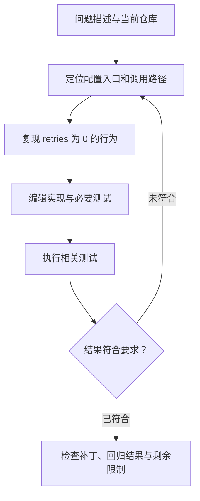
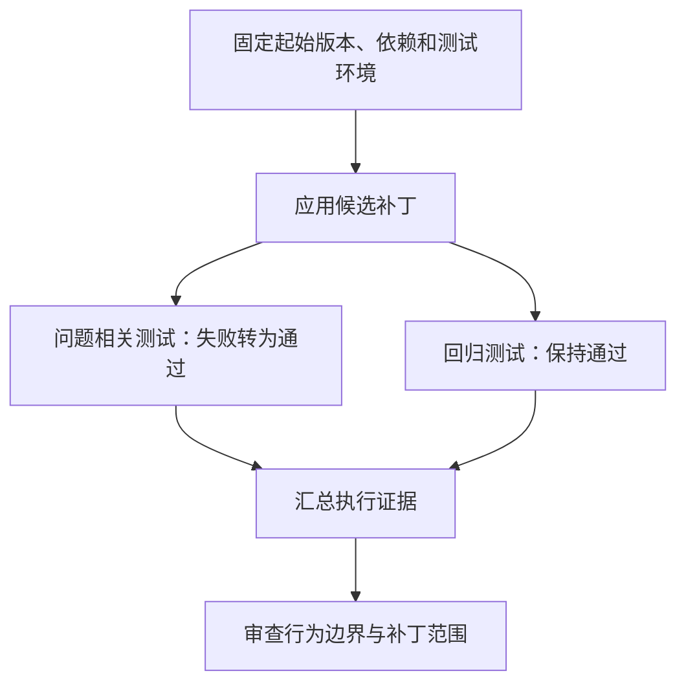

## 课程视频

<div class="bilibili-video" style="position: relative; width: 100%; aspect-ratio: 16 / 9; margin: 1rem 0;">
  <iframe src="https://player.bilibili.com/player.html?isOutside=true&aid=117346324780626&bvid=BV1Ceaq64Eje&cid=42262464923&page=1&high_quality=1&qn=120&quality=120&danmaku=0&autoplay=0" scrolling="no" border="0" frameborder="no" framespacing="0" allowfullscreen="true" style="position: absolute; inset: 0; width: 100%; height: 100%;"></iframe>
</div>

[B 站观看本讲](https://www.bilibili.com/video/BV1Ceaq64Eje/)

[官方录像](https://www.youtube.com/watch?v=1BWeH1oOM7k) · [官方幻灯片](https://www.cmu-agents.com/slides/lecture-06-coding-agents.pdf)

## 从生成函数到修改一个仓库

这一讲由 Graham Neubig 介绍编程智能体。代码补全的输入通常集中在光标附近，目标是生成下一段代码；处理仓库问题时，智能体还要查找实现、理解调用关系、修改文件、执行程序，再根据反馈继续调整。代码生成能力进入了一个持续与环境交互的过程。

我们先看一个补充示例。某个客户端允许通过配置关闭重试，用户设置 `retries: 0` 后，程序仍然重试了三次。相关实现如下：

```python
# config.py
def retry_count(config):
    return config.get("retries") or 3
```

Python 中，`0`、`None` 和空字符串等值在布尔判断中都为假。因此，显式配置的 `0` 被 `or` 表达式替换成了默认值 `3`。问题定位到这里，修改看起来很简单。不过，放到完整仓库中，我们还需要确认配置格式、调用位置、现有测试以及缺失值的约定。

编程智能体通常沿着下面的循环完成这些工作：



每次测试输出都是新的观察。模型需要根据失败信息改变后续动作，形成一个有证据支撑的补丁。

## 代码模型从哪里获得基础能力

原视频用 InCoder 的中间填充格式解释训练与推理如何利用右侧上下文。


*原视频截图：[回到 25:30](https://www.bilibili.com/video/BV1Ceaq64Eje/?t=1530)。*

讲义先回到代码模型的训练。预训练把代码作为 token 序列学习，模型从函数实现、类型、注释、测试及代码之间的关系中获得生成能力。训练语料的过滤、去重和数据隔离会影响学习质量，也会影响后面的评测可信度。

代码中的空格、缩进、标识符和符号都需要经过分词。一个变量名可能拆成多个 token；模型预测的是这些 token 的组合。长上下文训练进一步让模型接触跨文件关系，例如调用处引用了另一个文件的类型和函数。

除了从左到右续写，代码模型还能够通过 Fill-in-the-Middle，也就是中间填充任务学习编辑：输入已有前缀和后缀，生成两者之间缺失的实现。对于下面的函数，前缀给出了函数名与参数，后缀给出了后续代码，中间待补部分应与两边同时兼容。

```python
def retry_count(config):
    ...  # 待补全的函数体


def connect(config):
    retries = retry_count(config)
    ...  # 后续连接逻辑
```

具体的前缀、后缀和填充标记取决于模型训练格式。编辑接口也需要使用模型理解的表示。把同一段代码换成错误的模板，可能使模型继续补写后缀，或者输出无法应用的编辑内容。

预训练主要提供代码和文本的基础能力。后续监督微调能够教授工具调用、仓库调查和任务完成的轨迹；强化学习则利用执行结果改进策略。第 8、9 讲会继续解释这两个阶段。

图中先把原代码拆为 `prefix`、`span` 与 `suffix`。训练序列将缺口移到后面：前缀、缺口标记、后缀、对应标记，再生成待填片段和结束标记。推理时提供前缀与后缀，模型沿相同格式生成缺口内容。[InCoder](https://arxiv.org/abs/2204.05999) 的标记支持一个或多个缺口。

后缀能提供左侧续写没有的信息。若后续调用对返回值使用 `.strip()`，缺口中的返回值需要与字符串接口兼容；若函数返回值被用于 `range()`，相关实现又需要满足整数语义。类型标注、后续调用和测试共同约束填充内容。

多个缺口需要明确对应关系，模型生成的片段也要放回正确位置。编辑工具若把标记顺序或结束条件组织错，模型即使生成了合理代码，最终文件也可能插错位置。应用编辑后，应重新解析或编译实际文件，再执行行为检查。

## 生成得像，执行起来是否相同

程序允许很多种等价写法，字符串匹配很难充分评价代码。以整数输入为例，下面两种实现都满足“判断是否为正数”：

```python
def is_positive_a(x):
    return x > 0


def is_positive_b(x):
    return not (x <= 0)
```

把条件改成 `x >= 0`，代码仍然简短、语法正确，但输入 `0` 时就会违反要求。执行测试让这类边界进入评测。[EvalPlus](https://arxiv.org/abs/2305.01210) 通过增强代码生成任务的测试用例，研究测试覆盖对结果可靠性的影响。

代码生成评测中的 `pass@k` 描述采样 `k` 个候选时，至少一个候选通过测试的概率。这里的 `k` 是候选程序数量。它与一个智能体在同一仓库中执行了多少轮工具调用属于不同统计对象。报告结果时，还需要交代候选选择是否使用测试反馈，以及哪些测试对模型可见。

仓库任务又增加了依赖、构建和环境配置。程序没有运行起来时，先确认错误来自补丁还是环境，才有依据判断代码质量。

### pass@k 与候选选择

原视频的曲线同时展示一次生成与多次生成的结果，提醒我们区分“采到了正确程序”和“选出了正确程序”。


*原视频截图：[回到 40:20](https://www.bilibili.com/video/BV1Ceaq64Eje/?t=2420)。*

设一次评测采样 `n` 个程序，其中 `c` 个通过测试。如果从这批样本中不放回取 `k` 个，全部失败的比例为 `C(n-c, k) / C(n, k)`，因此常用的估计式为：

```text
pass@k = 1 - C(n-c, k) / C(n, k)
条件：1 ≤ k ≤ n
```

假设采样 10 个程序、其中 2 个正确，取 3 个时，估计值为 `1-C(8,3)/C(10,3)=0.5333`。这是本文的计算例子，评测还需要对不同问题汇总。原始方法见 [代码模型评测论文](https://arxiv.org/abs/2107.03374)。

```python
from math import comb


def estimate_pass_at_k(n, c, k):
    if not 0 <= c <= n or not 1 <= k <= n:
        raise ValueError("invalid counts")
    return 1 - comb(n - c, k) / comb(n, k)


print(estimate_pass_at_k(10, 2, 3))
```

`pass@k` 能说明候选集合中出现正确解的机会。实际使用还需要选择器：可见测试、静态检查、模型评分或其他证据分别能帮助到什么程度？用隐藏评测答案挑选最终程序，会改变评测设置，应单独报告。

增加采样次数也提高生成、环境初始化和测试成本。对于智能体，候选补丁还可能由不同调查轨迹得到，比较时应交代总尝试次数、每条轨迹的工具预算、候选验证和选择方式。曲线中的样本数量、参数规模与排序方法，是解释差异的条件。

## 沿着配置值找到错误

回到 `retries: 0`。假设我们已在仓库根目录，第一轮调查应把用户的描述转成可搜索的对象：配置键、解析方法、调用点与测试名称。

```bash
rg -n 'retries|retry_count' src tests
rg -n 'load_config|connect\(' src
```

搜索结果用于确定相关文件，再读取方法所在的一段代码。一次性把整个仓库放进上下文，既增加开销，也容易让模型在大量不相关实现中失去方向。对于配置问题，沿着“读取配置 → 应用默认值 → 调用重试逻辑”的数据流调查，通常更容易得到可核对的解释。

接下来，我们用一个短测试保留错误。下面的测试对应本文演示文件，使用 Python 标准库即可运行：

```python
# test_config.py
import unittest

from config import retry_count


class RetryCountTest(unittest.TestCase):
    def test_missing_uses_default(self):
        self.assertEqual(retry_count({}), 3)

    def test_none_uses_default(self):
        self.assertEqual(retry_count({"retries": None}), 3)

    def test_zero_disables_retry(self):
        self.assertEqual(retry_count({"retries": 0}), 0)

    def test_positive_value_is_preserved(self):
        self.assertEqual(retry_count({"retries": 2}), 2)
```

执行 `python3 -m unittest -v`，原实现会在 `test_zero_disables_retry` 上失败，其他三个用例通过。这个结果缩小了修改范围：在本文约定中，缺失配置和 `None` 使用默认值，显式提供的整数应保留。

对应补丁如下：

```diff
 def retry_count(config):
-    return config.get("retries") or 3
+    value = config.get("retries")
+    return 3 if value is None else value
```

修改后再执行测试，四个用例均应通过。负数、字符串和非法类型如何处理，取决于配置接口的约定；真实仓库中需要查看上游校验，再决定是否补充测试。当前补丁说明了默认值问题，也明确保留了它的验证范围。

## 一个单元测试覆盖了多大范围

刚才的四个测试验证了 `retry_count` 对几种输入的处理。配置真正进入客户端，还可能经过文件读取、环境变量覆盖和类型转换。用户描述的是整体行为，调查时应确认这些入口与我们测试的值一致。

假设环境变量中读取的值为字符串 `"0"`，配置解析器尚未将它转成整数，函数会保留这个字符串。后面的重试循环怎样使用它，就成了另一个问题。我们不能只看到默认值补丁通过，就推断配置链路全部正确。

下面用标准库构造一个 JSON 配置入口，继续检查本文的修复。这个演示采用 JSON；真实仓库使用什么格式，应读取实际实现确认。

```python
import json

from config import retry_count


def retry_budget_from_json(text):
    config = json.loads(text)
    return retry_count(config)


assert retry_budget_from_json('{"retries": 0}') == 0
assert retry_budget_from_json('{}') == 3
```

这两个断言把文本配置与目标函数连接起来，仍然没有覆盖实际网络重试。下一层验证应检查重试控制逻辑：初次请求失败后，`retries=0` 是否立即返回错误；`retries=2` 是否按约定增加两次尝试；成功请求是否提前停止。模拟传输器能让这些用例保持确定性，避免依赖真实网络偶发错误。

“重试次数”还可能表示总尝试次数，也可能表示首次失败后的额外次数。两种约定都存在，真实修改需要查看接口文档与原测试。智能体应保留仓库已有语义，防止顺便改变了循环边界。

测试范围因此沿着数据与控制流扩大：先确认默认值分支，再确认配置解析，最后确认传输尝试次数。每一层都有不同的观察，也对应不同的失败来源。无需为了一个短补丁运行所有昂贵测试；应先完成与行为相关的检查，再按项目要求执行必要回归。

## 终端输出怎样成为下一轮输入

终端工具返回测试失败后，模型应读取失败用例与断言差异。若结果只是依赖安装失败，它提供的是环境问题；若命令仍在运行，下一步应取得完成结果。把“命令已启动”写成“测试已通过”，会让证据链断开。

对于输出很长的测试套件，框架能保存完整日志，只将失败摘要、退出码和读取入口加入上下文。日志截断要明确标注，避免模型以为最后几行就是全部结果。重复执行前，还应检查上一次是否已经结束，防止并行测试争用端口和临时文件。

补丁审查也属于观察。`git diff` 能帮助检查目标文件是否出现无关格式调整、是否留下调试打印，以及原有未提交修改是否受到影响。文件里的最终实现、实际应用的补丁和模型描述应该对应起来。

成本评估则需要把整个闭环计入：仓库搜索、环境准备、候选修改和验证都消耗时间。只比较模型生成补丁的速度，无法反映一个需要反复修正、测试多次失败的方案。执行日志中的每次失败最好能对应后续调整，让读者判断重试有没有获得新的信息。

## 工具接口决定调查与编辑的方式

[SWE-agent](https://arxiv.org/abs/2405.15793) 强调 Agent-Computer Interface，即面向智能体的计算机接口。搜索结果怎样展示、文件怎样打开、编辑错误怎样返回，都会影响模型下一步的选择。模型能力与工具接口需要一起评估。

一个文件编辑工具如果只返回“失败”，模型很难区分路径错误、匹配不存在和语法检查失败。返回匹配位置、错误类型及附近内容，能够为恢复提供新的观察。终端工具也应给出退出状态，并区分命令完成、仍在运行和执行超时。

不同编辑形式各有适用范围：

| 编辑形式 | 适合的场景 | 容易出现的问题 |
| --- | --- | --- |
| 重写整个文件 | 新建短文件、整体结构调整 | 长文件内容遗漏，混入无关修改 |
| 搜索与替换 | 小范围、唯一上下文的修改 | 文本重复、上下文已变化 |
| 差异补丁 | 多处修改，需要查看变更边界 | 路径或上下文不匹配 |
| 语法树或符号编辑 | 有可靠语言工具支持的结构化修改 | 工具覆盖不足，复杂语法处理失败 |

对于重试配置这个问题，几行差异补丁就能表达修改。应用后应读取实际 diff，确认文件内容与提议一致。多个工作者同时编辑文件时，这一步还需要识别其他修改，避免覆盖已有工作。

[Mini-SWE-Agent](https://mini-swe-agent.com/latest/) 展示了较简洁的智能体实现。[Agentless](https://arxiv.org/abs/2407.01489) 则采用定位、修复、验证等固定阶段。两类方法提供了不同的控制方式：循环式智能体能根据观察继续探索，固定流程更方便约束步骤与成本。对于一个具体仓库，接口清晰度和验证质量同样影响最终效果。

## SWE-bench 在验证什么

[SWE-bench](https://arxiv.org/abs/2310.06770) 从真实仓库的问题与修改中构造任务：输入问题描述和仓库状态，系统生成补丁，再通过执行测试判断问题是否解决。这比补全一个独立函数更接近软件维护。

测试结果中常见两类检查。Fail-to-Pass 测试原先失败，应用补丁后应通过，用来验证目标行为。Pass-to-Pass 测试原先通过，补丁后仍应通过，用来检查回归。



评测需要可信的测试来源。通过删除断言、跳过用例或改写预期值获得的绿色结果，无法证明用户的问题已解决。训练环境也应将候选代码和可信验证器分开，防止智能体改变评分规则。

测试通过提供了有限范围内的行为证据。性能、资源占用、接口兼容性和可维护性需要相应检查。一个修复若让每次调用都扫描整个数据库，少量功能测试可能仍然通过，但生产成本已经改变。

对于 GUI 或前端问题，构建成功也只覆盖一部分条件。按钮能否点击、错误提示是否可读、保存后刷新是否保持状态，需要浏览器中的实际观察。验证手段应跟着修改的行为选择。

## 从执行任务中构造训练数据

视频中的错误注入例子，与前面默认值修复的测试形成了一个反向过程。


*原视频截图：[回到 67:00](https://www.bilibili.com/video/BV1Ceaq64Eje/?t=4020)。*

编程任务的一个优势是反馈能够来自真实执行。讲义讨论了 SWE-Gym、R2E-Gym 和 SWE-smith 等数据与训练环境：整理可运行的仓库任务，为智能体提供修改、执行和结果检查的过程；也能通过代码变异构造错误，再让智能体尝试恢复行为。

数据构造仍然需要保证任务有意义。人为变异如果让大量代码立即出现语法错误，模型可能只学到一类狭窄修复。一个任务的测试若覆盖不足，错误补丁也可能被标成成功。起始版本、依赖、变异位置和验证器都应一并保存。

划分训练集与评测集时，还要关注仓库和相近修改。相同仓库中的高度重复问题，可能让模型记住修复片段。跨仓库、跨问题类型的评测更有助于检查调查方法是否能够迁移。

图中正确实现用 `value is None` 决定是否取默认值，变异后改为 `not value`，显式 `0` 于是被覆盖。四个测试从全部通过变成三通过、一失败；恢复条件后，再回到四个通过。[SWE-smith](https://arxiv.org/abs/2504.21798) 利用代码变异与执行过滤构造可运行修复任务。

生成训练任务时，先要求原仓库和原测试可运行，再变异源代码，检查是否产生新的行为失败。测试是筛选变异的证据，因此应保留原检查条件。只制造语法错误容易得到大量可修但过于简单的任务；产生失败并不等同于问题具有代表性，还需要关注变异类型、修改范围和任务描述。

环境初始化也应复现。一个变异需要特定依赖版本才能触发，任务记录就应保存该版本；否则学生模型接手时可能只遇到安装错误，无法学习目标修复。成功修复之后，可信测试同时检查目标行为恢复和原行为保持。

### 讲义中的延伸：预测代码行为

视频结束前说明代码世界模型部分因时间不足留待后续讨论。讲义末尾列出的执行预测与模拟器，适合作为延伸阅读。下面保留这一方向与实际验证的关系，区分本讲已展开的执行闭环和额外研究问题。

执行反馈也说明了代码世界模型的边界。模型能够预测一段程序的结果，但预测仍需要验证。例如 `a = [1]; b = a; b.append(2)` 修改的是同一个列表，`len(a)` 为 `2`。复杂的别名、依赖和并发行为更容易超出一次文本推理能可靠处理的范围。

实际使用编程智能体时，完整证据链应该连接问题、复现、补丁与验证结果。在重试示例中，它表现为配置 `0` 被默认值覆盖、边界测试失败、替换默认值逻辑，以及相关测试和回归检查通过。读者据此能够判断修改解决了什么，也能够看到还需要检查哪些接口条件。

## 参考资料

- [课程 Schedule](https://www.cmu-agents.com/#/schedule)
- [本讲幻灯片](https://www.cmu-agents.com/slides/lecture-06-coding-agents.pdf)
- [SWE-agent](https://arxiv.org/abs/2405.15793)
- [Agentless](https://arxiv.org/abs/2407.01489)
- [SWE-bench](https://arxiv.org/abs/2310.06770)
- [Mini-SWE-Agent](https://mini-swe-agent.com/latest/)
- [EvalPlus](https://arxiv.org/abs/2305.01210)
- [InCoder](https://arxiv.org/abs/2204.05999)
- [Evaluating Large Language Models Trained on Code](https://arxiv.org/abs/2107.03374)
- [SWE-smith](https://arxiv.org/abs/2504.21798)
