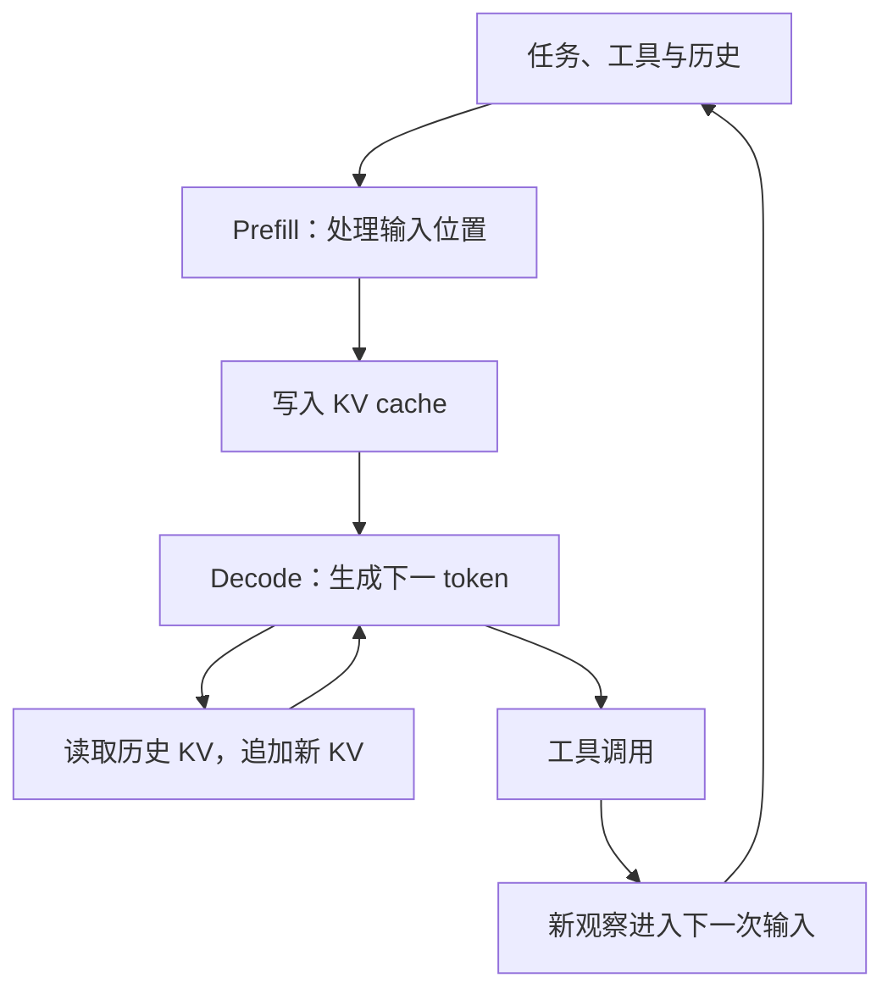
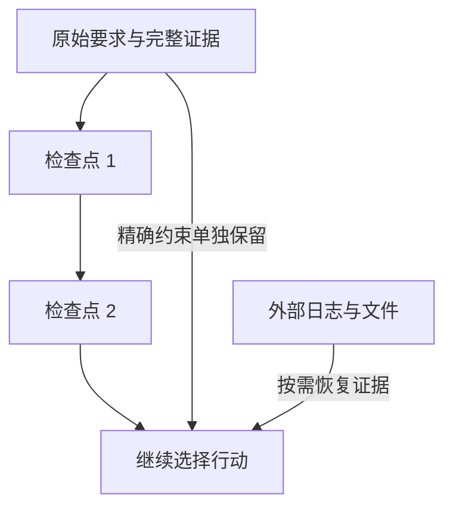

## 课程视频

<div class="bilibili-video" style="position: relative; width: 100%; aspect-ratio: 16 / 9; margin: 1rem 0;">
  <iframe src="https://player.bilibili.com/player.html?isOutside=true&aid=117245426604755&bvid=BV1hQYT64EXQ&cid=41753053659&page=1&high_quality=1&qn=120&quality=120&danmaku=0&autoplay=0" scrolling="no" border="0" frameborder="no" framespacing="0" allowfullscreen="true" style="position: absolute; inset: 0; width: 100%; height: 100%;"></iframe>
</div>

[B 站高清观看：03 - Long Context Modeling for Agents](https://www.bilibili.com/video/BV1hQYT64EXQ)

[官方录像](https://www.youtube.com/watch?v=AiwCCvFW1uE) · [官方幻灯片](https://www.cmu-agents.com/slides/lecture-03-long-context.pdf)

## 历史为什么越执行越长

上一讲中，工具结果被追加到消息历史，模型下一轮再读取这段历史。执行几轮时，这个实现很直接；如果一个修复任务持续几十轮，每轮带回文件片段和测试日志，输入长度与等待时间就会逐渐增加。

Graham Neubig 在 2026-09-01 的第 3 讲中讨论了长上下文智能体的上下文管理。这一讲同时涉及模型如何利用远处的信息、推理服务如何处理增长的输入，以及 Harness 怎样压缩任务历史。下面以排查一个持续失败的 CI 任务为例，把这些问题连接起来；日志与配置内容属于补充演示。

假设固定指令和工具说明占 `P` 个 token，每轮新增 `h` 个 token，第 `t` 次请求的历史增量近似为 `(t-1)h`。累计输入量如下：

```text
第 t 次输入：P + (t - 1)h
累计 T 次输入：TP + hT(T - 1) / 2
```

若 `P=2000`、`h=1000`，10 次请求累计输入约 65000 个 token，最后一次输入为 11000 个 token。这是为了观察增长方式的估算，实际每轮工具输出长短不同，缓存计费也会影响成本。

这个累积量描述的是重复提交的输入。模型单次处理长序列的计算开销，是另一个层面的问题。区分两者后，才能判断应该优化消息组织、缓存复用，还是模型计算。

## 长输入怎样影响推理

### Prefill 与 Decode

模型处理一次请求时，先计算已有输入，这个阶段称为预填充（prefill）；然后逐个生成新 token，进入解码（decode）阶段。已有位置的键和值被保存为 KV cache，后续生成时读取它们，减少重复计算。



较长的输入通常增加 prefill 工作量；较长的输出增加顺序解码次数。排查延迟时，应分别记录首 token 延迟（time to first token，TTFT）和输出 token 之间的时间（time per output token，TPOT）。排队时间也会进入用户观察到的首 token 延迟。

例如，CI 日志占据了大量输入，而模型只生成一条命令，等待可能主要发生在请求处理前半段。若模型每轮生成很长的分析内容，解码时间也会显著增加。只记录总响应时间，很难区分这两种情况。

### 注意力计算与 KV 存储

在标准稠密自注意力中，每个位置与可见的历史位置计算相关性。忽略维度常数，prefill 中位置对的数量随序列长度 `n` 近似按 `n²` 增长。使用 KV cache 后，单步解码仍需要读取相应的历史键和值。注意力机制的基础定义见 [Attention Is All You Need](https://arxiv.org/abs/1706.03762)。

KV 存储量则主要随保存的位置数增长。下面是适用于普通 KV 存储的简化估算，未包括分页、量化、分片与其他运行时开销：

```text
KV 字节数 ≈ 2 × 层数 × KV 头数 × 每头维度 × 序列长度 × 每元素字节数
```

前面的 `2` 表示同时保存 K 和 V。假设有 32 层、8 个 KV 头、每头 128 维、16384 个位置，每元素 2 字节，一条序列的 KV 约为 2 GiB。多个并发请求会继续增加存储需求；具体模型采用的注意力结构，会改变这个估算的参数和形式。

因此，长上下文的成本既涉及计算，也涉及缓存容量。扩大窗口时，还应检查模型能否利用新增的信息。接口允许提交更多 token，表示的是输入容量；能否从远处日志中找回一个配置值，需要通过任务验证。

## 模型怎样处理更长的历史

### 局部、递归状态与稀疏访问

课程介绍了几类降低历史处理开销的机制。它们对历史的表示和访问方式不同，不能只按最大窗口长度比较。

| 机制 | 怎样处理历史 | 需要关注的限制 |
| --- | --- | --- |
| 滑动窗口注意力 | 每个位置主要访问附近 `w` 个位置 | 当前层难以直接读取窗口外的细节 |
| 线性注意力或递归模型 | 把历史更新进较小的状态 | 多条信息可能在状态中相互影响 |
| 稀疏注意力 | 按固定规则或内容选择部分位置 | 选择错误可能漏掉相关证据 |
| KV 压缩或共享 | 减少每个位置保存的键值数据 | 需要与相应的模型结构配合 |

滑动窗口把位置比较数量从近似 `n²` 降到 `nw`。如果需要读取很早之前的 CI 配置，就要依靠全局访问层、检索或其他路径。采用局部计算和全局访问相结合的模型，也需要训练它什么时候使用远处信息。

线性注意力的直观思路，是逐步把键值关系写入一个固定大小的状态。例如在简化的双线性形式下，每轮把 `k_t v_t^T` 累加进去，再由当前查询读取。DeltaNet 类方法进一步根据预测误差修正已有关系，门控机制则控制信息保留。相应方法的推导见 [Transformers are RNNs](https://arxiv.org/abs/2006.16236) 和 [Gated Delta Networks](https://arxiv.org/abs/2412.06464)。

稀疏访问保留了对部分原始位置的读取能力。用于仓库任务时，我们关心选择器能否找到相关函数和失败日志；节省的计算量，需要与遗漏证据造成的任务失败一起衡量。

### DeltaNet 到底修正了什么

前面介绍了固定大小的递归状态。视频接着用 DeltaNet 说明，状态中的键值关系还能按预测误差调整。


*原视频截图：[回到 25:50](https://www.bilibili.com/video/BV1hQYT64EXQ/?t=1550)。*

沿用讲义的记号，让 `S` 为 `d_k × d_v` 的矩阵，键为 `k_t`，值为 `v_t`。先从已有记忆读出预测，再将误差写回：

```text
预测值：v_hat = S_(t-1)^T k_t
误差：  e_t = v_t - v_hat
写入：  S_t = S_(t-1) + β_t k_t e_t^T
读取：  o_t = S_t^T q_t
```

`β_t` 控制修正强度。假设一个单位键对应的旧预测为 `1`，新值为 `3`，误差就是 `2`；`β=0.5` 时，沿这个键方向增加 `1`，预测变成 `2`。简单累加新值会让旧值与新值叠加，误差修正则朝新关联调整。这个数值例子只用来解释写入方式。

Gated DeltaNet 还在修正之前对状态施加保留门 `α_t`：先得到 `S_tilde=α_t S_(t-1)`，再基于衰减后的预测计算误差。`α` 决定保留多少旧状态，`β` 决定写入多少修正。标量门作用于整个状态；更细粒度的门能够分别控制部分维度。

这些方法将历史压入固定状态，省去了逐项读取全部历史的路径，也使状态容量、键之间的干扰和遗忘策略影响检索。精确找回一个很早的日志行，仍需要在目标任务中验证。[Delta rule 的原始研究](https://arxiv.org/abs/2102.11174) 讨论了有限记忆与关联修正。

### 位置表示与长序列训练

模型还需要表达位置关系。[RoPE](https://arxiv.org/abs/2104.09864) 通过旋转查询和键，将位置关系引入注意力计算。把一个只在较短长度训练的模型直接放到更长输入上，位置分布和任务依赖都可能发生变化。

位置插值把更长范围映射到模型熟悉的范围，[YaRN](https://arxiv.org/abs/2309.00071) 则对不同频率采用不同调整方式，并处理注意力尺度。它们提供扩展上下文的方法；跨文件推理、远处证据检索和长任务恢复，还需要相应的数据与训练。

长序列训练可以包含相关文件、长文档和智能体轨迹。把许多互不相关的短样本拼起来，有利于利用 token 预算；构造依赖远处信息的任务，则帮助检查模型是否真正需要并使用这段历史。两类数据承担的作用应分别观察。

### 将一条长序列分给多张设备

模型结构之外，视频还介绍了 context parallelism，即沿上下文维度划分计算。


*原视频截图：[回到 50:50](https://www.bilibili.com/video/BV1hQYT64EXQ/?t=3050)。*

图中各设备保存一部分序列，处理自己的查询块，再取得其他设备的 K、V 块。只处理本地块不足以得到完整全局注意力；块交换使各查询逐步覆盖所需历史。块注意力计算与通信相互重叠，有助于减少等待。

对于按因果掩码组织的序列，分块计算还要保留原来的可见关系，不能让查询读取未来 token。不同块的 softmax 结果也需要正确合并，才能得到完整注意力输出。这要求实现处理分块归一化与数值稳定性。

[Ring Attention](https://arxiv.org/abs/2310.01889) 研究了这类跨设备的分块计算。它把长序列所需存储和计算分摊给多张设备，仍然保留完整注意力目标。在理想均分的估算中，单设备序列相关存储随设备数减少，总体位置对计算仍随 `n²` 增长。网络带宽、块大小、设备负载和通信重叠决定实际收益。

因此，稀疏注意力减少被计算的位置对，上下文并行分配完整计算，两条路线解决的约束不同。选择哪种方案，需要结合精度需求、模型结构与设备互联条件。

## 缓存怎样减少重复计算

### 稳定前缀与跨请求复用

多轮智能体请求通常共享系统指令、工具定义和已有历史。若推理服务支持前缀缓存，就能复用相同前缀已经计算出的状态，只处理新增部分。需要满足的匹配条件和保存时间，取决于具体实现。

```text
请求 1：[指令][工具][用户任务]
请求 2：[相同前缀                 ][调用 1][结果 1]
请求 3：[相同前缀                                      ][调用 2][结果 2]
```

为了增加复用机会，稳定内容适合放在前面，新观察追加在后面。每轮在开头插入变化的时间戳、重新排列工具说明，可能打断可复用前缀。缓存命中率、首 token 延迟和缓存淘汰情况需要一起记录。

缓存复用后，模型看到的输入依然包含这些历史。它降低重复计算，但模型仍需要从历史中选择相关信息，KV 也仍占用资源。服务端缓存与应用端历史压缩，分别处理不同的问题。

### PagedAttention 与 RadixAttention

[PagedAttention](https://arxiv.org/abs/2309.06180) 借鉴分页管理，将逻辑序列的 KV 分配到物理块，通过映射访问，减少连续预留造成的浪费，并支持共享。它主要解决缓存的内存管理问题。

[SGLang 的 RadixAttention](https://arxiv.org/abs/2312.07104) 使用树结构组织可复用前缀。在分支任务共享一段输入时，公共部分能够复用；不同后缀则分开管理。任务结束或内存紧张时，还需要相应的淘汰策略。

回到 CI 排查，如果两个分支都从同一份日志与配置开始分析，它们可能共享输入前缀。分页影响存储怎样分配，前缀索引影响哪些计算能够复用。实践中，应测量真实请求的共享程度，再据此估计缓存收益。

### 缓存命中还受请求路由影响

缓存放在不同 worker 上时，同样的请求可能遇到不同的已缓存前缀。视频用两个 worker 说明路由的取舍。


*原视频截图：[回到 62:00](https://www.bilibili.com/video/BV1hQYT64EXQ/?t=3720)。*

图中 worker 1 有 18K token 的前缀可复用，但队列里已有两个请求；worker 2 只有 2K token 匹配，队列为空。路由器需要同时考虑重算开销与排队等待。直接选择空闲设备会减少排队，也可能失去大量缓存；始终追求最长前缀则可能在繁忙设备前继续等待。

这里的 `reusable prefix − queue penalty` 是示意评分。实际路由需要把命中长度、预计处理时间和队列状态换算成可比较的目标。不同任务的输出长度、并发和缓存淘汰都会影响估计。

对智能体而言，连续请求使用相同前缀，有利于复用，但服务端还需要保留相应缓存并把请求路由到合适位置。压缩历史或换用另一套聊天模板，会改变前缀；改用不同模型，旧 KV 也不能直接按相同状态复用。评测应同时记录缓存命中、排队、首 token 延迟和端到端任务耗时。

## 把历史压缩成可继续执行的状态

### 哪些信息需要留下

假设排查过程中读到上万行 CI 日志，发现端口冲突；临时把测试并发改为 1 后通过，但用户要求保持原来的并发能力。这个过程是补充示例。若压缩结果只写“测试已通过”，下一轮可能直接结束任务，丢失尚未解决的要求。

较有用的检查点应保留目标、约束、观察依据和当前进展：

```yaml
goal: 修复并发测试中的端口冲突
constraints:
  - 保留并发执行能力
  - 不修改对外配置格式
observations:
  - 并发运行时出现 address already in use
  - workers=1 时通过，属于定位手段
artifacts:
  log: /tmp/ci-failure.log
  relevant_file: tests/conftest.py
next_action: 检查每个 worker 的端口分配方式
```

目标和精确约束应尽量保留原文。命令、路径、错误码和版本号也有恢复价值。重复输出、已经被新证据推翻的猜测，可以减少篇幅；完整日志则保存在外部，通过路径或检索接口取回。

这种处理把消息历史转换为当前工作状态。[MemGPT](https://arxiv.org/abs/2310.08560) 研究了有限上下文与外部存储之间的信息管理。对于我们的例子，外部日志保存证据，检查点告诉模型下一步为什么需要查看端口分配。

### 触发时机与压缩失败

框架需要为下一次输出和工具结果预留空间，在接近预算前触发压缩。压缩范围最好落在完整消息或工具交互边界，避免保留一次调用却丢掉它的结果。近期尚未完成的操作，也应明确记录。

下面是控制流程的伪代码，`estimate_tokens` 表示按实际模型或服务估算长度，省略具体实现：

```python
if estimate_tokens(history) + output_reserve > context_budget:
    anchors = extract_exact_constraints(history)
    checkpoint = summarize_completed_turns(history)
    recent_tail = keep_recent_complete_turns(history)
    candidate = [anchors, checkpoint, *recent_tail]
    if validate_checkpoint(candidate, anchors):
        history = candidate
    else:
        history = recover_history_or_stop(history)
```

检查点生成失败时，应保留可恢复的历史或报告无法继续。压缩后的格式也需符合消息协议：代码中的列表表达的是逻辑组成，实际发送时还要组织成合法角色与消息序列。

## 压缩以后怎样恢复原始证据

检查点中的 `relevant_file` 与日志路径，为继续调查提供入口。它们还需要配套一个约定：文件内容变化后，之前的观察是否仍然适用？如果工具刚修改了端口分配函数，压缩状态中保存的旧代码片段就应标为历史观察，下一轮再读取当前实现。

我们为 CI 练习补充一个信息保留对照。表中的值属于演示，目的在于区分需要精确保留的事实和能够压缩的过程。

| 原始信息 | 检查点中的表示 | 后续为什么需要 |
| --- | --- | --- |
| 用户要求保持 8 个 worker | 保留 `workers=8` 的目标约束 | 防止用降低并发代替修复 |
| `workers=1` 的测试通过 | 标注为定位实验及其结果 | 解释为何怀疑并发资源冲突 |
| 两个 worker 使用同一端口 | 保留端口值、worker ID 和日志位置 | 支持检查资源分配关系 |
| 上万行重复日志 | 外部文件路径及相关行范围 | 按需恢复证据，减少输入 |
| 尚在运行的测试进程 | 进程或会话标识、待取得的结果 | 避免重复启动或误判验证已完成 |

假设检查点写着“端口冲突已定位”，却没有保留哪两个 worker、什么端口和日志来源，模型仍可能需要重新运行整组测试。压缩长度下降了，后续调查成本却上升。评价压缩时，需要把重查资料的开销一起记录。

反过来，保留所有日志也不一定有帮助。重复堆栈可能占据大部分窗口，把第一次出现的端口分配记录挤到很远的位置。工具侧可以先筛选错误附近内容，保留完整原始文件，再提供相关片段。这个过程减少的是观察的输入量，应避免把尚未检查的异常误当成重复内容删除。

一种可复现的测试方式，是在同一个任务节点保存完整历史，再分别生成不同预算的检查点。后续执行使用相同模型、工具和初始仓库状态，比较是否仍然保留 8 个 worker、是否找到冲突来源、是否运行对应测试。随机生成会引入波动，因此需要多次运行或记录足够清楚的失败轨迹。

测量 token 时，还应明确统计对象。原始工具输出长度、最终请求输入长度和被缓存的前缀长度可能不同。摘要调用本身也消耗 token 和等待时间。如果任务马上结束，额外压缩可能没有机会摊销成本；任务还要继续几十轮，收益则可能更明显。

上下文预算还应容纳一次意外的大输出。若框架只为模型回答预留空间，下一次工具返回完整测试日志，仍可能超过窗口。常见处理是限制直接返回长度，将完整结果写到可检索的产物中，同时告知截断发生的位置。模型据此决定是否继续读取，避免把部分日志当成完整结果。

这种设计保留了观察的来源和完整性，也把“当前已看到什么”写清楚。继续执行时，智能体能从检查点回到证据，再从证据回到当前环境状态。

## 多次压缩后的信息漂移

一次摘要可能把“必须保留并发能力”写成“优化测试配置”；再次摘要后，任务可能变成“让测试通过”。连续压缩会继承上一次的损失，要求逐渐消失。



因此，评测压缩质量应让模型继续执行任务。可以在历史中放入明确的版本、禁止修改的文件和已经失败的方法，压缩后观察下一步是否遵守它们。摘要读起来流畅，只能说明表达可读；后续行为才能反映信息是否足够。

对 CI 示例，比较完整历史与压缩历史下的执行：是否继续检查并发问题、是否误把单线程通过当作完成、是否能找回日志。再记录输入 token、首 token 延迟和最终测试结果。重复压缩几次，观察约束是否仍然保留。

这组实验能分别回答缓存节省了多少计算、压缩减少了多少输入，以及模型是否保留了继续解决问题的依据。下一讲的记忆与技能，会进一步讨论哪些信息值得跨任务保存。

## 参考资料

- [课程安排](https://www.cmu-agents.com/#/schedule)、[第 3 讲幻灯片](https://www.cmu-agents.com/slides/lecture-03-long-context.pdf)
- [Attention Is All You Need](https://arxiv.org/abs/1706.03762)
- [Transformers are RNNs](https://arxiv.org/abs/2006.16236)、[Gated Delta Networks](https://arxiv.org/abs/2412.06464)
- [RoFormer / RoPE](https://arxiv.org/abs/2104.09864)、[YaRN](https://arxiv.org/abs/2309.00071)
- [PagedAttention / vLLM](https://arxiv.org/abs/2309.06180)
- [SGLang / RadixAttention](https://arxiv.org/abs/2312.07104)
- [MemGPT](https://arxiv.org/abs/2310.08560)
- [Delta rule：Linear Transformers Are Secretly Fast Weight Programmers](https://arxiv.org/abs/2102.11174)
- [Ring Attention](https://arxiv.org/abs/2310.01889)
