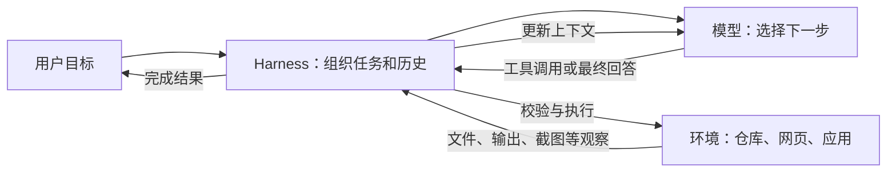
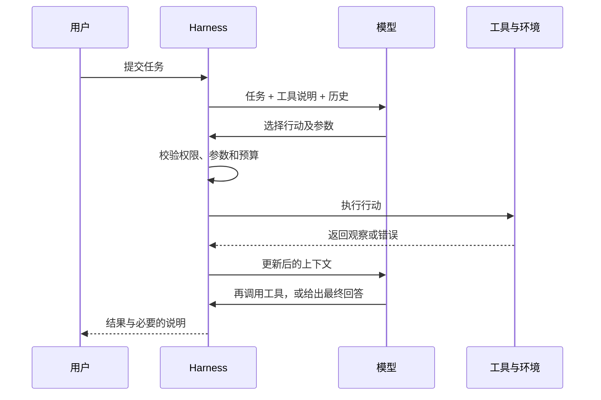
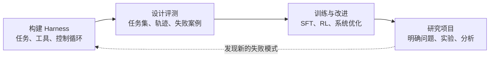

## 课程视频

<div class="bilibili-video" style="position: relative; width: 100%; aspect-ratio: 16 / 9; margin: 1rem 0;">
  <iframe src="https://player.bilibili.com/player.html?isOutside=true&aid=117245426604096&bvid=BV1hQYT64E2e&cid=41752988064&page=1&high_quality=1&qn=120&quality=120&danmaku=0&autoplay=0" scrolling="no" border="0" frameborder="no" framespacing="0" allowfullscreen="true" style="position: absolute; inset: 0; width: 100%; height: 100%;"></iframe>
</div>

[B 站观看本讲](https://www.bilibili.com/video/BV1hQYT64E2e/) · [官方录像](https://www.youtube.com/watch?v=UwfjzyLnvMg) · [官方幻灯片（39 页）](https://www.cmu-agents.com/slides/lecture-01-agents.pdf)

## 前言

假设我们把一个代码仓库交给语言模型，要求它修复某个测试失败的问题。模型需要先找到相关代码，读取实现，再修改文件、运行测试。测试可能返回新的错误，也可能因为依赖缺失而无法启动。接下来该做什么，需要结合执行结果判断。

语言模型生成的内容，怎样变成对仓库的实际操作？操作结果又怎样影响下一次生成？CMU 11-768: AI Agents 的第 1 讲介绍了这个过程。本讲由 Daniel Fried 和 Graham Neubig 授课，日期为 2026-08-25。下面结合[课程幻灯片](https://www.cmu-agents.com/slides/lecture-01-agents.pdf)，先看一次文件读取如何执行，再把它放进完整的代码修复过程。

## 从环境、观察和行动理解智能体

按照经典人工智能教材的定义，智能体通过传感器感知环境，再通过执行器作用于环境。[幻灯片第 9 页](https://www.cmu-agents.com/slides/lecture-01-agents.pdf#page=9)将这个定义放到了软件任务中：环境包括代码仓库、网页和应用，行动则包括文件修改、命令执行和 API 调用。以开头的代码修复任务为例，各个概念对应的对象如下。

| 概念 | 含义 | 编程任务中的例子 |
| --- | --- | --- |
| 环境（environment） | 智能体执行操作的外部对象 | 代码仓库、终端、测试进程、GitHub 页面 |
| 状态（state） | 环境当前的实际情况 | 文件内容、依赖版本、测试是否失败 |
| 观察（observation） | 本轮提供给模型的环境信息 | 文件片段、网页、截图、命令输出 |
| 行动（action） | 模型选择并交给系统执行的操作 | 读取文件、修改代码、运行测试、回复用户 |
| 奖励（reward） | 用于评价行动或任务结果的信号 | 依据测试结果、评测得分、用户反馈得到的奖励 |

这里先看状态与观察的区别。假设仓库中有几千个文件，文件内容、依赖版本和运行中的进程共同构成了当前状态。模型本轮读取 `test.py`，获得的观察只有这个文件的内容。要了解失败原因，它可能还需要搜索函数的调用位置、查看依赖配置。仓库的实际情况，要通过多次操作逐步获取。

执行 `pytest` 后返回的异常堆栈，也是一条观察，模型能据此定位报错位置。评测系统还可能根据测试通过情况计算奖励，用来评价这次修复。相同的测试结果，在执行循环中提供分析材料，在评测或训练中提供评价信号。

用 `s_t` 表示当前状态，`a_t` 表示本轮行动。行动执行后，环境进入 `s_(t+1)`，系统再把观察 `o_(t+1)` 交给模型。修改文件会改变仓库内容，读取文件则主要用于获取信息。模型结合任务、已有历史和新观察选择下一步，整个过程如下图所示。



图中的 Harness 是模型外部的执行框架，负责管理消息历史、执行工具调用，并将结果交回模型。课程在[第 14 页](https://www.cmu-agents.com/slides/lecture-01-agents.pdf#page=14)用“a model in a loop”描述这种形态。后面介绍工具调用时，我们会具体看到它怎样把模型和环境连接起来。

如果程序预先规定“读取文件、生成补丁、运行测试”的顺序，就是一个固定工作流；模型可以参与其中的某个步骤。智能体循环把后续操作的选择也交给模型，例如测试失败后，模型根据报错决定继续修改，或先读取其他文件。一次性问答通常在生成回答后结束。观察这些系统的控制流程，才能了解模型承担了哪些决策。

## 工具调用是如何执行的

### 定义工具接口

语言模型通过生成 token 表达下一步行动。为了让它调用工具，执行框架需要将可用工具的名称、用途和参数格式提供给模型。课程在[第 10–13 页](https://www.cmu-agents.com/slides/lecture-01-agents.pdf#page=10)展示了从接口定义到调用执行的过程。

先看读取文件的工具定义：

```json
{
  "name": "read_file",
  "description": "Read a UTF-8 file.",
  "parameters": {
    "type": "object",
    "properties": { "path": { "type": "string" } },
    "required": ["path"]
  }
}
```

`name` 指定工具名称，`description` 说明工具用途，`parameters` 使用 JSON Schema 描述参数结构。这里要求传入一个字符串类型的 `path`。收到“`test.py` 定义了什么”的问题后，模型根据工具说明和对话上下文，可能生成 `read_file({"path":"test.py"})`。

这个调用包含工具名和参数。真正读取文件的逻辑由 Harness 执行。

### 从工具调用到工具消息

下面沿着[第 12 页](https://www.cmu-agents.com/slides/lecture-01-agents.pdf#page=12)的例子，看一遍消息流转过程。为便于阅读，这里将消息格式简化为对话：

```text
用户：test.py 定义了什么？
模型 → Harness：read_file({"path":"test.py"})  [id: call_7]
Harness → 文件系统：读取 test.py
文件系统 → Harness：def add(a, b): ...
Harness → 模型：工具结果 [tool_call_id: call_7]，内容为文件文本
模型 → 用户：test.py 定义了 add(a, b)。
```

Harness 解析模型生成的调用，检查工具名、参数格式和访问权限，然后读取文件。返回内容被封装为工具消息，追加到历史中。`call_7` 将这条结果关联到对应的请求；模型下一轮收到更新后的历史，才能根据文件内容回答问题。实际接入时，需要遵循所用 API 的消息格式。

工具消息还需要保留来源。文件文本、网页和命令输出都是从环境获取的数据，框架应将它们与用户要求、系统指令分别组织。随着工具和消息数量增加，这些信息会直接影响模型怎样使用上下文。

## 模型怎样根据执行结果继续行动

### ReAct 与行动循环

前面的例子在文件读取成功后就能给出回答。如果 `test.py` 根本不存在，应该怎样继续？我们把返回结果换成一个错误，再看模型可能作出的选择。以下是为了说明错误恢复而构造的过程：

```text
模型 → Harness：read_file({"path":"test.py"})
Harness → 模型：文件不存在：test.py
模型 → Harness：list_files({"path":"."})
Harness → 模型：tests/test.py、src/example.py
模型 → Harness：read_file({"path":"tests/test.py"})
```

这里假设框架还提供了 `list_files` 工具。文件读取失败后，错误进入历史；模型据此尝试列出文件，再用返回的路径发起读取。新观察改变了后续操作，调用之间由此衔接起来。

[ReAct](https://arxiv.org/abs/2210.03629) 将推理和行动交替组织：根据已有信息考虑下一步，执行操作，读取观察，再调整行动。课程在[第 14 页](https://www.cmu-agents.com/slides/lecture-01-agents.pdf#page=14)借助这个方法说明模型循环。内部推理的组织方式取决于模型与提示；下面的时序图主要展示框架能够处理的消息和操作。



课程在[第 15 页](https://www.cmu-agents.com/slides/lecture-01-agents.pdf#page=15)展示了 [mini-swe-agent](https://github.com/SWE-agent/mini-swe-agent) 的循环实现。`run` 反复调用 `step`；每次 `step` 先通过 `query` 请求模型，再通过 `execute_actions` 执行动作、追加观察。前面的文件读取和错误恢复，都能放进这样的控制流程。

下面是便于理解控制流程的伪代码，省略了实际会话格式和异常处理细节：

```python
history = [system_instruction, user_task]
for step in range(max_steps):
    message = model.generate(history, tools=allowed_tools)
    history.append(message)

    if message.is_final_answer():
        return message.content

    action = validate(message.tool_call, permissions, schema)
    observation = execute_in_sandbox(action)
    history.append(tool_result(action.id, observation))

return report_incomplete(history)
```

注意 `history.append(tool_result(...))`：工具结果在这里进入历史，并随下一次请求交给模型。`validate` 和 `execute_in_sandbox` 分别表示调用检查与隔离执行，后面会介绍对应的系统组件。循环在模型给出最终回答或达到 `max_steps` 时结束；达到步数上限时，框架报告尚未完成的进展。

实际实现还要约定错误和中止的处理方式。文件不存在这类错误需要返回足够的信息，供模型重新选择行动；工具不存在、参数不合法和执行超时也需要相应处理。上下文长度、调用预算和用户中止，则会影响循环能否继续。

### 以修复代码为例

读取文件的任务比较短，代码修复则需要把多个操作连接起来。[幻灯片第 16 页](https://www.cmu-agents.com/slides/lecture-01-agents.pdf#page=16)展示了一个 [SWE-bench](https://www.swebench.com/) 任务，涉及 `parse_expr` 在 `evaluate=False` 时仍计算关系表达式的问题。下面围绕这个问题说明一条可能的修复过程，作为理解循环的示例。

模型首先搜索 `parse_expr` 的定义和相关测试，确定读取哪些文件。阅读实现是为了了解关系表达式怎样处理，运行针对性测试则是为了观察 `evaluate=False` 下的实际行为。这些操作提供的信息不同，需要结合起来判断修改位置。

复现问题后，模型修改实现和相关测试，仓库状态随之变化。再次执行测试，才能观察修改后的行为。测试通过后还要核对原始要求；出现新报错时，则需要根据报错继续调查。修复过程可能在读取、修改和测试之间往返多次。

从任务开始到结束，这些消息、动作和观察构成了执行轨迹（trajectory）。轨迹记录了模型看过哪些文件、进行了哪些修改、实际运行了哪些测试。后面排查系统故障、收集训练数据和评价任务结果，都会用到它。

## 模型之外还需要哪些组件

### 执行框架、沙箱与可观测性

前面的伪代码用 `validate` 和 `execute_in_sandbox` 概括了调用检查和工具执行。落实到系统实现，还需要确定文件访问范围、命令运行环境和失败记录的位置。课程在[第 26–31 页](https://www.cmu-agents.com/slides/lecture-01-agents.pdf#page=26)介绍了承担这些工作的组件。

| 组件 | 主要工作 |
| --- | --- |
| 模型与推理服务 | 模型生成下一步；推理服务处理流式输出、并发、吞吐与推理缓存（KV cache） |
| Harness | 管理历史、工具、记忆和控制流程，校验参数与权限，处理错误 |
| 沙箱 | 隔离代码和工具执行，限制计算、网络及文件系统访问 |
| 训练系统 | 收集轨迹与奖励，协调训练、检查点和实验复现 |
| 可观测性 | 记录执行轨迹、质量、时延、成本与失败类型 |

这些是功能上的划分，一款软件可能承担多项工作。例如 Harness 调用沙箱中的命令执行接口，沙箱限制命令能访问的文件、网络和计算资源。前面所说的环境是智能体操作的对象，沙箱则为操作提供隔离边界。

回到 `pytest`：模型生成命令，Harness 检查调用，沙箱中的测试进程返回输出，推理服务再处理下一轮模型请求。监控记录调用、耗时和任务进度，这就是可观测性在此处的作用。查看记录时，命令选错、工具超时和依赖缺失会呈现为不同的失败，需要在对应组件中处理。

### 模型训练与 Harness 工程

定位失败后，接下来要决定改进哪一部分。[幻灯片第 18–25 页](https://www.cmu-agents.com/slides/lecture-01-agents.pdf#page=18)讨论了模型训练和 Harness 工程两种途径，涉及工具调用、长上下文、定制化、复杂任务管理、环境理解和安全六类能力。

以工具参数不合法为例，我们先检查接口说明是否清楚、参数约束是否完整，以及框架是否将错误交回模型。这些属于 Harness 工程。训练侧则能用正确的工具调用轨迹进行监督微调（supervised fine-tuning，SFT），让模型学习调用格式和参数用法。

再看长任务中遗忘要求的情况。如果要求在历史压缩时被丢掉，需要先调整消息组织和记忆检索；如果要求仍在上下文中，模型却持续忽略它，就要进一步检查模型使用长历史的能力，考虑长上下文 SFT。两类改进需要根据实际轨迹选择，也能结合使用。

其余能力也有类似的分工：用户偏好能通过记忆、技能和用户反馈处理；复杂任务能借助规划、分解、委派，以及长周期任务训练来改进。领域理解需要合适的观察接口、领域技能和训练数据，安全执行则涉及沙箱、凭证限制、轨迹监控和训练信号。

每次改进都应回到原来的失败案例，观察模型是否选对工具、是否保留任务要求，以及新增机制带来了多少开销。执行轨迹在这里提供了比较依据。

### 预训练、SFT 与 RL

课程在[第 19 页](https://www.cmu-agents.com/slides/lecture-01-agents.pdf#page=19)按预训练、中期训练 / SFT、强化学习（reinforcement learning，RL）介绍训练过程。预训练利用文本、代码和多模态数据建立基础能力；中期训练 / SFT 部分关注指令、示范轨迹和工具调用格式；RL 则通过奖励或偏好改进轨迹层面的行为。

代码修复的结果通常出现在多次搜索、读取和修改之后。最后测试通过了，前面哪些行动对此有帮助？如果失败了，问题又从哪一步开始？这类结果与行动之间的关系，是智能体训练需要处理的问题。因此，训练系统要收集完整轨迹，并设计与任务目标相符的评价信号。具体算法会在后续课程中展开。

## 执行权限与任务评测

### 哪些操作需要人工参与

模型能够生成某个工具调用后，还需要判断它是否有权执行。课程在[第 4 页](https://www.cmu-agents.com/slides/lecture-01-agents.pdf#page=4)给出了网店结账故障诊断、支付 API 迁移、群发邮件、购票、报税和调整胰岛素剂量等讨论题，让学生考虑各类任务适合怎样的自主程度。

读取日志、修改本地代码和向大量用户发送邮件，影响范围和恢复成本各不相同。系统应根据任务授权、凭证范围和操作后果设置执行权限。例如，本地代码修改能在隔离环境中进行，再通过差异和测试检查；邮件外发、付款等操作则应按授权范围设置人工检查点。

这些限制要落实到 Harness 的调用检查、沙箱的访问控制和凭证管理中。轨迹监控则记录实际执行情况，供事后检查。对应组件见[第 25、28、31 页](https://www.cmu-agents.com/slides/lecture-01-agents.pdf#page=25)。

### 怎样判断任务完成了

循环中出现最终回答，表示模型决定结束这次任务。任务是否完成，还要检查实际结果。对于代码修复，需要把补丁与原始要求对照，并查看对应测试的调用和输出；“测试通过”的说明应能在轨迹中找到依据。

评价整个系统时，还要观察它怎样到达这个结果：遇到错误能否恢复，是否遵守访问权限，重复执行时结果是否稳定。步数、耗时、token 用量和成本，则帮助我们比较不同方案的执行开销。这些是结合课程评测与监控内容整理的实践考虑，指标需要按任务制定。

课程第 2 次作业要求测量行为、报告失败案例，相关内容见[第 31–33 页](https://www.cmu-agents.com/slides/lecture-01-agents.pdf#page=31)。整理失败案例时，应保留任务要求、执行轨迹和最终结果，方便判断失败来自哪一部分。

## 后续课程与一个入门练习

构建 Harness 后，我们就能观察多步任务的执行过程，为评测提供材料；根据评测发现的失败，再改进模型和系统。课程在[第 32–34 页](https://www.cmu-agents.com/slides/lecture-01-agents.pdf#page=32)介绍了作业和研究项目安排，实践内容也围绕这些环节展开。



在能力方面，后续课程会介绍工具使用、长上下文、记忆与技能、规划及多智能体协作，再结合编程、GUI 和深度研究等应用进行学习。训练部分覆盖 SFT、RL 和训练系统，工程部分则包括沙箱、凭证、OpenHands、LangGraph 及监控。三次个人作业分别围绕 Harness、Evaluation 和 Training 展开，具体要求与日期以[课程安排](https://www.cmu-agents.com/#/schedule)和作业说明为准。

开始动手时，先把前面的文件读取例子实现出来即可。准备只有两个文件的仓库，让模型回答“哪个文件中的函数实现了 `add(a, b)`”。提供 `list_files` 和 `read_file` 两个工具，限制调用步数，并记录每次调用和返回结果。

实现时，检查工具名和参数，再把执行结果作为工具消息追加到历史中。先验证正常读取和回答的过程，然后模拟一次“文件不存在”，查看下一轮请求是否包含这条错误，以及模型是否重新查找文件。这样既能检查框架的消息传递，也能观察模型的恢复行为。

最后故意把步数上限设低，检查框架是否在达到限制时结束循环、报告进展。这个小例子走通后，再加入修改文件和执行测试的工具，逐步扩展到开头的代码修复任务。

## 参考资料

- [课程主页与 Schedule](https://www.cmu-agents.com/)
- [第 1 讲官方幻灯片：What Are Agents? And How Do They Work?](https://www.cmu-agents.com/slides/lecture-01-agents.pdf)
- [官方课程录像](https://www.youtube.com/watch?v=UwfjzyLnvMg) · [B 站视频](https://www.bilibili.com/video/BV1hQYT64E2e/)
- [ReAct：推理与行动交替的原始论文](https://arxiv.org/abs/2210.03629)
- [Toolformer：学习何时、如何调用外部 API](https://arxiv.org/abs/2302.04761)
- [mini-swe-agent：课程展示的精简循环实现](https://github.com/SWE-agent/mini-swe-agent)
- [Assignment 1：Build an Agent Harness](https://github.com/cmu-agents/assignment-1)
