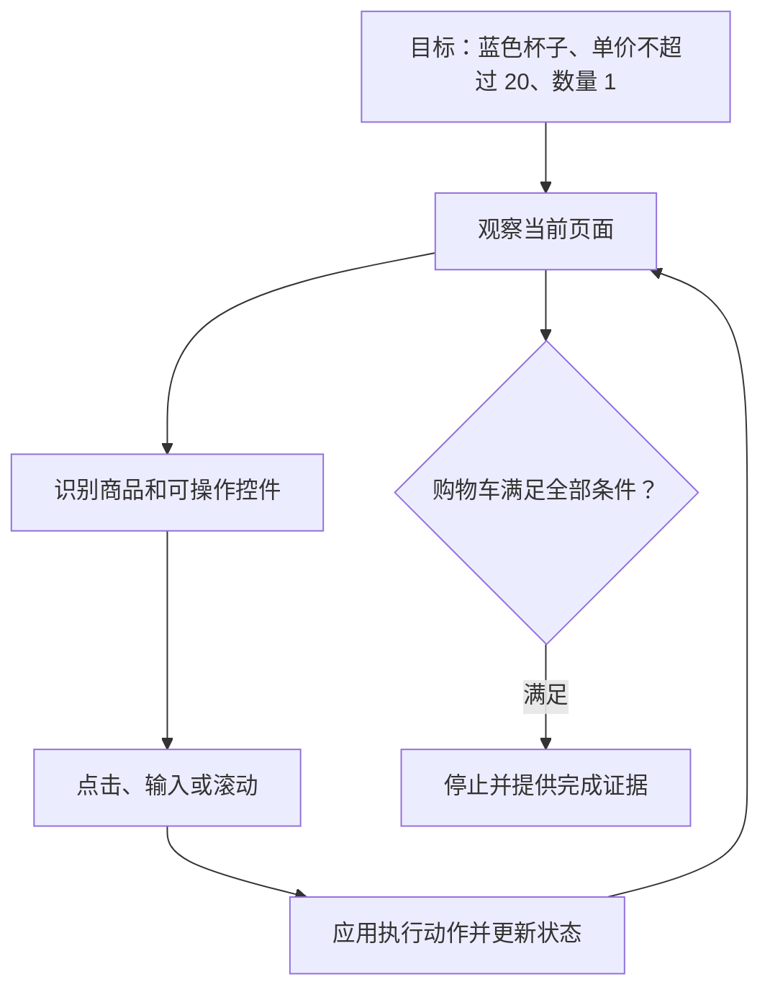
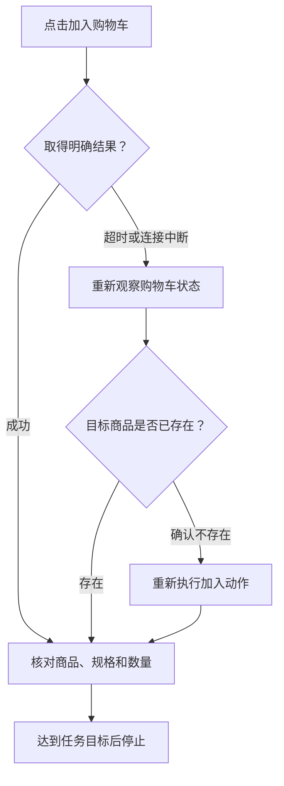

## 课程视频

<div class="bilibili-video" style="position: relative; width: 100%; aspect-ratio: 16 / 9; margin: 1rem 0;">
  <iframe src="https://player.bilibili.com/player.html?isOutside=true&aid=117346324714933&bvid=BV1peaq64Ek1&cid=42262659399&page=1&high_quality=1&qn=120&quality=120&danmaku=0&autoplay=0" scrolling="no" border="0" frameborder="no" framespacing="0" allowfullscreen="true" style="position: absolute; inset: 0; width: 100%; height: 100%;"></iframe>
</div>

[B 站观看本讲](https://www.bilibili.com/video/BV1peaq64Ek1/)

[官方录像](https://www.youtube.com/watch?v=jwGluLrrqjQ) · [官方幻灯片](https://www.cmu-agents.com/slides/lecture-07-computer-use-agents.pdf)

## 让模型操作它看到的界面

编程智能体主要通过文件、终端和测试观察环境。GUI 智能体面对的是网页与桌面应用：页面布局、按钮、输入框、滚动区域，以及点击之后才出现的新状态。本讲由 Jing Yu Koh 介绍 Computer Use Agents，重点落在界面观察、动作定位、交互过程和评测。

讲义用购买杯子的任务说明这一过程。我们构造一个更小的练习：在本地模拟商店中，找到一个蓝色杯子，单价不超过 20 元，加入购物车一件，停留在购物车页面。商品和价格仅用于解释机制。

这个任务至少包含三个判断。搜索结果中的蓝色图片是否对应目标商品？价格是否满足条件？加入购物车后，商品和数量是否正确？模型需要把用户目标转成界面上的对象，再把交互后的状态与目标对照。



截图只展示当前时刻的一部分状态。一个动作执行后，页面可能切换、弹出提示，或者仍在加载。因此，GUI 智能体的观察与动作需要反复交替。

## DOM、可访问性树与截图

网页里的文字、图片和按钮，能够通过不同接口交给模型。DOM 是浏览器中的文档结构；可访问性树将界面整理为具有角色、名称和状态的对象；截图则保留实际布局与视觉信息。

| 观察方式 | 能提供的信息 | 主要限制 |
| --- | --- | --- |
| DOM | 元素结构、属性、文字和链接 | 结构可能很大，存在隐藏元素，Canvas 内容不易表达 |
| 可访问性树 | 按钮、输入框等角色及可访问名称 | 依赖应用实现，可能缺少视觉关系与图像细节 |
| 截图 | 实际布局、颜色、图片、遮挡和弹窗 | 需要视觉识别与坐标定位，屏幕之外的内容不可见 |

“蓝色杯子”可能由商品图片表达，名称只写“陶瓷杯”。这时读取文字难以确定颜色，截图提供了额外信息。反过来，商品规格选择器的状态通过可访问性属性表达得很清楚，读取结构化信息有助于检查已选规格。

组合多种观察有助于弥补缺口，也会增加输入长度与获取开销。观察方式应与任务需要匹配：查找图片中的物体需要视觉，填写有明确标签的表单适合使用语义定位。

多模态模型会将图像编码成视觉表示，再与目标、文字和历史一起参与预测。文字中的按钮名与截图中的按钮位置，需要在同一任务中建立联系。这个联系是否可靠，是后续动作能否落到正确位置的基础。

## Grounding：把意图落到一个位置

ScreenSpot-Pro 在视频中提供了一个很具体的定位任务：在专业软件的密集界面里找到创建球体的控件。


*原视频截图：[回到 15:55](https://www.bilibili.com/video/BV1peaq64Ek1/?t=955)。*

“点击加入购物车”是一项语义动作，浏览器或操作系统需要更具体的目标。Grounding，也就是定位过程，负责将动作映射为某个元素、区域或坐标。

在网页结构足够清楚时，语义定位能够使用角色与名称。以下是独立的 Playwright 示例，展示接口形式，未连接实际商店：

```javascript
await page.getByRole('button', {
  name: '加入购物车',
  exact: true
}).click();
```

[Playwright 的定位器文档](https://playwright.dev/docs/locators) 解释了角色、标签、文字等定位方式。若页面上有多个同名按钮，还需要先限定目标商品区域；直接选择第一个匹配项可能操作另一个商品。

截图接口通常需要像素坐标。假设原截图为 `1920 × 1080`，模型看到等比例缩小后的 `960 × 540` 图像。视图中的位置 `(400, 200)` 对应原截图中的 `(800, 400)`。在没有裁剪、留白和坐标系变化时，换算关系如下：

```text
x_original = x_view × original_width / view_width
y_original = y_view × original_height / view_height
```

工具要求的坐标可能是屏幕坐标、视口坐标或归一化坐标，必须按接口约定解释。窗口移动、滚动、缩放和设备像素比都可能改变关系。对裁剪截图，还需要加上裁剪区域的原点偏移。

定位正确也不代表动作发生时仍然正确。商品图片加载后，按钮位置可能向下移动。执行过程中应重新观察发生变化的页面，减少基于旧截图连续点击的情况。

[ScreenSpot-Pro](https://arxiv.org/abs/2504.07981) 的这类样本用目标区域评估定位：预测点位于正确区域内，当前定位就算成功。视频例子标注的框为 `(417, 132)–(576, 152)`，原截图尺寸为 `2560 × 1440`，目标区域高度只有 20 个像素。

如果原截图等比例缩到 `640 × 360`，这个区域高度只剩 5 个像素。附近的同类菜单项很容易混淆。裁剪相关区域、保留坐标变换，或利用可访问性结构，都能为定位提供额外依据；这些方法的收益需要在相同样本上比较。

区域命中验证了这一次指向。点击后是否创建了正确物体，仍需要执行环境检查。因此，定位数据能单独训练和测量一部分能力，完整智能体还要处理界面状态、操作知识与后续验证。

## 页面变化以后再决定下一步

我们沿着练习走一遍：输入“杯子”并搜索，读取结果；打开目标商品，检查颜色规格和价格；点击加入购物车；打开购物车，确认一件目标商品。

搜索动作之后才知道结果布局，选择规格之后才知道价格或库存。因此，这些步骤依赖新的观察。将所有坐标预先写成一串动作，遇到页面变化就容易把误差传到后面。

同一稳定表单中，填写几个已定位字段通常适合连续执行。跨页面导航、依赖弹窗或等待网络返回的步骤，则需要观察边界。动作分批应依据状态依赖，而非固定规定每批包含几次点击。

等待也需要明确对象。点击后检查商品已出现在购物车，或者等待目标页面和加载状态完成，比单纯等待固定秒数更贴近任务。网络慢时，固定等待可能过短；网络快时，又会产生不必要延迟。

再看一个失败分支：点击加入购物车后，工具报告超时。这个结果说明调用没有在预定时间内完成，商品是否加入仍不确定。立即重试可能使数量变为两件。更合理的恢复是先读取购物车状态，再决定是否补做动作。



这里同时用到了第 2 讲的工具错误处理和第 5 讲的动态调整。GUI 动作产生的状态变化，需要在恢复策略中保留。

## 怎样证明任务完成

只看到“已加入购物车”的提示，还无法核对颜色、数量和价格。提示可能属于上一个动作，也可能在页面刷新后消失。完成证据应对应用户要求的最终状态。

本文练习允许停留在购物车，目标状态能够表示为下面的示例数据：

```json
{
  "cart": [
    {"product_id": "mug-blue-01", "color": "blue", "unit_price": 18, "quantity": 1}
  ],
  "order_submitted": false
}
```

在可重置的模拟环境中，评测器能够直接检查这些字段。下面的函数演示一种完整目标检查，环境数据结构由本文定义：

```python
def task_succeeded(state):
    cart = state["cart"]
    if len(cart) != 1 or state["order_submitted"]:
        return False
    item = cart[0]
    return (
        item["product_id"] == "mug-blue-01"
        and item["color"] == "blue"
        and 0 <= item["unit_price"] <= 20
        and item["quantity"] == 1
    )
```

真实商店的内部状态未必开放给智能体。它需要结合商品信息、购物车明细及页面状态取得证据。评测器具有的检查权限与智能体可见的观察也应区分开，防止把隐藏答案提供给模型。

不同评测任务覆盖的能力不同。静态界面定位检查一个目标是否被准确指向；逐步动作评测检查当前动作；端到端评测则检查一串动作之后，环境是否达到目标。局部步骤全部看起来合理，仍可能遗漏最终规格检查。

[WebArena](https://arxiv.org/abs/2307.13854) 提供可复现的交互网站，并通过最终状态检查功能结果。[VisualWebArena](https://arxiv.org/abs/2401.13649) 进一步包含依赖图片和视觉内容的任务。[OSWorld](https://arxiv.org/abs/2404.07972) 把范围扩展到桌面应用、文件和跨应用工作流，任务配置包含初始状态与执行评测脚本。

[WebVoyager](https://arxiv.org/abs/2401.13919) 研究开放网站上的视觉交互，并使用模型辅助评测。模型评审适合处理较开放的输出，但仍需校验它对成功与失败的判断。购物车数量这样的可程序化状态，适合直接由确定性规则检查。

### 长任务为什么还要记录部分进展

购物车练习的目标很小。原视频用 Odysseys 展示了旅行规划等长任务，观察和产物分布在多次网页交互中。


*原视频截图：[回到 36:50](https://www.bilibili.com/video/BV1peaq64Ek1/?t=2210)。*

画面中的任务涉及航班、机场选择、驾驶时间、租车与可编辑行程。最终一个“已完成”页面无法覆盖这些要求，评测需要查看调查证据与产生的文档。当前讲义的旅行示例将要求拆成八项，满足七项时，平均分项完成率为 `7/8=0.875`，完全完成指标仍为 `0`。

两个指标分别反映进展与完整性。分项得分能说明系统完成了航班比较、租车和行程保存，却遗漏某个途中餐厅的比较；完全完成率则检查全部条件同时成立。报告两者有助于区分全面失败与接近完成的任务。

分项规则也需要验证。每项的权重是否合理、互相依赖的要求是否重复计分，以及模型评审能否根据证据正确判断，都会影响最终分数。若重要硬性条件被赋予很低权重，高分仍可能对应一个不可用方案。

长任务还会受到网站变化和预算限制影响。评测记录应保留页面来源、产物、步骤上限与终止原因。查询完成但预算耗尽后没有保存行程，与行程存在但内容遗漏，是不同的失败类型。视频与[本讲长任务部分](https://www.cmu-agents.com/slides/lecture-07-computer-use-agents.pdf#page=39)共同说明了这种评测范围。

## 保留一条能够分析的操作记录

GUI 任务出了问题，最后一张截图通常不足以说明原因。以“购物车中出现两件杯子”为例，它可能来自重复点击、默认数量为二，或者上次运行没有清空购物车。需要把初始状态与动作过程连起来分析。

我们为模拟商店定义一条日志，记录动作前观察、目标、执行状态和后续观察：

```json
{
  "step": 5,
  "observation_before": "screenshots/step_05_before.png",
  "target": {"role": "button", "name": "加入购物车"},
  "action": {"type": "click"},
  "execution_status": "timeout",
  "observation_after": "screenshots/step_05_after.png",
  "next_decision": "读取购物车，确认动作是否已经生效"
}
```

这个格式是本文补充示例。截图文件记录可见信息，目标描述记录定位依据，超时状态说明调用结果不确定。若使用坐标，还应保存坐标系、图像尺寸和裁剪信息，方便检查位置换算。

分析时可以按过程区分原因。目标识别错误，是把红色杯子误认成蓝色；定位错误，是认对商品但点到邻近按钮；执行错误，是工具无法发送动作；状态判断错误，是操作生效后仍继续重试；任务理解错误，则可能是忘记“数量一件”的约束。

这些问题需要不同改进。增加更多静态截图训练，有助于研究识别和定位；对重复动作造成的数量错误，则需要检查状态观察和恢复逻辑。只汇总最终成功率，会把不同原因混在一个数字里。

## 回放记录为什么需要环境配合

保存截图和点击坐标以后，我们能否把成功轨迹直接回放？如果商品排序、窗口尺寸和加载时间保持稳定，回放有机会重复相同过程。页面增加促销横幅、库存变化或搜索顺序调整后，旧坐标就可能指向其他对象。

语义定位也依赖页面语义。按钮名变化、同名控件增加和可访问性实现缺失，都需要重新检查。可靠回放应在关键步骤核对目标与状态，发现变化后停止旧动作序列，重新定位。

训练与评测的环境重置能减少无关差异。购物车恢复为空，账号使用固定初始权限，商品数据保持可控，才能比较两个策略在同一任务上的表现。跨应用任务还需要处理打开的文档、下载目录和系统弹窗等状态。

评测模型的鲁棒性时，再有计划地改变布局、窗口尺寸、同名商品和网络等待。这些变化应保持目标含义不变，例如蓝色杯子的价格仍满足要求。否则，目标商品缺货导致失败，与定位能力不足就难以区分。

步骤数与耗时同样应结合成功结果观察。一个策略走五步完成任务，另一个走八步但多核对了规格与数量，后者可能在布局变化时更稳定。缩短轨迹的优化应继续运行完整目标检查，确认节省步骤没有省掉必要验证。

这种实验设计把“认出了界面”与“完成了用户任务”连接起来，也让速度、定位和恢复之间的取舍有具体证据。

### 视觉观察与动作怎样进入模型

原视频用交错的 token 序列表示 GUI 策略，前面的任务目标、观察与动作一同决定下一步。


*原视频截图：[回到 52:07](https://www.bilibili.com/video/BV1peaq64Ek1/?t=3127)。*

目标和文字经过分词与嵌入，截图通过视觉编码器，再由投影模块接入模型。图中的 `v_0,1 … v_0,N` 是视觉表示的示意，实际未必是词表中的离散 ID，也不意味着所有模型采用相同的图像切块方式。

一次动作生成后，应用产生新的截图，这个观察与刚执行的动作继续追加。模型的条件可写为 `π(a_t | goal, o_≤t, a_<t)`。历史能帮助判断页面是否已经切换、某个动作是否生效，以及哪些约束已验证。

保存历史时，顺序与坐标系要保持一致。若动作在滚动之前定位，截图却记录了滚动后的页面，训练样本的条件与动作就错位。裁剪、缩放和坐标换算也应一起记录，保证观察中的位置与执行接口使用的位置能够对应。

视觉历史会迅速增加上下文成本。保存近期状态、目标约束和关键证据，再按需读取旧截图，是一种系统层面的取舍；直接删除所有旧观察，则可能让模型重复已经完成的调查。训练和实际运行采用什么历史策略，应在评测中明确。

## 从演示和交互中学习

GUI 训练数据需要把观察、动作和时间顺序连接起来。人类演示中的一次点击，应对应点击前的截图与目标位置；点击后的截图则提供执行结果。记录错位会使模型学习“在错误页面上点击正确坐标”。

[OpenCUA](https://arxiv.org/abs/2508.09123) 提供计算机操作数据与训练方法，研究从人类交互中学习通用的计算机使用能力。模型既需要识别控件，也需要学习操作流程，例如进入详情页后检查规格，再操作购物车。

监督微调能够学习演示中的动作。强化学习进一步让模型在可交互环境中尝试，由任务结果提供反馈。这要求环境支持重置、动作执行和可靠检查，否则不同轨迹从不同购物车状态开始，奖励就难以比较。

本文模拟商店的训练流程可组织为：恢复空购物车，给出目标，记录每步观察与动作，执行完成检查，再把结果交给训练过程。账号、文件与应用状态都属于环境初始化的一部分。模拟环境中的探索也应限定在练习允许的操作范围。

## 长任务里的速度与可靠性

GUI 操作经常花时间在截图、视觉推理、网络等待和应用切换上。减少一次观察能够降低延迟，但也可能漏掉新状态。更合适的优化是识别稳定步骤与变化步骤，让昂贵的观察落在需要确认的位置。

历史截图也会逐渐占据上下文。保留任务约束、已确认商品、关键价格与购物车状态，同时压缩重复的页面观察，有助于继续长任务。压缩后的状态需要带有来源和时间：十步之前确认的价格，不能自动代表当前规格的价格。

失败分析时，应保留动作前后的观察、定位信息、执行状态和最后检查结果。购物车多出一件商品，可能来自超时后的重复点击；选错颜色，可能来自规格定位；停止得太早，可能来自完成判断。把这些原因分开，才能决定下一轮改进定位模型、工具接口还是控制流程。

## 参考资料

- [课程 Schedule](https://www.cmu-agents.com/#/schedule)
- [本讲幻灯片](https://www.cmu-agents.com/slides/lecture-07-computer-use-agents.pdf)
- [WebArena](https://arxiv.org/abs/2307.13854)
- [VisualWebArena](https://arxiv.org/abs/2401.13649)
- [OSWorld](https://arxiv.org/abs/2404.07972)
- [WebVoyager](https://arxiv.org/abs/2401.13919)
- [OpenCUA](https://arxiv.org/abs/2508.09123)
- [Playwright Locators](https://playwright.dev/docs/locators)
- [ScreenSpot-Pro](https://arxiv.org/abs/2504.07981)
- [Odysseys](https://arxiv.org/abs/2604.24964)
