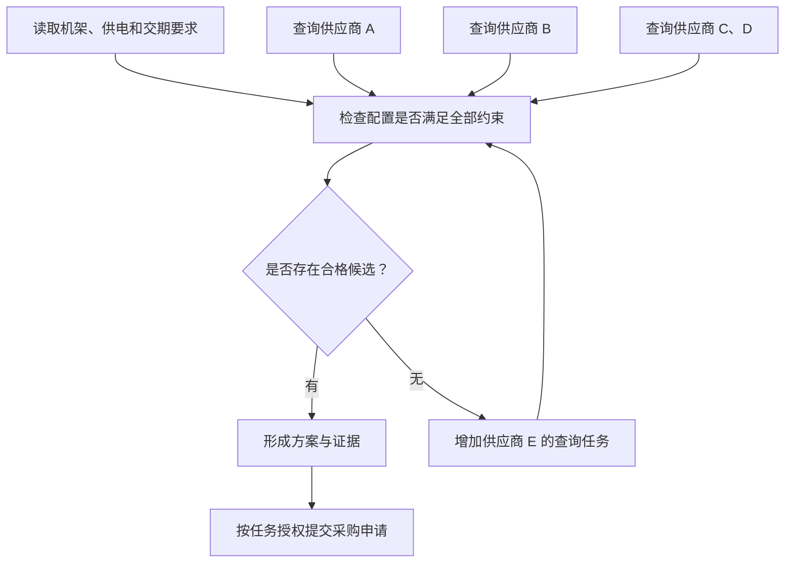
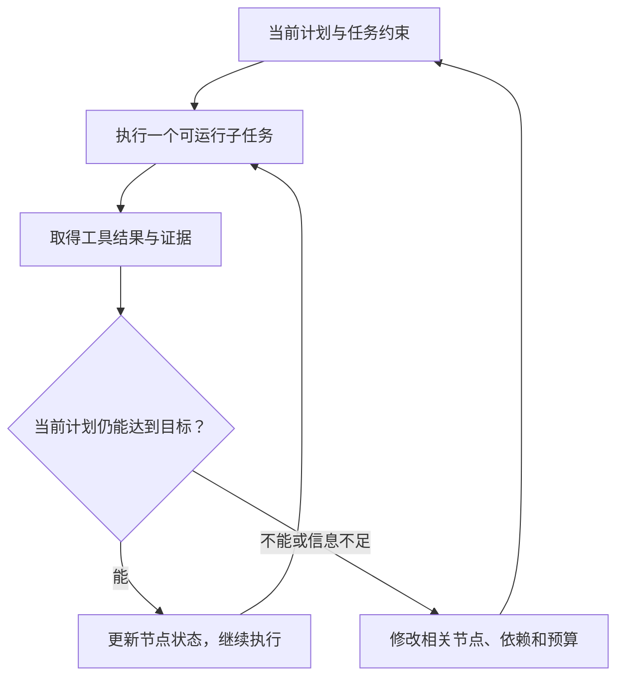

## 课程视频

<div class="bilibili-video" style="position: relative; width: 100%; aspect-ratio: 16 / 9; margin: 1rem 0;">
  <iframe src="https://player.bilibili.com/player.html?isOutside=true&aid=117346324714497&bvid=BV1peaq64E6G&cid=42262135855&page=1&high_quality=1&qn=120&quality=120&danmaku=0&autoplay=0" scrolling="no" border="0" frameborder="no" framespacing="0" allowfullscreen="true" style="position: absolute; inset: 0; width: 100%; height: 100%;"></iframe>
</div>

[B 站观看本讲](https://www.bilibili.com/video/BV1peaq64E6G/)

[官方录像](https://www.youtube.com/watch?v=S8v-dR4s29M) · [官方幻灯片](https://www.cmu-agents.com/slides/lecture-05-planning.pdf)

## 一张采购清单为什么需要规划

视频先展示了一个持续推进的采购过程，框架没有把子任务依赖单独保存下来。


*原视频截图：[回到 04:00](https://www.bilibili.com/video/BV1peaq64E6G/?t=240)。*

前几讲已经介绍了工具、上下文和记忆。具备这些能力后，智能体能够查询资料，也能够把调查结果保留下来。这一讲继续研究一个问题：面对几十步、几百步的任务，它如何决定接下来做什么？Daniel Fried 在讲义中用实验室采购 GPU 工作站的任务展开规划、任务分解和协同。

采购任务包含访问供应商网站、比较配置和价格、阅读内部集群要求，以及提交采购申请。这几件事存在依赖：不了解机架尺寸和供电限制，就很难判断机器是否合适；查询不同供应商通常允许并行；提交申请又会产生外部影响。把所有动作排成一条长对话，容易在调查过程中丢失约束，也容易过早接受一个勉强合适的候选项。

下面沿用讲义的任务类型，构造一个简化示例。假设实验室要求 4U 机箱、功耗不超过机位供电上限、交货时间不超过 6 周。四家供应商的配置都查完了，只有 D 满足硬件要求，但它需要 20 周交货。

此时，“四家供应商均已查询”成立，“找到符合要求的方案”仍未成立。任务进度与任务目标是两件需要分别记录的事。下一步可能是扩大搜索范围，或者向用户说明当前候选方案的限制。交货周期这个约束也应继续保留。



这张图已经表达了一份计划：未来要完成哪些子目标，子目标之间有什么顺序与依赖，以及什么观察会触发调整。它同时把采购约束与提交动作关联起来，方便执行前检查。

## 把计划从推理中取出来

模型回答复杂问题时，经常先写几步推理，再继续求解。这样的中间文本为后续生成提供了上下文，但计划和答案可能在同一次生成中完成，外部系统没有机会检查中间步骤。

[Least-to-Most Prompting](https://arxiv.org/abs/2205.10625) 将问题分解与求解分成两个阶段：先生成较简单的子问题，再按顺序回答，把已有答案传给后面的子问题。[Decomposed Prompting](https://arxiv.org/abs/2210.02406) 进一步引入不同的处理模块，分解器把子任务交给适合的提示、模型或函数。这两种方法体现了分解的价值：缩小一次求解需要处理的范围，让中间结果参与后续计算。

放到采购示例中，“搜索供应商”和“检查供电兼容性”需要的输入与工具各不相同。前者需要网页搜索和规格页面，后者需要机器功耗、机位上限及内部规则。把兼容性检查独立出来，能够直接检查是否漏用了交货时间等条件。

计划与上一讲的技能也存在用途差别。技能保存跨任务复用的方法，例如“比较服务器配置时检查哪些项目”；当前计划记录这一次要查询哪几家供应商、谁已完成、还缺什么信息。技能为规划提供经验，计划则落到具体任务状态。

为了让计划支持执行，我们给每个节点加上输入、产物和完成条件。以下 YAML 是本文示例的数据结构，并非某个框架的配置格式：

```yaml
goal: 形成满足实验室要求的采购方案
constraints:
  chassis: 4U
  delivery_weeks_max: 6
nodes:
  - id: requirements
    depends_on: []
    output: 带出处的机架和供电要求
    status: done
  - id: vendor_d
    depends_on: []
    output: 配置、功耗、价格、交期及页面出处
    status: done
  - id: compatibility
    depends_on: [requirements, vendor_d]
    output: 每个约束的检查结果
    status: done
    result: 交期 20 周，超过允许的 6 周
  - id: recommendation
    depends_on: [compatibility]
    completion_condition: 至少一个候选满足全部约束
    status: blocked
```

`compatibility` 执行成功，产物却是候选不合格。调度器应把这类结果与工具报错区分开：前者需要业务上的重规划，后者需要定位访问、解析或环境问题。`recommendation` 的完成条件也防止系统把“已有一份比较表”误当成“采购方案已找到”。

## 动作的前置条件与执行结果

经典规划通常明确描述状态、动作的前置条件和效果。讲义用积木世界说明：拿起一块积木，要求它在桌上、上方没有其他积木、机械手为空；执行后，机械手持有积木，原来的桌面状态发生变化。规划器寻找一串满足前置条件、最终达到目标的动作。

对于语言模型智能体，世界知识往往隐含在模型参数与当前上下文中。模型能写出“打开采购系统并提交申请”，但这一步还依赖账号权限、必填字段、有效报价和用户授权。自然语言计划覆盖的领域广，执行条件则需要环境中的证据。

我们在采购流程中能够明确检查的条件包括：报价来源是否可访问，规格是否完整，候选是否满足约束，以及提交前是否具备任务要求的权限。检查失败后，应回到相应节点补资料或修订计划。

计划也有不同表示方式：

| 表示 | 适合表达的内容 | 执行时需要补充的检查 |
| --- | --- | --- |
| 自然语言 | 开放任务、调查方向、解释取舍 | 步骤是否具体，依赖与完成条件是否明确 |
| 结构化任务图 | 顺序、并行、节点状态、资源预算 | 图中的前置条件是否对应实际证据 |
| 程序 | 分支、循环、调用与结果处理 | API 的真实效果、错误路径、权限和输入合法性 |
| 形式化状态与动作 | 明确的状态空间和可验证约束 | 形式化模型是否覆盖真实环境 |

程序化计划便于执行分支和检查条件。它的可靠性仍取决于接口返回的数据及世界模型的准确性。例如一个网页解析函数将“暂时无货”识别为“价格为零”，后面的预算检查就会获得错误输入。

[SayCan](https://arxiv.org/abs/2204.01691) 提供了另一种结合方式：语言模型估计下一项技能与目标的相关性，技能的价值函数估计在当前环境中执行成功的可能性，两类信号共同参与选择。这让“语义上合理”和“当前执行得了”同时进入决策，但可行性估计本身也会有误差。

## 什么时候修改计划

讲义区分了开发者固定流程、先规划后执行，以及根据观察调整计划的方式。采购示例能直接体现它们的差异。

固定流程规定查询 A、B、C、D，再比较结果。先规划后执行允许模型在开始时选择供应商和调查顺序。动态重规划进一步允许执行中增加 E，或者先返回内部 wiki 补查被遗漏的供电要求。

流程固定的任务通常更容易控制成本和复现结果。环境信息逐步揭示的任务更需要调整能力。每次调整也有代价：重新读取上下文、更新任务图、取消已无价值的工作，都会消耗时间。因此，重规划应由明确观察触发，例如候选全部不合格、前置条件失效、出现新的硬性要求。



[Plan-and-Act](https://arxiv.org/abs/2503.09572) 将规划器和执行器分开，并利用成功轨迹构造计划训练数据。这样，高层规划负责描述目标和步骤，执行器负责把步骤映射成具体交互。两者的接口需要保留足够信息：只交接“找一个便宜的工作站”，就会丢失尺寸、供电和交期要求。

执行器返回的也应包含事实和证据。例如“D 不合格：规格页面显示交期 20 周；任务上限 6 周”，比“D 看起来不太适合”更方便规划器决定下一步。

### 规划器与执行器交接什么

视频把规划与像素定位放在两个模块中，展示了专门化的一个具体用途。


*原视频截图：[回到 40:20](https://www.bilibili.com/video/BV1peaq64E6G/?t=2420)。*

图中高层模块根据任务与截图决定下一步是搜索显示器，输出目标元素描述和要输入的内容。低层定位模块将“页面顶部的搜索框”映射为坐标，执行点击和输入。规划需要理解目标与流程，定位需要区分实际界面中的控件，两者的训练数据和评测目标存在差别。

一个完整交接应包含当前子目标、动作意图、目标元素特征、需要填写的值，以及完成后要检查的状态。例如“在商品搜索框输入 4K 显示器并搜索，返回结果页观察”，比“继续搜索”更容易验证。

执行器定位失败时，应交回新截图和失败原因，规划器再决定重试定位、换用文字结构或调整任务。执行器也需要知道约束，例如本阶段只调查规格，才能将操作限制在相应范围。

Plan-and-Act 的训练从成功轨迹出发，利用教师把低层动作分段，标注每段对应的高层目标。规划器学习从任务状态生成步骤，执行器学习在高层目标和当前观察条件下生成具体动作。分段质量决定接口是否清楚：把两项不同目的的操作混在一段，会增加执行器需要推断的内容。

对于采购任务，一段可以对应“获取带交期的报价”，下一段对应“核对机位供电”。执行器交回字段与出处，规划器据此检查依赖。任务分解、模块训练和产物验证便沿着同一个接口连接起来。

## 重规划时哪些结果还能使用

增加供应商 E 后，原来 A、B、C、D 的查询结果并不需要全部重做。它们仍然能作为不合格候选的证据。需要修改的是候选集合和后续比较节点，已确认的机架要求则继续保留。

如果变化来自用户的新要求，影响范围可能更大。假设用户把交货上限从 6 周调整到 4 周，规格和价格查询仍可复用，但交期检查需要重新执行。若要求更换 GPU 型号，原来的配置报价可能已经失效，相关查询也要更新。

任务图中的依赖帮助确定这些范围。一个结果除了记录 `done`，还应注明使用了哪个版本的输入。否则，某个兼容性结论虽然显示完成，却可能基于已经变化的要求。

我们为示例加上三个版本号：

```text
要求文档：requirements_v2
供应商 D 报价：vendor_d_quote_v1
兼容性检查：使用 requirements_v2 与 vendor_d_quote_v1

要求更新为 requirements_v3 后：
  供应商报价保持可用
  兼容性检查标为待重新验证
  最终方案等待新的检查结果
```

这个版本号是教学表示。真实系统也能使用文件版本、内容摘要或时间戳表达来源。目的在于追踪结论依赖什么信息，防止工作者交回旧结果后把新计划的状态错误更新为完成。

节点状态还要表达失败与取消。某个候选被证实无法交货，继续读取它的报价就失去意义，相关工作可以取消；但取消动作可能只能停止后续调用，已经发出的请求仍会返回。协调层收到结果时，应检查它是否还属于当前计划。

## 并行减少了什么成本

假设四个供应商查询分别耗时 30、40、50、60 秒，且彼此独立，不受限流与资源竞争影响。串行查询耗时合计 180 秒；四个工作者同时执行，查询阶段耗时接近最长的 60 秒。这个估算只说明并行缩短了等待时间，总工作量仍是四次查询。

如果每个工作者都读取同一份 8,000 token 的规范，输入成本可能随工作者数量增长。协调者先抽取准确约束，再交给工作者，有助于减少重复输入；抽取本身也可能丢失信息，需要检查。并行的收益应覆盖上下文复制、结果汇总和冲突处理。

对于共享的网页服务，同时四路访问也可能遇到限流。此时增加并发会产生更多重试，完成时间反而拉长。执行器需要限制并发，并记录调用预算。到达预算上限还没有候选时，应返回已有证据和未完成目标，避免继续扩展一个没有停止条件的搜索。

任务图也需要检查环。若“最终方案”依赖“审批结果”，而“审批结果”又依赖“最终方案”，两个节点都无法执行。更合理的拆分是先形成待审批方案，再取得审批结果，最后按授权执行。规划阶段发现这种依赖问题，比运行到无任务可调度时再补救更容易解释。

## 子任务拆到多细才合适

“查询供应商 D”仍然很大，往下还能拆成搜索产品、打开详情、读取功耗和查交期。拆分一直继续，会产生越来越多的计划节点与交接文本。

合理粒度取决于产物是否明确，以及交接收益是否超过开销。把“获取 D 的可核对报价”作为一个节点，通常比把每次点击作为一个节点更方便组织采购任务。页面内部的点击和读取由执行器完成，协调层检查报价是否包含所需字段。

递归分解允许处理者继续拆分自己遇到的复杂任务，但需要停止条件。一个任务已经能用现有工具直接完成，就应执行；分解深度、总调用次数和剩余时间接近上限时，也需要停止继续扩展。否则，模型可能反复把“调查问题”分解成另一层“调查问题”，一直没有获得新的环境观察。

过度规划还可能表现为猜测一个本来能直接测试的细节。遇到 CSV 解析异常，查看文件前几行往往比继续推测分隔符更有信息价值。计划的作用是组织有效调查，调查本身仍应及时发生。

## 多智能体怎样共享同一个目标

原视频的 MACU 架构图进一步把这些模块放入一个可反复修订的调度循环。


*原视频截图：[回到 70:50](https://www.bilibili.com/video/BV1peaq64E6G/?t=4250)。*

采购任务中的供应商查询彼此相对独立，适合分配给多个执行者。协调者保留全局约束，工作者分别返回候选数据。硬件兼容性检查和最终方案选择则依赖这些产物。

多智能体带来的收益主要来自并行和专门化。角色名称本身不会保证收益：“研究员”“审查员”“经理”若共享同一份模糊输入，可能只是重复调查。每个工作者应有明确任务、输入范围、可用工具和交付要求。

下面的伪代码说明协调层要处理什么，省略了异步执行与存储细节：

```python
while not goal_satisfied(plan):
    ready = nodes_with_successful_dependencies(plan)
    if not ready:
        plan = replan_from_blockers(plan, evidence, budget)
        continue

    results = run_bounded_workers(ready, budget)
    for node, result in results:
        evidence.record(node, result)
        update_status_after_validation(node, result)

    if feedback_invalidates_plan(plan, evidence):
        plan = revise_affected_nodes(plan, evidence, budget)
```

这里的依赖满足，要求上游提供了可接受的产物。供应商访问失败，不能当成已完成查询；候选被判不合格，也不能解锁“提交该候选”的后续节点。重规划还应检查预算是否足够，避免没有可运行节点时无限循环。

共享工作区带来另一类问题：多个编程工作者可能同时编辑一个文件，多个网页工作者可能操作同一个登录会话。任务独立与环境隔离需要一起设计。隔离的结果汇总后，还要检查全局条件，例如各个部件单独符合规格，组合后的总功耗却超出机位上限。

在这个例子中，协同是否有效，适合从完成时间、总调用成本、候选数据质量和最终约束满足率比较。增加工作者后，如果查询更快但约束丢失、交接更长，整个任务的收益仍可能下降。评估应覆盖完整采购流程，也应留下触发重规划的观察，便于判断问题发生在搜索、验证还是协调阶段。

### 完成一个节点以后，管理者还要检查什么

架构图中，管理者生成任务 DAG，调度器找到依赖满足的节点，再把子任务交给并行工作者和相应虚拟机。虚拟机池为界面操作提供隔离环境，减少多个工作者同时控制同一个窗口的冲突。

工作者报告完成后，结果进入 follow-up loop，也就是跟进循环。管理者检查产物是否满足节点要求，再决定接受结果、补做工作或修改任务图。图中的 `continue` 与 `done` 表示本次检查后还要继续工作，还是该分支确实结束。

这一步需要区分三个状态：工作者的消息已返回、子目标已验证，以及全局目标已满足。供应商查询完成并返回交期 20 周，产物有效；要求 6 周内交付的采购目标仍未满足。协调层据此增加新查询，待全局约束通过验证后再提交结果。

视频末尾还比较了固定工作者、替换管理者，以及限制任务图修改次数的设置。固定较小的工作者模型，能够观察规划与协调能力变化带来的影响；限制重规划，则能检验后续信息是否确实需要改变初始分解。解读这类实验时，应同时看任务集合、工作者能力、成功率和调用成本。

管理者通常处理相对少量的高层决策，工作者执行更多低层动作。因此，使用更强管理者的成本变化，需要按各模块的实际调用量计算。任务不能有效分开、工作者反复回报含糊产物时，协调开销也可能超过并行收益。

将系统用于新的任务时，可以保留相同的工作者和预算，只改变是否允许修订图，再比较失败原因。若固定图经常卡在新出现的依赖上，动态调整有明确价值；若任务始终沿稳定流程完成，额外的规划回合就需要更充分的收益证据。

## 参考资料

- [课程 Schedule](https://www.cmu-agents.com/#/schedule)
- [本讲幻灯片](https://www.cmu-agents.com/slides/lecture-05-planning.pdf)
- [Least-to-Most Prompting](https://arxiv.org/abs/2205.10625)
- [Decomposed Prompting](https://arxiv.org/abs/2210.02406)
- [Plan-and-Act](https://arxiv.org/abs/2503.09572)
- [SayCan](https://arxiv.org/abs/2204.01691)
- [Building Effective Agents](https://www.anthropic.com/engineering/building-effective-agents)
- [Multi-Agent Computer Use](https://arxiv.org/abs/2606.01533)
