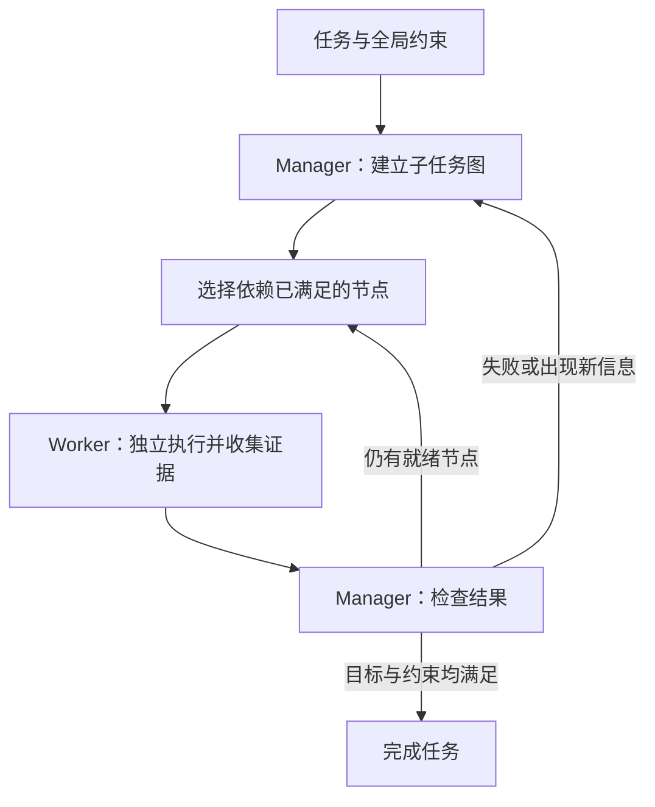

## 课程视频

  <iframe src="https://player.bilibili.com/player.html?isOutside=true&aid=117346324714497&bvid=BV1peaq64E6G&cid=42262135855&page=1&high_quality=1&qn=120&quality=120&danmaku=0&autoplay=0" scrolling="no" border="0" frameborder="no" framespacing="0" allowfullscreen="true" style="position: absolute; inset: 0; width: 100%; height: 100%;"></iframe>

[B 站观看第 5 讲](https://www.bilibili.com/video/BV1peaq64E6G) · [官方课件](https://www.cmu-agents.com/slides/lecture-05-planning.pdf)

## 工作站采购中的计划

第 5 讲由 Daniel Fried 于 2026-09-08 授课，主题是规划、任务分解及多智能体协调。本文沿原视频顺序，先看任务为什么需要结构，再讨论计划表示、重规划和长任务，最后介绍 MACU。

课堂开头给出采购 GPU 工作站的任务：比较多家供应商的配置与价格，对照内部 wiki 的集群要求检查兼容性，最后提交采购申请。一个纯反应式智能体可能先在供应商页面配置设备，几十步后才读到机架空间和供电要求；上下文压缩后，又可能忘记哪些候选已被排除，或者在没有合适选择时草率提交。

*来源：[官方课件第 3 页](https://www.cmu-agents.com/slides/lecture-05-planning.pdf#page=3)。*

供应商搜索可以独立进行，兼容性检查依赖规格和内部要求，提交申请则具有外部影响。若四家都不合适，系统还需要增加第五家。计划需要表达这些关系，并允许根据新信息修改。

**计划是对未来预期行为的显式表示**，包含动作或子目标，以及它们的顺序、依赖。它面向当前任务，技能则提供跨任务指导。计划是可检查和修改的提议，是否可行仍要通过环境验证。

## 先分解，再求解

Daniel 从 Chain-of-Thought 讲起：中间推理为模型增加计算和可回看的草稿。Plan-and-Solve 进一步提示模型先制定计划，再按步骤解答，但计划与解答仍可能在一次生成中完成，没有独立检查者。

Least-to-Most 把过程拆成两阶段：先生成子问题，再逐个求解，把前面答案传给后面。这样可以降低单次问题的复杂度和所需上下文。Decomposed Prompting 还为子问题分配类型，交给不同处理器；处理器可以分别使用提示、专门模型或外部信息。

这种分解是否有价值，需要看子问题是否真的更容易、是否保留了所需证据，以及路由和交接成本。把一个任务拆成更多文本段落，本身不保证结果变好。

## 计划开始作用于环境

推理中的文字可以继续改写，外部动作却会改变后续状态。发送、提交或删除可能不可逆，动作也可能失败或揭示新信息。因此，规划需要处理可执行性、后果和恢复。

### 经典规划与语言计划

经典规划把状态写成谓词集合，把动作写成前置条件与效果。积木世界中，`pick-up(x)` 要求积木在桌上、上方无遮挡且机械手为空；执行后，状态变为持有积木、积木不再位于桌上、手不再为空。搜索算法寻找满足各步前置条件、最终到达目标的动作序列。

*来源：[官方课件第 13 页](https://www.cmu-agents.com/slides/lecture-05-planning.pdf#page=13)。*

语言模型能很容易写出看似合理的计划，难处转向它隐含的世界模型是否正确。形式计划便于校验，但需要明确环境表示；自然语言计划覆盖面广，缺乏通用验证器；程序计划处于两者之间，可以调用感知和控制 API，同时接受程序结构的限制。Code as Policies、ProgPrompt 和 Binder 展示了这条路线。

### 什么时候重规划

课程区分三种控制方式：开发者固定工作流，模型先计划再执行，以及执行中根据反馈适配。固定供应商列表便宜、可预测；动态增加供应商需要更多判断，却能处理原候选全部失败的情况。是否加入重规划，应比较环境反馈的价值与额外成本。

## 加入规划结构的四个理由

### 模块化：让不同部分各自改进

UGround 把高层意图和像素级定位分开：规划器描述下一动作，专门训练的执行器把描述映射到坐标。Plan-and-Act 则让教师标注成功轨迹中的计划，再分别训练规划器和执行器。

固定角色也有局限。若预先规定“定位者、编码者、验证者”，验证者却不能继续定位自己发现的问题，分工会限制行动；交接报告还可能遗漏下一角色需要的上下文。多智能体数量与可靠性之间没有简单的正比关系。

### 反馈：动作能否做，做完发生了什么

SayCan 结合语言模型对候选技能的评分和技能价值函数给出的可执行程度，避免只选择语言上顺畅的步骤。LLM-Planner、Inner Monologue 等工作把执行反馈带回计划，让系统在发现障碍时修改后续行动。

课程随后比较“多想”与“多交互”。真实观察能消除信息缺口，反复延长推理不一定有同样效果。过度思考可能表现为迟迟不行动、无关动作链或提前放弃。Calibrate-then-Act 的文件解析例子包含分隔符、引号和表头行数三个未知因素，单凭文件名猜格式不够，执行检查可能更有价值。

### 长任务：阻止错误不断自我强化

Vending-Bench 让智能体长期经营自动售货机。课件中的失败把“今天尚未到货”误判为“业务已经失败”，之后又把正常费用解释成欺诈。早期错误进入自己的历史，持续影响后续判断。

任务越长，单步准确率和恢复机制越重要。更大模型可能执行更长任务，也可能更依赖自己先前写下的错误。RAO 把 `launch_subagent(goal)` 作为可学习动作，允许递归分解；这解决部分上下文压力，但仍需要检验子任务结果。

### 控制：哪些信息可以改变哪些动作

计划也可以成为权限边界。程序可以从网页接收价格等数据，却不允许页面文本任意改写将要执行的操作。课堂以商品评论中的恶意指令说明提示注入路径；固定程序结构只能减少部分攻击面，输入中的价格或商品信息仍可能被操纵。

接着的 Plan Mode 演示让人回答澄清问题、编辑 Markdown 计划，再进入执行。TravelPlanner 则指出跨子任务约束：机票、酒店、饮食可以分别查，预算、交通衔接和饮食要求仍然跨越所有部分，必须由全局状态统筹。

## MACU：把计划写成可修改的依赖图

最后，Daniel 用 Odysseys 中寻找 ACL 外科医生的长任务引入 Multi-Agent Computer Use（MACU）。Manager 建立子任务图，Worker 在各自环境执行已就绪节点，完成后回传结果；Manager 检查证据，必要时重试或修改图，再派发下一批。

*来源：[官方课件第 38 页](https://www.cmu-agents.com/slides/lecture-05-planning.pdf#page=38)。*

下面根据课件整理执行关系：

课件分别比较 Manager、Worker 能力和并行数，强调强管理器、较弱执行器以及不同任务之间的收益并不相同。并行可以缩短独立子任务的等待时间，但共享状态冲突、遗漏约束和管理开销也会抵消收益。

课末留下的问题是：语言计划怎样校验，智能体如何判断该思考、观察、询问还是重规划，以及全局约束如何在分解后继续保持。选择规划结构时，应针对具体失败类型添加机制，再测量完整任务的收益。

## 参考资料

- [官方第 5 讲课件](https://www.cmu-agents.com/slides/lecture-05-planning.pdf)
- [Least-to-Most Prompting](https://arxiv.org/abs/2205.10625)
- [SayCan](https://arxiv.org/abs/2204.01691)
- [官方课程安排与阅读材料](https://www.cmu-agents.com/)
