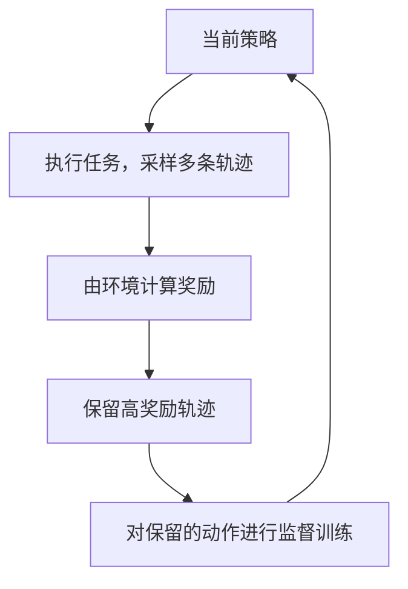
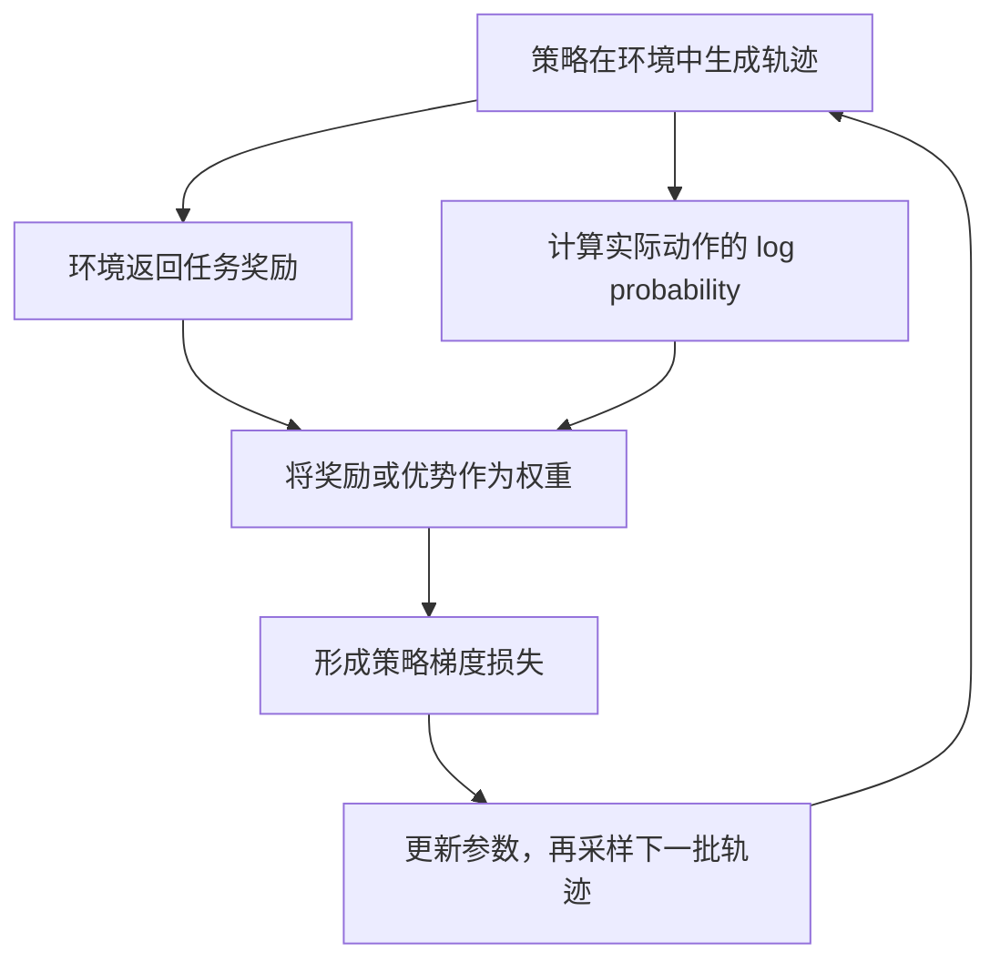

## 课程视频

<div class="bilibili-video" style="position: relative; width: 100%; aspect-ratio: 16 / 9; margin: 1rem 0;">
  <iframe src="https://player.bilibili.com/player.html?isOutside=true&aid=117346341492295&bvid=BV1Waaq6ZEhq&cid=42262725708&page=1&high_quality=1&qn=120&quality=120&danmaku=0&autoplay=0" scrolling="no" border="0" frameborder="no" framespacing="0" allowfullscreen="true" style="position: absolute; inset: 0; width: 100%; height: 100%;"></iframe>
</div>

[B 站观看本讲](https://www.bilibili.com/video/BV1Waaq6ZEhq/)

[官方录像](https://www.youtube.com/watch?v=paAcPaaYZGM) · [官方幻灯片](https://www.cmu-agents.com/slides/lecture-09-rl-basics.pdf)

## 猜中数字有多种办法

上一讲用记录好的轨迹训练智能体，模型在每一步学习演示中的目标动作。这一讲由 Daniel Fried 介绍强化学习基础，从智能体自己执行的结果出发，讨论怎样提高成功轨迹的概率。

讲义使用一个猜数字环境：隐藏整数位于 1 到 16 之间，智能体有四次机会。猜错后，环境返回 `higher` 或 `lower`；猜中得到奖励 `1`，用完机会仍未猜中得到 `0`。隐藏数字为 `11` 时，下面两条轨迹都成功：

```text
轨迹 A：8 → higher → 12 → lower → 10 → higher → 11 → correct
轨迹 B：4 → higher →  8 → higher → 12 → lower → 11 → correct
```

如果监督数据只包含 A，SFT 会提高这些目标动作的概率。B 使用另一种动作序列，同样完成任务。任务结果允许多种有效解法，强化学习的目标直接关注这些解法整体带来的期望奖励。

失败轨迹也提供信息：

```text
轨迹 C：16 → lower → 8 → higher → 9 → higher → 10 → timeout
轨迹 D： 1 → higher → 2 → higher → 3 → higher →  4 → timeout
```

C 和 D 在四次机会内没有找到目标。学习算法需要决定怎样使用它们：只丢弃失败样本，还是让低于预期的结果降低相应动作的概率？这会引出后面的自训练、策略梯度和优势估计。

## 策略看到的是历史

在这个环境中，隐藏数字属于环境状态，智能体看到的是已猜过的数字与返回结果。策略不能把隐藏答案作为输入。

用 `h_t` 表示到第 `t` 步为止的可见历史，`a_t` 表示下一次猜测，策略写成 `π_θ(a_t | h_t)`。参数 `θ` 决定每个动作的概率。对于语言模型，一次工具调用还可以展开成多个 token 的生成概率。

完整轨迹包含动作、观察和奖励。其概率既取决于策略，也取决于环境怎样响应：

```text
p_θ(τ | x) = p(o_0 | x)
             × Π_t π_θ(a_t | h_t)
             × P(o_(t+1), r_(t+1) | h_t, a_t, x)

R(τ) = Σ_t r_(t+1)
J(θ) = E_[τ ~ p_θ][R(τ)]
```

`x` 是任务实例，包含环境用来运行任务的信息；它不意味着策略能够读取全部实例字段。`P` 描述环境返回观察与奖励的规律。实际任务中，我们通常能够执行动作得到样本，即使无法写出环境的完整概率分布。

假设一个简化分布只包含前面的四条轨迹，概率分别为 `0.30`、`0.20`、`0.25`、`0.25`，期望奖励就是：

```text
J = 0.30 × 1 + 0.20 × 1 + 0.25 × 0 + 0.25 × 0 = 0.50
```

这个数表示该简化策略有一半概率成功。训练希望把概率质量移向高奖励轨迹。真实猜数字任务还有其他轨迹，上面的四项仅用于演示计算。

## 先生成，再用成功结果训练

一个容易理解的办法是让模型执行任务，保留成功轨迹，再做监督训练。下一轮用更新后的模型重新执行，继续收集更好的数据。

[ReST](https://arxiv.org/abs/2308.08998) 和 [ReST-EM](https://arxiv.org/abs/2312.06585) 研究了这类自训练过程。本讲将它作为从 SFT 走向强化学习的第一步：教师数据来自当前模型的尝试，环境奖励参与选择训练数据。



在二元奖励的猜数字例子中，A、B 被保留，C、D 被丢弃。每次训练增加成功解法的概率。这个方法依赖模型已经能采到部分成功轨迹；如果每次都失败，筛选后就没有新的正样本。

同时，保留下来的成功轨迹仍需要检查质量。四次机会内猜中，不代表每个动作都最有效。前一讲关于重复操作和数据筛选的问题，在自训练中依然存在。

## 奖励如何产生梯度

原视频把期望梯度和单条采样轨迹的估计并列展示，下面沿着两行公式继续计算。


*原视频截图：[回到 38:50](https://www.bilibili.com/video/BV1Waaq6ZEhq/?t=2330)。*

测试通过、数字猜中、网页状态符合目标，都是执行后才知道的结果。通常无法直接对“运行一次测试”反向传播，也无法沿着离散动作的采样步骤计算普通导数。

策略梯度利用概率分布对参数的依赖，绕过直接对环境求导。先将期望写成所有轨迹的求和，再使用对数导数恒等式：

```text
J(θ) = Σ_τ p_θ(τ) R(τ)

∇J(θ) = Σ_τ ∇p_θ(τ) R(τ)
       = Σ_τ p_θ(τ) R(τ) ∇log p_θ(τ)
       = E_[τ ~ p_θ][R(τ) ∇log p_θ(τ)]
```

这一步假设奖励规则与环境转移本身不依赖待优化的策略参数。轨迹的对数概率由策略项和环境项组成，环境项对 `θ` 的导数为零，因此：

```text
∇log p_θ(τ) = Σ_t ∇log π_θ(a_t | h_t)

∇J(θ) = E[R(τ) × Σ_t ∇log π_θ(a_t | h_t)]
```

REINFORCE 用采样轨迹估计这个期望。执行时记录真实动作与观察，更新时计算模型对这些动作的 log probability，再用奖励加权。若优化器最小化损失，则使用负号：

```text
L_PG = -R(τ) × Σ_t log π_θ(a_t | h_t)
```

对于语言模型，每个 `a_t` 又是一段 token。工具观察进入条件上下文，动作 token 和模型生成的结束标记参与损失。这里沿用了上一讲的掩码机制，但目标动作来自当前策略采样，权重来自执行奖励。



在最基础的二元奖励形式中，失败轨迹的 `R=0`，损失贡献也为零；成功轨迹则增加其动作的概率。因此，它与“对成功轨迹做 SFT”有紧密联系。自训练的数据聚合和批量更新方式可能不同，不能据此把整个训练算法视为完全相同。

### 采样完成后，训练步骤还做什么

采样阶段让当前策略真实执行任务，保存每个动作的 token、当时的条件历史和环境观察。得到终局奖励后，训练阶段再次计算这些已采样 token 的 log probability，形成带权重的损失。动作是已经发生的离散样本，梯度通过模型对它们的概率计算进入参数。

权重参与更新时应按算法视为固定信号。奖励来自测试或状态检查，基线与优势也要按指定方式停止梯度。若价值模型另外训练，它使用自己的目标；不能把价值模型的梯度路径无意混入策略损失。

批次含 `B` 条轨迹时，最基础的估计写成：

```text
gradient_estimate = (1/B) × Σ_i R_i × Σ_t ∇log π_θ(a_i,t | h_i,t)
```

平均能减轻单条轨迹的波动，样本多样性仍然影响估计。十条来自同一狭窄状态的尝试，与十条来自不同任务的尝试，提供的信息不同。旧轨迹在多轮更新后也逐渐偏离当前策略，后续课程会通过概率比等机制处理。

正奖励提高已采样动作的概率，但一条成功轨迹里的多余动作也可能被一起强化。终局信号较粗时，还需要基线、任务多样性和信用分配方法，让更新更贴近有效行为。采样日志和奖励检查应保留下来，便于解释某种策略为什么越来越常出现。

## 为什么要减去一个基线

只用终局奖励加权，一条成功轨迹中的所有动作都受到强化，失败轨迹又没有直接梯度。我们希望引入“这个结果比平时好多少”的信息。

价值函数 `V^π(h)` 表示从历史 `h` 出发，继续按当前策略执行时的期望回报。动作价值 `Q^π(h, a)` 表示先执行动作 `a`，随后继续当前策略的期望回报。优势定义为：

```text
A^π(h, a) = Q^π(h, a) - V^π(h)
```

二者通常未知，需要估计。一个简单形式是用实际回报减去历史相关的基线：`Â_t = R(τ) - b(h_t)`。更新变成：

```text
∇J ≈ Σ_t (R(τ) - b(h_t)) × ∇log π_θ(a_t | h_t)
```

如果基线只依赖动作选择前的历史，它不改变梯度估计的期望。对固定历史，将动作求和，有：

```text
E_a[b(h) × ∇log π(a | h)]
= b(h) × Σ_a ∇π(a | h)
= b(h) × ∇1
= 0
```

合适的基线有助于降低方差，让更新更稳定。基线的选择仍需要评估；任意数值并不会自动带来更好的方差表现。更新策略时，作为权重的奖励与基线也应按算法要求停止梯度，避免把目标改成另外一个优化问题。

## 用两个动作把计算展开

视频中的两臂例子同时展示成功动作和失败动作的更新方向。


*原视频截图：[回到 59:50](https://www.bilibili.com/video/BV1Waaq6ZEhq/?t=3590)。*

讲义用双臂老虎机说明基线。设策略选择 A 的概率 `p=σ(θ)=0.25`，选择 B 的概率为 `0.75`。A 的奖励为 `1`，B 的奖励为 `0`。提高 `θ` 就会提高 A 的概率。

对这个单参数策略，`∂log π(A)/∂θ = 1-p = 0.75`，`∂log π(B)/∂θ = -p = -0.25`。

| 采样动作 | 奖励 | 不使用基线的梯度 | 使用基线 `b=0.5` 的梯度 |
| --- | --- | --- | --- |
| A | 1 | `1 × 0.75 = 0.75` | `(1-0.5) × 0.75 = 0.375` |
| B | 0 | `0 × (-0.25) = 0` | `(0-0.5) × (-0.25) = 0.125` |

使用基线后，采到 B 也产生正方向更新，因为它的结果低于基线，算法会降低 B 的概率。两种估计的期望相同：

```text
无基线：0.25 × 0.75  + 0.75 × 0     = 0.1875
有基线：0.25 × 0.375 + 0.75 × 0.125 = 0.1875
```

下面的补充代码同时计算期望与方差，无需训练框架：

```python
def gradient_stats(p, baseline):
    samples = [
        (p, (1 - baseline) * (1 - p)),
        (1 - p, (0 - baseline) * (-p)),
    ]
    mean = sum(prob * grad for prob, grad in samples)
    variance = sum(prob * (grad - mean) ** 2 for prob, grad in samples)
    return mean, variance


for baseline in [0.0, 0.5]:
    mean, variance = gradient_stats(0.25, baseline)
    print(f"baseline={baseline}: mean={mean:.6f}, variance={variance:.6f}")
```

输出的期望均为 `0.187500`，方差分别约为 `0.105469` 和 `0.011719`。这个例子把“期望不变、采样波动变小”落实到了具体数字。

## 动作价值与终局结果的差别

我们再看猜数字中的一个具体历史：已经猜过 `8` 并得到 `higher`，随后猜 `12` 得到 `lower`。候选集合缩小到 `{9, 10, 11}`，还剩两次机会。

为了计算清楚，假设三个候选在当前历史下等概率，后续策略会正确使用比较结果。选择 `10` 时，猜中立即成功；返回 `lower` 就只剩 `9`，返回 `higher` 就只剩 `11`，最后一次也能确定答案。这一步的成功概率为 `1`。

选择 `11` 时，有 `1/3` 概率立即成功。若返回 `lower`，仍有 `{9, 10}` 两个等概率候选，最后一次只能选一个，成功概率为 `1/2`。因此，这一步后续成功概率为：

```text
Q(h, 11) = 1/3 + (2/3) × (1/2) = 2/3
Q(h, 10) = 1
```

这解释了为什么“最后猜中”与“这一步更好”存在差别。选择 `11` 的某条轨迹可能成功，单条终局奖励也会强化它；比较期望回报时，选择 `10` 更充分地利用了剩余机会。

如果当前策略在这两种动作上都有概率，状态价值位于 `2/3` 与 `1` 之间，对 `10` 的优势为正，对 `11` 的优势为负。这里的判断依赖等概率假设和后续策略；不同候选概率、不同后续动作会改变数值。

## 搭一个可重复执行的猜数字环境

策略梯度训练需要真实采样环境。我们先写一个小环境验证轨迹与奖励是否对齐，尚不涉及语言模型训练。隐藏目标由环境保存，策略只接收每次返回的提示。

```python
def make_number_game(target, budget=4):
    if not 1 <= target <= 16 or budget <= 0:
        raise ValueError("invalid task")
    turns = 0
    finished = False

    def guess(number):
        nonlocal turns, finished
        if finished:
            raise RuntimeError("game already finished")
        if not 1 <= number <= 16:
            raise ValueError("guess out of range")
        turns += 1
        if number == target:
            finished = True
            return {"observation": "correct", "reward": 1, "done": True}
        finished = turns >= budget
        observation = "higher" if number < target else "lower"
        return {"observation": observation, "reward": 0, "done": finished}

    return guess


for actions in [[8, 12, 10, 11], [1, 2, 3, 4]]:
    game = make_number_game(11)
    total_reward = 0
    for action in actions:
        result = game(action)
        total_reward += result["reward"]
        print(action, result)
        if result["done"]:
            break
    print("return:", total_reward)
```

第一组的总奖励为 `1`，第二组为 `0`。示例在最后一次猜错时仍返回比较提示，同时用 `done=True` 表示机会用完。讲义轨迹中的 `timeout` 对应这个终止状态；训练日志应清楚记录观察与终止原因。

不同策略的比较应覆盖多个目标值。如果只让目标恒为 `11`，模型学会总是猜 `11` 就能获得满分，却没有学会利用比较提示。任务采样和评测划分会直接决定奖励鼓励的行为。无效动作、重复动作和总执行时间，也需要在完整框架中定义处理方式与预算。

## 一组轨迹中的相对奖励

训练价值模型是一种估计基线的方法；对同一个任务采样多条轨迹，再用组内奖励比较，也是另一种方法。[DeepSeekMath](https://arxiv.org/abs/2402.03300) 提出了 Group Relative Policy Optimization，即 GRPO。

假设同一任务的四条轨迹奖励为 `[1, 1, 0, 0]`，组内均值为 `0.5`，按总体定义计算的标准差为 `0.5`。用 `(R_i-mean)/std` 得到的组优势为 `[1, 1, -1, -1]`。

下面只演示组优势计算，完整 GRPO 还包含策略概率比、裁剪等更新机制，并可能加入 KL 约束：

```python
import math


def group_advantages(rewards):
    if not rewards:
        raise ValueError("empty reward group")
    mean = sum(rewards) / len(rewards)
    variance = sum((r - mean) ** 2 for r in rewards) / len(rewards)
    if variance == 0:
        return [0.0] * len(rewards)
    std = math.sqrt(variance)
    return [(r - mean) / std for r in rewards]


print(group_advantages([1, 1, 0, 0]))
print(group_advantages([0, 0, 0, 0]))
```

第二组全部失败，组内没有差异，这种相对优势为零。全部成功也一样。这解释了稀疏奖励任务中的一个困难：如果没有采到奖励差异，组内比较就没有区分信号。

组均值由当前采样轨迹计算，包含被加权轨迹自己的奖励，因此不能直接套用前面“只依赖历史的基线”所对应的无偏证明。组采样方法的性质需要结合具体估计器与归一化方式分析。

讲义还讨论了 [Dr. GRPO](https://arxiv.org/abs/2503.20783)，它研究组标准差归一化和响应长度归一化带来的偏差，并调整相关项。标准差归一化影响不同任务的更新尺度，按响应长度平均影响长短轨迹的相对权重。评估时需要明确损失在哪一层求和、在哪一层平均。

### Dr. GRPO 改变了每个 token 的权重

前面的组优势只给出轨迹级数字，损失还需要决定怎样将它分配到生成 token。原视频把两种归一化并列展示。


*原视频截图：[回到 72:30](https://www.bilibili.com/video/BV1Waaq6ZEhq/?t=4350)。*

第一项涉及组标准差。同一组二元奖励中的成功比例记为 `p`，总体标准差为 `sqrt(p(1-p))`。`[1,0,0,0]` 的 `p=0.25`，归一化优势约为 `[1.732,-0.577,-0.577,-0.577]`；`[1,1,1,0]` 则约为 `[0.577,0.577,0.577,-1.732]`。

这里的 `p` 来自当前有限样本组，具有采样波动。按标准差缩放，会改变不同任务组在更新中的相对尺度；只减均值，则保留组内原始奖励差。Dr. GRPO 选择后一种处理，奖励规则本身保持不变。

第二项涉及响应长度。若每条响应按自身 token 数求平均，优势为 `-0.5` 的失败轨迹，长度为 2 时，每个生成 token 的权重为 `-0.25`；长度为 20 时，权重为 `-0.025`。长响应中的单个 token 因此受到更小的负权重。

换成同一个常数 `C=20`，两条响应每个生成 token 的权重均为 `-0.025`。C 是全局归一化常数，论文采用生成预算。这个计算例子说明归一化位置怎样改变学习信号，与隐藏奖励内容无关。

设批次有 `B` 个任务，每个任务采样 `G` 条轨迹，简化的当前策略形式可写为：

```text
A_ij = R_ij - mean_j(R_ij)
L = -(1/B) × Σ_i (1/G) × Σ_j (A_ij/C)
                 × Σ_[t: mask_ijt=1] log π_θ(u_ijt | history_ijt)
```

同一轨迹生成的 token 共享 `A_ij/C`，用户输入和环境观察的 mask 为零。A 为负时，对应项可能是负的损失值，优化方向仍由梯度决定：它降低这些已采样动作的概率。损失数值的正负本身不能用来判断任务成功。

这仍是为了理解权重的简化表达，完整算法包含策略概率比与裁剪等项。组内奖励全部相同时，任务奖励优势为零；其他辅助目标若存在，需要另外分析。算法比较应明确组大小、奖励检查、长度上限和损失归一化，才有依据解释更新差异。

## 长轨迹的奖励与信用分配

猜数字只有四步，仍然存在“成功中的哪些动作真正有效”的问题。仓库修改可能包含几十次搜索、编辑与测试，最后一个成功奖励难以说明每一步的贡献。

存在逐步奖励时，可以使用从当前动作之后累积的回报，也就是 reward-to-go，减少过去奖励对当前动作的无关影响。若加入折扣，还需要明确时间索引与目标变化。中间奖励本身也要检查：奖励“执行了测试”，可能诱导重复测试；奖励“减少报错数量”，可能诱导删除相关代码。

对于编程任务，可信奖励应来自目标行为和回归验证；GUI 任务应检查最终状态与用户约束。奖励规则若只检查购物车中出现杯子，却忽略颜色、数量和是否下单，训练就可能强化违反原任务条件的轨迹。

我们把 reward-to-go 再展开一点。假设在动作 `a_1` 之前，环境已经给过 `0.2` 的奖励，后面完成任务又得到 `1`。对 `a_1` 而言，前面的 `0.2` 已经固定在历史中，未来回报为 `1`；用总回报 `1.2` 加权会带入与当前选择无关的随机变化。

reward-to-go 只累加当前动作之后的奖励。在通常的策略梯度条件下，去掉过去奖励不改变期望梯度，并能减少无关波动。猜数字只在最后奖励一次，所有动作的未来回报都等于该条轨迹的终局奖励，所以这个替换不会改变它的权重。

信用分配仍有剩余问题：最终成功究竟来自哪个动作、某个早期调查有没有帮助，单个终局分数很难回答。价值估计按不同历史给出基线，能够提供更细的相对比较；中间奖励提供更密的信号，也增加奖励设计和验证的工作。

环境版本、初始状态和预算需要固定或记录。猜数字只有四次机会，增加到十次就改变了任务；仓库任务中，改变测试超时和依赖版本也会改变奖励分布。评测应使用独立任务，同时记录成功率、成本、失败类型和约束满足情况。

基础策略梯度推导使用当前策略采样的轨迹。参数更新后继续反复使用旧轨迹，就需要处理采样分布变化；概率比和更新约束将在后续课程中展开。读本讲时，先把策略生成的动作、环境提供的观察、最终奖励和用于更新的权重逐项对齐，再看更复杂的训练公式，会更容易定位它们各自解决的问题。

## 参考资料

- [课程 Schedule](https://www.cmu-agents.com/#/schedule)
- [本讲幻灯片](https://www.cmu-agents.com/slides/lecture-09-rl-basics.pdf)
- [Reinforced Self-Training](https://arxiv.org/abs/2308.08998)
- [ReST-EM](https://arxiv.org/abs/2312.06585)
- [DeepSeekMath：GRPO](https://arxiv.org/abs/2402.03300)
- [Understanding R1-Zero-Like Training：Dr. GRPO](https://arxiv.org/abs/2503.20783)
