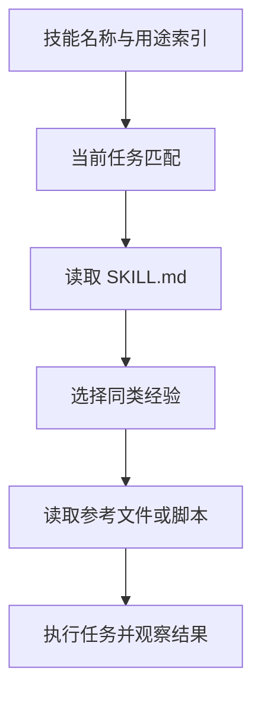
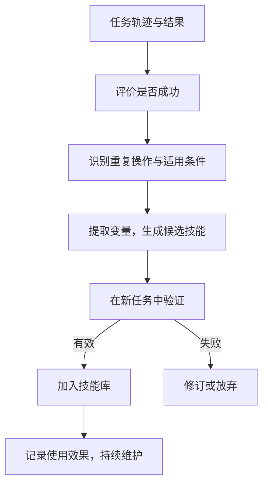

## 课程视频

<div class="bilibili-video" style="position: relative; width: 100%; aspect-ratio: 16 / 9; margin: 1rem 0;">
  <iframe src="https://player.bilibili.com/player.html?isOutside=true&aid=117245443315225&bvid=BV1GSYT6ZEb4&cid=41753117912&page=1&high_quality=1&qn=120&quality=120&danmaku=0&autoplay=0" scrolling="no" border="0" frameborder="no" framespacing="0" allowfullscreen="true" style="position: absolute; inset: 0; width: 100%; height: 100%;"></iframe>
</div>

[B 站高清观看：04 - Memory and Skills for Agents](https://www.bilibili.com/video/BV1GSYT6ZEb4)

[官方录像](https://www.youtube.com/watch?v=6zigF2a-2Pw) · [官方幻灯片](https://www.cmu-agents.com/slides/lecture-04-memory-and-skills.pdf)

## 把重复说明保存下来

本仓库的 `blog-writing` 技能保存了写作要求、文章分类经验和旧文索引。处理新的课程笔记时，模型先读取技能，再按题材查同类文章。我们因此能复用已有写作经验，又让每篇文章根据材料选择自己的结构。

这正好对应第 4 讲关心的问题：任务之间反复出现的经验，应该怎样保存和使用？Daniel Fried 于 2026-09-03 介绍了记忆与技能，既讨论人编写的知识包，也讨论智能体从执行轨迹中提取经验的方法。下面先从仓库中的技能文件开始，再看经验如何归纳、验证和维护。

## 一次经历能留下什么

完成一次任务后，系统能保存不同层次的信息。一次完整修改过程、一个仓库的测试命令、跨任务适用的操作方法，都有复用价值，但需要的表示不同。

| 信息 | 在博客仓库中的例子 | 后续使用方式 |
| --- | --- | --- |
| 工作记忆 | 本篇的目标、读过的资料、尚未处理的小节 | 支持当前任务继续执行 |
| 情景记忆 | 某篇文档的改写轨迹和用户反馈 | 在相似任务中参考具体经历 |
| 语义记忆 | 仓库采用 Hexo，文档位于 `source/wiki/` | 提供相对稳定的事实 |
| 程序性知识或技能 | 按题材查原文、保留嵌入内容、检查构建 | 指导重复执行的方法 |

记忆与技能有交集。智能体从自己的经历中提取出可复用方法，这份技能也属于记忆；人根据已有规范编写的技能，则有独立于执行经历的来源。课程[第 3–6 页](https://www.cmu-agents.com/slides/lecture-04-memory-and-skills.pdf#page=3)按保存位置、经验类型和创建途径进行了讨论。

完整轨迹保留了丰富细节，但输入成本较高。事实记录简短，可能随仓库变更而过期。技能把重复方法抽出来，更容易迁移，也需要说明适用条件。保存形式取决于未来任务需要找回什么。

## 技能怎样组织成文件

### 从说明到资源包

本仓库的写作技能采用如下结构：

```text
.agents/skills/blog-writing/
├── SKILL.md
├── references/
│   ├── article-types.md
│   └── corpus.md
└── agents/
    └── openai.yaml
```

`SKILL.md` 说明用途和处理原则，`article-types.md` 区分不同题材的写法，`corpus.md` 帮助查找旧文。这个目录记录了当前仓库的组织方式；其他技能还可能包含脚本、模板和数据，具体加载规则由执行框架决定。

[OpenHands 的技能写作指南](https://www.openhands.dev/blog/20260227-creating-effective-agent-skills) 将技能描述为可重复使用的说明、脚本与资源集合。它适合承载那些需要反复解释的操作规范，例如代码审查、依赖升级和文档维护。

技能中的步骤应有具体目的。例如“修改完成后运行 `npm run build`”对应文档构建检查；“保留视频 iframe”对应已有嵌入内容的完整性。这类要求能在执行结果中检查，比“输出高质量文章”更容易指导行动。

### 渐进式披露

技能数量增多后，把所有正文塞进系统提示会占据大量上下文。渐进式披露（progressive disclosure）先提供名称和简短描述，匹配任务后加载正文，再根据需要读取引用资源。



以本文为例，知道 `blog-writing` 用于中文博客和学习笔记，就足以决定加载它；课程笔记需要哪些写法，再到分类文件和旧文中寻找。与当前任务无关的安装教程资源，无须全部加入上下文。

描述写得过宽，会让技能频繁介入不适合的任务；过窄又可能错过需要它的场景。名称、描述、适用条件和资源引用，应共同帮助模型判断加载范围。

## 工具与技能怎样配合

工具提供可执行的操作，例如读取文件、搜索内容、运行命令。技能说明怎样组合这些操作，以及应采用什么判断标准。执行写作技能时，模型仍通过文件工具读取旧文，通过编辑工具修改目标文件，通过命令工具检查构建。

下面用一个补充示例表示这种关系：

```text
任务：完善一篇课程笔记
技能：选择同类原文，核对课程来源，沿具体例子解释
工具：read_file、search、edit_file、run_command
结果：正文、引用、构建日志与页面检查
```

技能也能包含可执行脚本。例如统一检查代码围栏、图片路径或特定文件格式，能够减少重复操作。脚本固定了部分行为，文字说明则帮助处理不同题材和例外情况。

技能文件本身不会扩大工具权限。读取外部技能后，框架仍需控制文件、网络和命令访问。来源不明的说明、过期脚本和引用中的指令，都需要按已有授权和执行边界处理。

## 从执行轨迹中提取经验

### 先判断任务结果

人编写技能时能够直接说明规范；智能体自动提取技能时，需要先判断经历是否值得复用。一次运行结束，只说明流程走到了终点，任务是否成功还需要测试、应用状态或用户评价提供依据。

假设模型多次处理同类文档，发现每次都要保留 front matter、核对资料、检查图表。我们能把重复的部分提取为方法，将文章路径、主题和视频地址作为变量。具体的错误标题、某次临时文件名，则不适合写成所有文章都应采用的规则。



这里的验证需要新任务。原任务成功，能证明当时的操作有效；换一篇文章后仍能满足要求，才有依据说明方法具备复用价值。过早把一次偶然成功固化为技能，会扩大错误经验的影响。

### AWM：抽取文本工作流

[Agent Workflow Memory（AWM）](https://arxiv.org/abs/2409.07429) 从任务轨迹中提取常见子过程，保存为工作流供后续任务参考。例如，在不同商品任务中，进入网站、定位搜索框、输入关键词和查看结果会重复出现。

保存时，可以把关键词改为变量，留下过程及其用途。模型在新页面中仍需根据当前观察定位元素，文本工作流为它提供方法上的参考。它能适应一些界面变化，也仍需要模型逐步执行低层操作。

对写作任务来说，“寻找同题材原文，观察概念如何随着例子展开”也属于文本方法。具体选择哪篇旧文、保留多少背景，应由当前文章决定。

### ASI：提取可执行技能

视频从评论搜索轨迹提取出导航与搜索两个函数，展示了程序技能怎样参数化。


*原视频截图：[回到 59:00](https://www.bilibili.com/video/BV1GSYT6ZEb4/?t=3540)。*

[Agent Skill Induction（ASI）](https://arxiv.org/abs/2504.06821) 研究将重复操作提取为程序技能。下面是说明参数化方式的伪代码，浏览器接口由所在系统提供：

```python
def search_product(browser, search_box, query):
    browser.click(search_box)
    browser.fill(search_box, query)
    browser.press("Enter")
    return browser.observe()
```

`query` 是随任务变化的输入，`search_box` 表示当前页面中的定位结果。代码把几个操作组合起来，能够测试和复用，也能成为更大技能的一部分。如果页面提交方式变化，函数就需要修改。

使用代码技能时，应区分参数和前置条件。这个函数依赖搜索框已经定位、页面可以提交，并假设回车会启动搜索。把这些条件写清楚，才便于发现失效原因。文本技能留下较多适应空间，代码技能则固定了更多执行行为。

图中的原任务查询包含某个关键词的评论数量。导航函数打开评论页面，搜索函数接收搜索框、按钮与关键词。这种拆分把固定导航与变化输入分开，但页面元素 ID 仍受当前界面约束，需要由执行时观察取得。

生成函数之后，还要执行一次试用，检查最终状态是否正确、候选技能是否确实被调用。任务碰巧成功，但整个过程绕开了新函数，不能据此证明函数有效。语法和 lint 检查只能发现部分问题，实际任务验证还要检查参数是否影响行为。

讲义举出的一个例子是函数定义了 `color` 参数，却没有在内部使用它。调用 `identify_pill(..., color="White")` 看起来满足接口，执行时实际忽略了颜色条件。检查未使用参数能发现这个问题，再通过界面选择和状态验证确认修复。

程序技能入库时，适合保存签名、前置条件、测试任务与观察结果。新页面上无法定位旧元素时，先重新定位或修订实现；稳定的业务意图仍可能复用。这也解释了为什么同一功能有时需要多个适配实现。

## 失败经验怎样保存

失败轨迹也能提供有用信息，但保存方式需要调整。若把一个反复翻页、最终超时的过程直接作为成功演示，后续模型可能继续模仿低效操作。将失败原因提取为策略，则能帮助避免重走同一路径。

[ReasoningBank](https://arxiv.org/abs/2509.25140) 研究了从成功和失败轨迹中提取推理经验的方法。例如，搜索结果过多时，先调整关键词和筛选条件，再决定是否逐页查看。这种经验保留了调整策略的条件，供下一次任务判断是否适用。

下面构造一条文档任务的失败记录，说明提取后的形式：

```yaml
problem: 自动改写把不同题材都整理成相同的小节
evidence: 原文包含排障转折，改写后丢失了继续调查的原因
lesson: 先确定本文的问题与证据，再选择章节；保留推动调查的观察
scope: 技术博客与学习笔记改写
```

这里保存的是问题、证据和适用范围。经验中有推断时，应与已观察到的现象区分。没有证据的自我评价，例如“本次表现很好”，对后续任务帮助有限。

## 检索、冲突与过期信息

### 选择当前需要的经验

课程先用 SkillsBench 展示人编写技能的评测流程，再讨论检索数量。


*原视频截图：[回到 27:30](https://www.bilibili.com/video/BV1GSYT6ZEb4/?t=1650)。*

技能库越大，检索越需要选择。主题相似不代表步骤相同：源码分析需要沿调用关系展开，安装教程需要沿配置依赖展开。把所有旧经验一起加入上下文，会增加干扰和阅读成本。

检索时应结合任务类型、环境、前置条件和历史效果。可以先按名称与描述筛选，再读取少量候选，检查是否匹配当前版本和目标。过多检索的影响，也应通过任务结果验证。

[SkillsBench](https://arxiv.org/abs/2602.12670) 评测了不同领域的人编写技能。它显示技能的帮助程度取决于任务和技能内容，也存在效果变差的任务。因此，技能是否有用，需要比较启用前后的行为与结果。

这项实验使用人整理的任务与技能配对，覆盖 87 个任务、8 个领域和 18 个模型与 Harness 组合。讲义汇总的平均通过率从 `33.9%` 上升到 `50.5%`，差值为 `16.6` 个百分点；同时有 13 个任务受到负面影响。相关设置与结果见 [SkillsBench](https://arxiv.org/abs/2602.12670)。

解读这组结果时，需要区分两个问题：给出已经匹配好的技能，是否改善执行；从整个技能库中自动找到合适技能，是否也能取得收益。前者的结果不能自动代表后者，因为检索会增加漏选、错选和无关内容。

讲义还观察到技能更集中、数量较少的组往往获益更大。这是实验中的相关现象，适合用来提出后续比较：保持任务、模型和预算一致，逐步加入相关技能，再加入干扰技能，观察完成率、错误类型与上下文开销。技能长度和数量的最佳值需要在具体系统中确定。

检索后的正文也应围绕当前任务使用。一个长技能包含构建、部署和发布步骤，本次只修改学习笔记，执行应按当前授权范围选取相关部分，避免把所有步骤串成固定流程。

### 更新、合并与删除

仓库测试命令变化后，旧事实需要更新；两个技能重复描述同一流程时，需要检查是否合并；长期无效或已经被替代的内容，应退出常用检索范围。

```json
{
  "kind": "repository_fact",
  "content": "文档构建命令为 npm run build",
  "source": "package.json",
  "scope": "当前博客仓库",
  "status": "active"
}
```

这是一种补充的记忆记录格式。`source` 让后续系统能重新核对事实，`scope` 限定使用范围，`status` 支持停用。版本、记录时间和验证结果也能按需要加入。敏感信息应按授权范围保存，避免不必要地复制到通用技能中。

### 判断器出错会怎样影响记忆

记忆系统中的判断器决定哪些轨迹被认为成功，也影响后续提炼出的经验。原视频展示了控制判断准确率的实验。


*原视频截图：[回到 69:20](https://www.bilibili.com/video/BV1GSYT6ZEb4/?t=4160)。*

实验从真实成功标签开始，按固定概率翻转标签，得到不同准确率的模拟判断器。这样能把“记忆方法改变”和“判断质量改变”分开。图中横轴是模拟准确率，纵轴是下游成功率；总体上判断质量下降会损失收益，局部数据点也有波动。

错误判断有两种不同影响。把失败当成成功，可能将不可靠方法作为正向经验；把成功当成失败，可能错过有用方法，或者生成错误反思。保存原始观察和判断依据，能让后续维护重新核对这些记录。

ReasoningBank 从失败中提炼策略，因此失败轨迹仍可能提供“下一次怎样调整”的信息；直接把失败轨迹或失败工作流作为正向演示，模型则可能模仿无效动作。经验表示方式与判断方式应一起选择。

过量检索的实验还提示，更多记忆可能增加无关输入，或超过模型筛选有效信息的能力。这两种原因需要不同改进：前者改进记忆范围和检索，后者研究模型对干扰内容的处理。整合记忆时，应保留适用条件、消除重复，并检查合并是否扩大了原来经验的范围。

## 一条经验怎样进入下一次任务

从自动归纳到实际复用，中间还需要决定何时写入、检索什么以及如何更新。我们沿着博客仓库中的测试命令走一遍：第一次任务读取 `package.json`，看到构建脚本对应 `hexo generate`；系统保存“当前仓库使用 `npm run build`”，下一次文档任务再检索到它。

这条记录需要仓库范围。另一个项目也有 `package.json`，但构建可能要求 `pnpm build` 或额外准备步骤。若把本仓库命令存为“所有文档项目的构建命令”，经验的范围已经扩大，下一次使用就可能出错。

事实也应与建议区分。`package.json` 中存在某个脚本，是能重新读取的事实；“每次修改应运行该脚本”则是执行规范。规范可能来自用户要求或仓库约定，单次成功经历不足以自动创建长期要求。

假设后来仓库把脚本改名为 `generate`，检索到旧命令后，模型还应查看当前文件。更新记录时保留“旧事实已失效，当前来源为新版 `package.json`”，能够解释冲突，减少两个相反命令同时参与后续判断。

下面用逻辑步骤描述这次检索与验证，属于补充流程：

```text
新任务：修改本仓库的一篇课程笔记
检索条件：仓库标识、文档构建、当前工具环境
候选记忆：npm run build；来源为 package.json
验证：读取当前 package.json，检查脚本是否存在
执行：运行当前有效的构建命令
更新：保存本次验证时间和结果，失效记录退出常用检索
```

这里没有要求每次重读所有旧文。稳定且明确的规范能够直接指导工作，容易变化的事实则需要按任务成本核对。记忆检索与验证的预算，应随错误影响调整：一个过期文章标题容易修正，一个过期发布命令可能影响外部状态。

跨任务保存还会遇到偏好冲突。用户在某篇速查文档中要求使用表格，不应自动推导为“以后每篇文章都使用表格”。记忆应带上题材与任务范围；用户提出新的明确要求后，再根据来源和范围处理旧记录。写作技能中的分类经验，正是为了保留这种差别。

对于自动提取技能，版本管理能把归纳结果变成可审查的产物。新技能先作为候选，与旧版本在独立任务中比较，再决定启用。运行失败时，日志需要指出调用了哪个技能版本，否则很难分辨问题来自模型、工具变更还是技能内容。

技能不断增加时，也要检查重复和组合关系。一个技能负责来源核对，另一个负责全文改写，两者可能共享读取资料的步骤。执行系统应按需要组合，避免每个技能重新完成同一项调查。长期没有使用、效果持续下降或来源无法核对的记忆，则适合停用或清理。

## 用新任务检验复用价值

评测技能时，可以在相同模型、工具和任务预算下，比较不使用经验、使用文本技能、使用代码技能三种情况。记录任务成功情况、模型调用次数、耗时和错误恢复，观察复用是否真正减少重复工作。

还应给出变化后的任务。例如搜索页面换了提交方式、仓库修改了测试命令、文章从教程变成资料索引。检查模型能否发现前置条件变化，并修订技能或重新调查。一次技能调用成功，只说明该次匹配有效。

在本仓库中，写作技能的检验也应分题材进行。课程笔记看概念与例子的解释是否完整；排障文章看现象、证据和修改之间是否连贯；资料索引则看分类和链接是否方便查找。共同保存研究方法，各篇保留自己的叙述节奏，才能让经验复用服务于新的任务。

## 参考资料

- [课程安排](https://www.cmu-agents.com/#/schedule)、[第 4 讲幻灯片](https://www.cmu-agents.com/slides/lecture-04-memory-and-skills.pdf)
- [OpenHands：How to Create Effective Agent Skills](https://www.openhands.dev/blog/20260227-creating-effective-agent-skills)
- [SkillsBench](https://arxiv.org/abs/2602.12670)
- [Agent Workflow Memory](https://arxiv.org/abs/2409.07429)
- [Agent Skill Induction](https://arxiv.org/abs/2504.06821)
- [ReasoningBank](https://arxiv.org/abs/2509.25140)
- [MemGPT](https://arxiv.org/abs/2310.08560)
