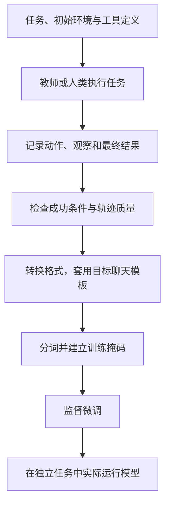
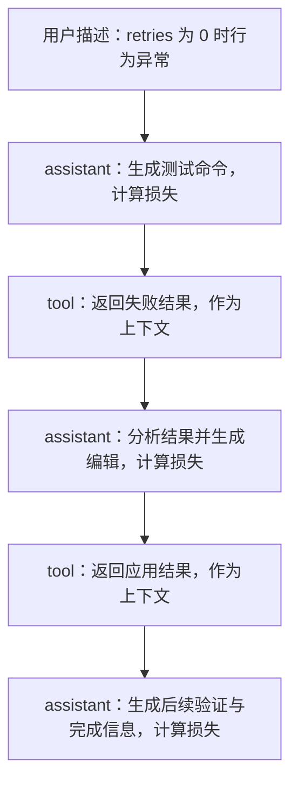

## 课程视频

<div class="bilibili-video" style="position: relative; width: 100%; aspect-ratio: 16 / 9; margin: 1rem 0;">
  <iframe src="https://player.bilibili.com/player.html?isOutside=true&aid=117346324845812&bvid=BV1Aeaq6tEvT&cid=42262661725&page=1&high_quality=1&qn=120&quality=120&danmaku=0&autoplay=0" scrolling="no" border="0" frameborder="no" framespacing="0" allowfullscreen="true" style="position: absolute; inset: 0; width: 100%; height: 100%;"></iframe>
</div>

[B 站观看本讲](https://www.bilibili.com/video/BV1Aeaq6tEvT/)

[官方录像](https://www.youtube.com/watch?v=O3HSU0AoILc) · [官方幻灯片](https://www.cmu-agents.com/slides/lecture-08-sft.pdf)

## 把执行记录变成模型的行为

前面的课程主要改变模型每次调用时看到的内容：工具说明、上下文、技能和任务计划。这一讲由 Yueqi Song 介绍监督微调，研究怎样把执行轨迹写入模型参数，让模型在新的调用中学会相应行为。

假设我们记录了第 6 讲的配置修复过程：用户报告 `retries: 0` 失效，智能体搜索实现、执行测试、修改默认值逻辑，最后确认测试通过。完整记录包含用户输入、模型动作、工具观察和最终回答。这些内容组成一条轨迹。

将轨迹用于训练，首先要回答两个问题：模型在每一步看到了什么？我们希望它学会生成其中哪些内容？工具输出的失败日志提供推理依据，后续编辑则是模型需要学会的动作。两者在数据中都要保存，训练目标各有用途。



这张图中的最后一步决定训练结果是否有实际价值。损失下降说明模型更会预测训练目标，智能体能否解决新任务还需要执行评测。

## 一条轨迹怎样序列化

下面使用简化消息格式展示配置修复的两个回合。字段和文本用于教学说明，实际训练时应使用目标系统的数据协议：

```json
[
  {"role": "user", "content": "配置 retries 为 0 时，仍然重试了三次。"},
  {
    "role": "assistant",
    "tool_calls": [
      {"id": "call_1", "name": "bash", "arguments": {"cmd": "python3 -m unittest -v"}}
    ]
  },
  {
    "role": "tool",
    "tool_call_id": "call_1",
    "content": "test_zero_disables_retry: FAIL; expected 0, got 3"
  },
  {
    "role": "assistant",
    "content": "显式配置的 0 被 or 表达式替换，需要按 None 判断默认值。"
  }
]
```

聊天模板把角色、消息内容、工具调用和结束标记写成模型接受的 token 序列。模型最终处理的是序列，并不会直接读取原始 JSON 中的 `role` 字段。角色信息需要由模板表达。[Transformers 的聊天模板文档](https://huggingface.co/docs/transformers/main/en/chat_templating) 说明了这个转换过程。

不同模型使用不同的特殊标记。工具调用也可能包含专门结构。训练时，应使用与推理系统匹配的模板，并检查追加工具观察后，已经生成的前缀是否保持一致。模板中的条件分支若反过来修改了此前的消息，训练与运行就会出现格式偏差。

轨迹还应记录工具调用 ID 与对应结果。多次调用同时发生时，只有角色顺序不足以判断哪条观察属于哪个动作。记录实际环境版本和工具定义，有助于解释相同命令为什么在另一个环境中得到不同结果。

## 哪些 token 参与损失

原视频用红色框标出受监督的 assistant 回合，工具观察则保留为条件输入。


*原视频截图：[回到 11:10](https://www.bilibili.com/video/BV1Aeaq6tEvT/?t=670)。*

本讲采用的主要目标，是对 assistant 生成的 token 计算交叉熵。用户输入与工具观察作为上下文，参与后续预测；它们通常不作为需要模型模仿生成的目标。

用 `x_t` 表示第 `t` 个 token，`m_t` 表示这个位置是否参与训练，损失可写为：

```text
L(θ) = -Σ m_t × log p_θ(x_t | x_<t)

m_t = 1：模型需要生成的 assistant token
m_t = 0：用户输入、工具观察等条件内容
```

在上面的测试轨迹中，命令和后续分析需要学习，`expected 0, got 3` 则为下一步提供条件。让模型生成工具结果，会混淆智能体与环境各自负责的内容。



掩码还应处理结束标记。模型需要学会结束当前消息、交出工具控制权或完成任务，相关标记应按目标模板进入训练。若正文受监督、终止位置却一直被忽略，模型可能学会内容，却没有学会正确停下。

推理文本是否保留在上下文、是否参与损失，是两个独立选择。保留推理有助于解释后续动作；训练它则会让模型学习相应表达与推理习惯。人为截断产生的标记也需要单独检查，避免把训练管线的截断行为教给模型。

[TRL 的 SFTTrainer 文档](https://huggingface.co/docs/trl/main/en/sft_trainer) 提供 `assistant_only_loss` 等设置，并说明 assistant 掩码对聊天模板的要求。配置项与模板需要配套检查，不能只根据选项名称推断实际标签。

## 检查掩码与预测位置

语言模型训练有一个容易忽略的偏移：位置 `t` 的输出预测下一个 token。为了看清对齐，下面直接用 token 名称演示；真实代码使用 token ID 和向量化操作。

```python
tokens = ["<user>", "问题", "<assistant>", "调用工具", "<end>"]
mask = [0, 0, 0, 1, 1]

pairs = [
    (tokens[:i], tokens[i])
    for i in range(1, len(tokens))
    if mask[i] == 1
]
for prefix, target in pairs:
    print(prefix, "->", target)
```

输出包含两个监督位置：看到 `<assistant>` 后生成“调用工具”，看到“调用工具”后生成 `<end>`。角色前缀在本文示例中由运行系统提供，因此没有作为目标。

实际调试时，可以解码一条训练样本，把每个 token 的角色、掩码与标签打印在一起。若工具参数全部被屏蔽，模型即使学会解释问题，仍然得不到调用格式的训练信号。若工具日志全部进入损失，数据量也可能被大量输出主导。

这种检查应在大规模训练前完成。先用少量样本测试训练管线，确认损失能下降、目标位置正确，再扩大数据集，比等待完整训练后才查格式更容易定位问题。

## 一个小损失怎样计算

沿用前面的 token 例子，假设模型给“调用工具”分配的概率为 `0.8`，给 `<end>` 分配的概率为 `0.5`。这两个数字是为了演示计算而设置的值。采用受监督 token 平均后，损失为：

```text
L = (-log 0.8 - log 0.5) / 2 ≈ 0.458145
```

观察 token 的概率没有进入这个求和，但它们仍然出现在预测动作的前缀中。下面的代码把掩码和归一化一起展开，使用自然对数：

```python
import math


def masked_nll(target_probabilities, mask):
    if len(target_probabilities) != len(mask):
        raise ValueError("length mismatch")
    selected = [
        probability
        for probability, trained in zip(target_probabilities, mask)
        if trained
    ]
    if not selected:
        raise ValueError("no supervised tokens")
    if any(not 0 < p <= 1 for p in selected):
        raise ValueError("invalid probability")
    return -sum(math.log(p) for p in selected) / len(selected)


print(masked_nll([1.0, 0.01, 0.01, 0.8, 0.5], [0, 0, 0, 1, 1]))
```

前三个位置被屏蔽，因此它们在这个计算中的概率不会影响损失。真实训练从模型输出的 logits 计算交叉熵，通常会采用更稳定的数值实现；上面的函数只帮助核对目标选择与平均方式。

如果一条轨迹没有任何受监督 token，这个函数会报错。训练管线也应统计这种情况，防止一批格式转换错误的样本悄悄变成零损失。对于工具调用数据，还应分别统计动作名称、参数和结束标记是否进入目标。

## 长轨迹处理要保留交互边界

假设一条轨迹在长度上限前记录了“运行测试”，工具输出与最终分析却被截断。模型学到发出测试命令，但这条样本没有提供如何使用结果的后续动作。若数据集大量出现这类截断，任务完成方式就可能被系统性改变。

简单保留最后一段也有问题：后半段可能引用此前的文件位置、错误信息和用户约束。处理长轨迹时，应检查哪些依赖被切掉。拆分样本需要保留足够前缀；压缩前缀需要明确如何产生摘要，并让训练与运行采用兼容方式。

工具交互边界尤其容易出错。一个调用带有 ID，后面的结果需要与它对应；多个调用并行返回时，还要保留协议允许的顺序和关联。样本格式检查应在分词之前完成，再在分词之后检查长度与掩码。

对数据清洗，我们能先选少量样本逐条渲染，再把它们放入目标运行系统检查解析。若同一个动作在训练中叫 `shell`，推理工具却叫 `bash`，需要明确适配，而非期待模型自动猜出映射。目标系统的工具签名变化后，已有数据也要重新核对。

每次转换与筛选最好保留版本和规则。某轮实验成功率下降，可能来自数据源改变、掩码变化或截断方式；只保存最终模型权重，很难重建原因。记录各阶段保留了多少任务、轨迹和监督 token，能够把训练结果追溯到实际输入。

## 成功轨迹也需要筛选

强模型或人类执行任务，再保留成功轨迹，是构造智能体监督数据的常见方法。编程任务的测试、网页任务的最终状态检查，都能够帮助判断结果。

不过，最终成功无法保证每个中间动作都值得学习。讲义列出了测试通过却带有问题的轨迹，例如不断重复编辑和测试，或者在最终补丁中留下调试打印。普通监督损失会提高所有被标记动作的概率，连同这些习惯一起学进去。

我们对比三条补充示例轨迹：

| 轨迹 | 执行过程 | 数据处理时关心什么 |
| --- | --- | --- |
| A | 四步定位并修复，测试通过 | 短轨迹是否包含必要观察与验证 |
| B | 首次修改失败，根据日志恢复，最终通过 | 错误与恢复的因果关系是否完整 |
| C | 连续十次执行相同命令，最后偶然成功 | 重复动作是否有新的信息与执行必要性 |

A 不应因为短而自动丢弃，B 提供了恢复经验，C 需要检查重复行为的原因。只按回合数量过滤，无法完成这些判断。

也不能简单删掉 B 中的失败观察。后面的恢复动作正是以失败日志为条件；删除它会改变训练前缀。若决定对某些动作使用不同权重或掩码，需要同时保留真实观察顺序，再通过实验评估这种处理。

教师模型在任务排行榜上的成绩，也不能直接等同于它产生的数据对学生最有效。学生的容量、轨迹长度、工具格式和任务分布都会影响学习。合理做法是在相同训练与评测条件下比较不同教师数据的结果。

### 教师排名和学生表现分别回答什么

视频引用 OpenThoughts-Agent 的教师消融，将不同教师产生的轨迹用于相同学生训练，再看下游任务结果。


*原视频截图：[回到 29:50](https://www.bilibili.com/video/BV1Aeaq6tEvT/?t=1790)。*

表中的每一行对应一种数据来源，后面的基准分数反映训练后的学生表现。课程指出，教师本身的任务能力排名与学生训练收益没有保持相同顺序。在这项设置下，GPT-5.3-Codex 的轨迹产生的学生较弱，而其他教师数据取得了更好的学生结果。这里讨论的是论文的消融设置，结果范围见 [OpenThoughts-Agent](https://arxiv.org/abs/2606.24855)。

一个待验证的解释是，教师使用的解法、推理长度或工具策略可能超出学生易于学习的范围。教师独立执行时能够完成某种复杂操作，学生却可能只模仿了开头，后续遇到错误状态就失去方向。验证这个解释，需要进一步控制轨迹长度、任务分布和工具格式。

选教师时，应把任务完成质量和学生可学习性同时放进实验。先用一致的数据处理、训练预算和评测集比较少量教师，再投入大规模轨迹采样。只根据教师自己的排行榜选择，会漏掉数据对学生的实际影响。

任务源也要单独消融。源码修复、终端操作和网页调查分别包含不同工具与状态。扩充某一来源可能改善相近基准，却对另一类任务帮助较少。按任务类型记录成绩，比一个混合平均分更容易看出变化。

对于数据扩展，讲义比较了继续采样相同任务与增加新任务的路线。重复采样提供不同解法，新任务扩展问题范围；二者对泛化的作用需要分别测量。训练集划分应在采样前考虑，避免一个任务的不同运行跨到评测侧。

## 数据数量还要换算成 token

按轨迹数混合数据时，长任务可能在损失中占据很大比例。假设加入 10 条编程轨迹，每条有 4,000 个受监督 token；再加入 40 条短问答，每条有 200 个受监督 token。

```text
编程：10 × 4,000 = 40,000 个受监督 token
问答：40 × 200 =  8,000 个受监督 token
编程占比：40,000 / 48,000 ≈ 83.3%
```

编程轨迹只占样本数的 20%，却占了约 83.3% 的监督 token。这里假设采用全局 token 平均损失；若按样本归一化，权重关系又会改变。混合配比应同时查看样本、总 token、受监督 token 以及最终损失的归一化方式。

一条轨迹内部也存在类似问题。很长的解释可能压过很短的工具调用参数。需要先测量各部分的长度与错误类型，再决定是否调整采样或权重。

数据规模增加时，还要区分新任务和同一任务的重复运行。重复轨迹丰富了同一目标的解法，新增任务扩大了问题范围。训练与评测划分应把同一任务的全部运行放在同一侧；要检验跨仓库迁移，则需要按仓库划分。

## 多种数据格式如何进入同一套训练

编程、网页和桌面任务可能来自不同采集系统。一个数据集保存 HTML，另一个保存可访问性树，还有一个只保留截图。工具名、参数和终止方式也各不相同。

讲义介绍的 Agent Data Protocol 使用带类型的动作和观察作为中间表示。源数据先转换一次，再由目标运行系统的渲染器生成训练消息。这样能够减少每个数据集与每个运行系统之间分别编写转换器的重复工作。

中间表示应保留原来的信息。例如 HTML 与可访问性树都属于观察，统一格式不必强行将它们压成同一种文字。输出到目标系统时，再选择该系统支持的观察方式。

动作语义也需要验证。某个系统提供“替换文件中的唯一匹配文本”，另一个只提供终端命令，两者即使能完成同一修改，也需要明确转换规则。转换完成后应检查工具参数是否可解析、调用是否有对应观察，以及最终消息是否正确结束。这里的协议介绍依据本讲的格式转换部分。

## 训练管线与实际运行分别检查

视频中的 packing 图保留整条对话，把不同长度的运行装进固定长度训练序列。


*原视频截图：[回到 46:00](https://www.bilibili.com/video/BV1Aeaq6tEvT/?t=2760)。*

长轨迹对序列长度、显存和批处理有直接影响。Packing 将多条轨迹放入一个训练序列，减少填充浪费；同时需要检查对话边界、注意力隔离、位置编号和结束标记的处理。过长轨迹如何截断，也要避免把一半的工具调用或最终验证切掉。

图中第一组放入 `19K、15K、11K、8K` 的运行，第二组放入 `29K、17K、7K` 的运行。K 表示 token 数量的千级单位；这些长度来自课上的示意，说明不同轨迹如何填补空间。

选择剩余空间最贴合的 pack，能减少填充；保持完整对话，则保存了动作与反馈的顺序。这个过程仍需明确每条对话的起止标记和损失位置。即使原轨迹的掩码正确，拼接时错移一段位置，也会把工具观察当成模型目标。

不同对话之间是否允许相互注意，应按训练方法检查。需要独立样本时，应使用相应的注意力边界和位置处理；若方法允许跨样本连接，评测时也应理解它产生的条件。单纯将多段字符串拼在一起，无法表达全部训练约定。

这一讲还提出模板漂移：同一条 assistant 消息，单独渲染和追加 tool 消息后渲染，前面内容可能被条件分支改变。工具循环要求下一轮包含真实的已有前缀，变化会使训练时的条件与部署时不同。

一个实用检查是对同一轨迹保存两种渲染结果，比较已完成回合的 token 前缀是否一致，再解码差异。空格、特殊标记、推理区块和结束标记都应纳入比较。发现漂移后应修订模板或数据转换，避免通过继续训练掩盖格式问题。

训练配置需要与数据匹配。若大量样本在长度上限处被截断，继续调学习率无法补回被删除的执行结果。对于混合专家模型，还需要观察训练分布变化对专家路由的影响；小规模密集模型实验则有不同的资源与调试条件。

讲义建议先检查能否过拟合二十个样本。这是数据与训练管线的诊断：如果连少量样本都学不好，应先查模板、掩码、优化与标签。过拟合成功后，再通过独立任务判断泛化，避免把记住样本当成任务能力。

训练时，模型始终沿着记录好的前缀预测。实际运行时，它可能生成另一条命令，获得训练数据中未出现过的失败结果。接下来的行为必须在真实环境中检查。因此，评测要使用目标工具系统，记录调用解析率、任务成功率、恢复情况和成本，也要覆盖原有能力是否退化。

SFT 为后续强化学习提供一个能基本操作环境的起点。最合适的起点需要结合后续训练结果选择：只追求 SFT 阶段最高分，未必得到最适合继续探索的模型。第 9 讲会从模型自己采样的轨迹出发，把任务结果转成参数更新。

## 参考资料

- [课程 Schedule](https://www.cmu-agents.com/#/schedule)
- [本讲幻灯片](https://www.cmu-agents.com/slides/lecture-08-sft.pdf)
- [Transformers：Chat Templates](https://huggingface.co/docs/transformers/main/en/chat_templating)
- [TRL：SFTTrainer](https://huggingface.co/docs/trl/main/en/sft_trainer)
- [OpenThoughts-Agent](https://arxiv.org/abs/2606.24855)
