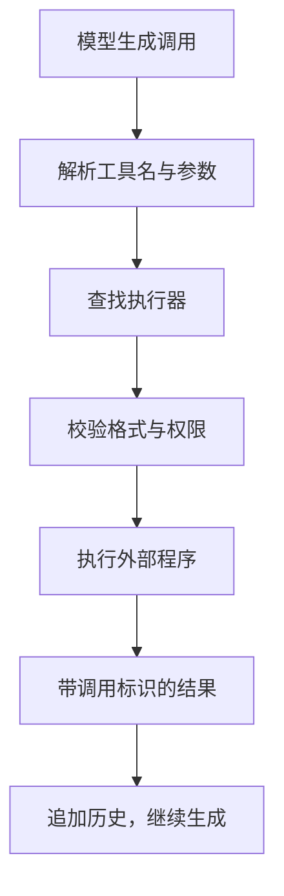
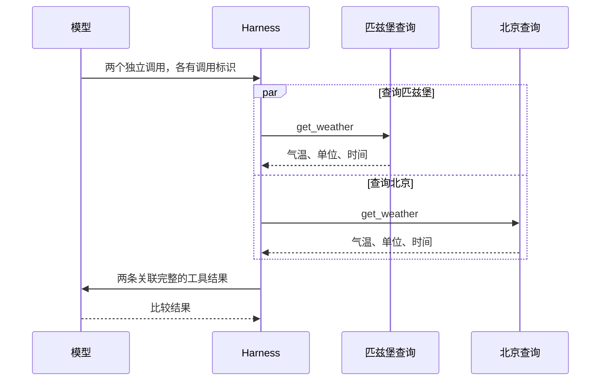

## 课程视频

<div class="bilibili-video" style="position: relative; width: 100%; aspect-ratio: 16 / 9; margin: 1rem 0;">
  <iframe src="https://player.bilibili.com/player.html?isOutside=true&aid=117245426538149&bvid=BV13QYT64Eyq&cid=41753051513&page=1&high_quality=1&qn=120&quality=120&danmaku=0&autoplay=0" scrolling="no" border="0" frameborder="no" framespacing="0" allowfullscreen="true" style="position: absolute; inset: 0; width: 100%; height: 100%;"></iframe>
</div>

[B 站高清观看：02 - Tool Use for Language Model Agents](https://www.bilibili.com/video/BV13QYT64Eyq)

[官方录像](https://www.youtube.com/watch?v=jXChFB4JSyw) · [官方幻灯片](https://www.cmu-agents.com/slides/lecture-02-tool-use.pdf)

## 从一次调用到一组工具

第一讲介绍了模型与 Harness 之间的循环：模型提出行动，框架执行工具，再把结果交回模型。这一讲由 Graham Neubig 于 2026-08-27 授课，继续讨论工具接口怎样设计，以及系统怎样可靠地执行这些调用。

先考虑一个简单任务：比较匹兹堡和北京的当前气温。模型需要获取两地的最新数据，统一单位，再进行比较。查询接口返回什么字段，城市名怎样传入，两个查询能否同时执行，都会影响后续处理。下面沿着这个例子展开；文中的接口和返回数据是用于说明机制的演示。

工具把外部程序的能力暴露给模型。例如，搜索工具提供新资料，计算器执行精确计算，业务 API 读取用户授权的应用状态。[What Are Tools Anyway?](https://arxiv.org/abs/2403.15452) 将工具的作用概括为扩展能力和辅助计算。选择工具时，还要考虑调用的延迟、成本与失败可能性。

## 工具定义怎样进入模型输入

### 名称、用途和参数约束

查询气温的工具定义如下。这里使用简化的函数描述，实际接口外层结构取决于模型服务。

```json
{
  "name": "get_weather",
  "description": "查询指定城市当前的天气，返回气温、单位和观测时间。",
  "parameters": {
    "type": "object",
    "properties": {
      "city": {
        "type": "string",
        "description": "城市名称，例如 Pittsburgh；存在同名城市时补充地区。"
      },
      "units": { "type": "string", "enum": ["C", "F"] }
    },
    "required": ["city", "units"],
    "additionalProperties": false
  }
}
```

`description` 帮助模型判断何时使用这个工具；`parameters` 中的 JSON Schema 约束参数结构。`required` 要求两个字段都出现，`enum` 限定单位，`additionalProperties` 禁止传入未定义字段。这些规则的具体含义见 [JSON Schema 对象文档](https://json-schema.org/understanding-json-schema/reference/object)。

参数描述还承担了业务说明的作用。`city` 是字符串，只能约束数据类型；城市是否存在、同名城市如何消歧，需要接口描述和服务端逻辑共同处理。如果接口默认返回华氏度，模型又直接与摄氏度比较，即使调用格式完全正确，任务结果仍然会出错。

工具输出也应有稳定的含义。气温字段最好同时给出单位、城市解析结果和观测时间，让模型有依据判断数据是否适合当前比较。设计接口时，输入约束与输出语义需要一起考虑。

### 消息格式与 chat template

模型接收到的是序列化后的输入。系统指令、用户消息、工具定义与历史结果，需要经过聊天模板（chat template）转换为模型使用的 token 序列。不同模型可能使用 JSON、特殊 token 或参数标签表达调用，接入层负责相应的转换和解析。

例如，下面是便于阅读的调用内容：

```json
{
  "name": "get_weather",
  "arguments": { "city": "Pittsburgh", "units": "C" }
}
```

这段内容表示模型选择了哪个工具、填写了哪些参数。接口返回的调用标识、消息角色和参数的序列化形式，则由相应协议规定。课程[第 19–25 页](https://www.cmu-agents.com/slides/lecture-02-tool-use.pdf#page=19)展示了消息转换、调用分发和结果关联的过程。

因此，工具定义、聊天模板和调用解析器需要匹配。训练中使用某种参数标签，推理时换成另一套格式，会增加模型表达行动的难度。框架应保留协议要求的结构，再将解析后的参数交给具体工具。

## Harness 如何执行调用

原视频把分发拆成初始化和运行两个阶段。先看这张图，再对照下面的简化实现。


*原视频截图：[回到 24:10](https://www.bilibili.com/video/BV13QYT64Eyq/?t=1450)。*

注册工具时，框架建立名称到执行器的映射；收到调用后，按名称查找执行器、校验参数，并检查权限。下面展示这个过程，属于补充伪代码：

```python
TOOLS = {"get_weather": weather_executor}

def dispatch(call):
    if call.name not in TOOLS:
        return tool_error(call.id, "unknown_tool", call.name)

    arguments = parse_arguments(call.arguments)
    validate_schema(call.name, arguments)
    check_permissions(call.name, arguments)
    result = TOOLS[call.name](**arguments)
    return tool_result(call.id, result)
```

`TOOLS` 解决名称查找，Schema 校验处理参数结构，权限检查确定这次操作是否允许执行。工具执行后，返回消息携带原调用的标识。即使多个查询完成的顺序不同，框架也能将每条结果关联到相应城市。



图中初始化时的 `resolve_tool(spec, state)` 将工具声明与当前环境连接起来，建立名称到工具定义的映射。声明中的参数 Schema 告诉模型如何填写输入，执行器则提供实际操作能力。将这两部分分开，能够在模型调用前完成配置，减少每轮重复解析环境。

运行时，模型输出先被解析为名称与参数，再查找映射中的工具。参数构造为对应的 Action，执行器返回 Observation；调用 ID 随结果保留。Action 表达“要执行什么”，Observation 记录“执行后获得什么”。框架需要把真实返回结果交回模型，后续决策才有依据。

工具定义与实现还应保持同步。例如 Schema 要求 `city` 和 `units`，执行器却只接受 `location`，调用在模型一侧合法，到运行时仍会失败。接口升级时，应一起检查工具声明、参数转换、执行器签名和错误封装。这里的对象名称取自视频中的分发示意图，具体类与方法由所用 Harness 实现。

返回结果需要提供可用的观察。查询成功时，模型读取气温和单位；城市无法解析时，模型可能补充地区信息；服务超时时，框架需要说明失败类型。把这些情况都转成一个空字符串，会让下一轮缺少判断依据。

## 调用成功后还要检查数据

我们补齐天气比较中的返回内容。假设两个接口分别返回摄氏度和华氏度，模型或程序需要先转换单位。下面的数据继续使用演示值：

```json
[
  {"call_id": "weather_p", "city": "Pittsburgh", "temperature": 18, "units": "C"},
  {"call_id": "weather_b", "city": "Beijing", "temperature": 68, "units": "F"}
]
```

直接比较 `18` 与 `68`，会把表示单位的差异当成气温差异。将华氏度换算为摄氏度后，北京为 `20°C`，比匹兹堡高 `2°C`。一个没有访问真实天气服务的转换练习如下：

```python
def to_celsius(observation):
    value = observation["temperature"]
    unit = observation["units"]
    if unit == "C":
        return value
    if unit == "F":
        return (value - 32) * 5 / 9
    raise ValueError(f"unsupported unit: {unit}")


pittsburgh = {"temperature": 18, "units": "C"}
beijing = {"temperature": 68, "units": "F"}
print(to_celsius(beijing) - to_celsius(pittsburgh))
```

这个转换解决了单位问题，观测时间仍需要检查。一个接口返回刚更新的数据，另一个返回昨天的数据，转换后也不能直接作为当前气温比较。工具协议和业务有效性应分别验证，后者往往需要结合用户任务判断。

错误结果同样适合明确结构。服务正常返回“城市不存在”，表示请求已被处理、业务结果失败；HTTP 请求根本没有完成，则连业务结果都未获得。这两种状态会引出不同的恢复动作。

```json
{
  "call_id": "weather_b",
  "ok": false,
  "error": {
    "code": "ambiguous_city",
    "message": "存在多个同名城市，需要补充地区。",
    "retryable_without_changes": false
  }
}
```

这是本文定义的错误格式。`retryable_without_changes` 为假，提示框架重复发送相同参数不会解决问题。模型需要根据已有任务信息消歧，必要时获取缺失信息。网络超时、限流和参数歧义应有不同的处理路径。

还有一种错误发生在调用解析之前：模型输出了半截参数，解析器尚未得到一个完整对象。此时应记录原生成内容和解析问题，要求重新生成合法调用，避免把未校验的字符串直接交给执行器。对于参数检查抛出的异常，前面的分发伪代码还需补充捕获与结果封装。

批量调用时，每个结果都应保留自己的状态。匹兹堡查询成功、北京查询失败，不能把整个批次写成“天气查询失败”后丢弃前者。保留已完成结果能减少重复调用，也便于在预算不足时明确报告目前获得了什么。

## 约束解码怎样减少格式错误

### 从生成后校验到生成中约束

普通生成可能输出少一个括号的 JSON，也可能把 `units` 写成 `"K"`。生成后校验能发现这些问题，再要求模型修正。约束解码（constrained decoding）则在每一步生成时，排除无法延续成合法结构的 token。

以单位枚举为例，在读取到 `"units":` 后，允许的值由 Schema 决定。解码器结合已经生成的前缀，计算下一步允许的 token 集合，将其他候选的概率屏蔽，再从剩余候选中选择。

```text
当前前缀：{"city":"Pittsburgh","units":
合法延续："C" 或 "F"，以及语法允许的空白
完成之后：关闭字符串，再关闭对象
```

这里描述的是字符层面的合法结构。实际 token 可能包含多个字符，也可能只覆盖一个字符串的一部分，所以解码器需要检查 token 解码后的内容与当前语法状态是否相容。

### 嵌套结构与 XGrammar

原视频的 token masking 图把语法检查与模型推理放在同一条生成路径上。


*原视频截图：[回到 33:20](https://www.bilibili.com/video/BV13QYT64Eyq/?t=2000)。*

JSON 对象和数组能够嵌套。检查器除了记录当前字段，还需要记住嵌套结束后应返回哪个位置，下推自动机（pushdown automaton）的栈可以表达这种关系。[XGrammar](https://arxiv.org/abs/2411.15100) 进一步区分可预先检查的 token 与依赖当前语法状态的 token，通过缓存、持久化栈和推理计算重叠来减少检查开销。

回到天气工具，约束解码能帮助生成符合 Schema 的 `city` 和 `units`。城市选择是否符合用户要求、查询权限是否足够、返回数据是否可信，还需要后续检查。格式约束所覆盖的范围，在接口设计和评测中应明确记录。

### 掩码怎样改变采样概率

图中模型先得到一组 logits，语法检查器根据当前结构和已生成前缀给出允许集合。被禁止的候选设为负无穷，再做 softmax，得到的概率为零；剩余候选重新归一化，然后进入采样器。

用三个候选举例，原 logits 为 `[2, 1, 0]`，假设第二个 token 会破坏当前 JSON 结构，那么合法集合为第一个和第三个。二者的概率约为 `[0.8808, 0.1192]`，非法 token 的概率为 `0`。下面是这个过程的标准库演示：

```python
import math


def constrained_probabilities(logits, allowed):
    if len(logits) != len(allowed):
        raise ValueError("length mismatch")
    valid = [value for value, ok in zip(logits, allowed) if ok]
    if not valid:
        raise ValueError("no valid continuation")
    offset = max(valid)
    weights = [math.exp(value - offset) if ok else 0.0
               for value, ok in zip(logits, allowed)]
    total = sum(weights)
    return [weight / total for weight in weights]


print(constrained_probabilities([2, 1, 0], [True, False, True]))
```

减去 `offset` 是数值稳定处理，不改变归一化后的比例。真实推理引擎还要处理词表、批次、token 解码后的字节和多个语法状态。一个 token 若同时包含引号、逗号和字段名，检查器需要判断整个片段的合法性。

约束检查也有运行成本。XGrammar 的缓存减少重复词表检查，持久化栈支持共享与分支，CPU 语法工作和 GPU 推理尽量重叠。评估时应比较总生成延迟、格式失败率和最终任务结果；仅看到合法 JSON 增多，仍无法判断整个工具流程的收益。

## 文本动作、函数调用与代码动作

下面这张视频画面展示了代码怎样组合内置运算、外部库和视觉辅助函数。


*原视频截图：[回到 11:40](https://www.bilibili.com/video/BV13QYT64Eyq/?t=700)。*

工具调用也有不同的表达方式。文本动作通过命令或特定标记表达意图；结构化函数调用提供固定名称和参数；代码动作让模型生成程序，由解释器执行。

| 形式 | 演示 | 接口特点 |
| --- | --- | --- |
| 文本动作 | `weather Pittsburgh C` | 需要约定命令语法和解析方式 |
| 函数调用 | `get_weather(city="Pittsburgh", units="C")` | 参数结构明确，适合局部校验 |
| 代码动作 | 循环查询多个城市并计算结果 | 能组合控制流、变量和库函数 |

假设要处理一批城市，代码动作能在一次执行中组织重复查询和数据转换。下面只演示组合方式，`get_weather` 表示已经提供的接口：

```python
cities = ["Pittsburgh", "Beijing"]
observations = [get_weather(city=city, units="C") for city in cities]
coldest = min(observations, key=lambda item: item["temperature"])
print(coldest["city"], coldest["temperature"])
```

这段代码使用变量保存结果，再进行比较。[CodeAct](https://arxiv.org/abs/2402.01030) 研究了以可执行 Python 代码统一表达行动的方法，也允许根据执行结果在后续轮次修改代码。代码具有更大的表达空间，执行环境相应需要限制文件、网络和资源访问。

这个例子还有一个接口约定：所有查询都应返回摄氏度和相同含义的气温字段。程序能完成比较的前提，是输入数据语义一致。代码组合提高了表达能力，也让错误处理和数据约定成为执行的一部分。

从图中的三个例子看，代码承担的不只是一次函数调用。面包数量任务把题目中的数量关系写成运算；表格任务引入数据处理库，读取年份与假期数据；视觉任务先定位人物和区域，再调用后续识别方法。变量与控制流把中间产物连接起来，减少模型反复用文本转述数值的需要。

这种组合也改变了反馈粒度。多个操作放在一次程序执行里，框架可能只获得最终输出；中间查询失败时，需要异常、日志或结构化返回解释失败位置。对一批天气数据，可以逐项保存成功结果和错误，最后返回已完成城市与缺失城市，避免一个异常使整批有效数据丢失。

工具粒度因此要跟任务匹配。固定业务动作适合清晰的函数接口，开放的数据处理适合代码组合。比较时应保持模型、任务和预算一致，并检查调用次数减少之后，是否增加了隐藏在程序内部的网络请求、执行时间或恢复开销。

## 从库函数、REST 到 MCP

同一个天气能力，既能以进程内函数提供，也能通过 HTTP 服务调用。库函数在调用者进程中执行；REST 接口需要确定地址、HTTP 方法、参数编码和认证方式。模型生成的工具调用可以由 Harness 转换为 HTTP 请求。

```text
get_weather(city="Pittsburgh", units="C")
    ↓ Harness 适配
GET /weather?city=Pittsburgh&units=C
    ↓ 天气服务
{"city":"Pittsburgh","temperature":18,"units":"C"}
```

上面的温度是演示数据。OpenAPI 描述 HTTP 操作及其参数，MCP（Model Context Protocol，模型上下文协议）则提供工具发现和调用协议。按照 [MCP 工具规范](https://modelcontextprotocol.io/specification/2025-11-25/server/tools)，客户端通过 `tools/list` 获取定义，再通过 `tools/call` 发起调用。

MCP 服务可以封装上游 REST API。客户端认证到 MCP 服务，服务再使用自己的凭证访问上游；这样能够分别管理两段访问关系。是否采用 MCP，应根据工具发现、接入和权限管理需求决定。直接调用 REST 也需要完整处理这些职责。

| 层次 | 需要解决的问题 |
| --- | --- |
| 模型工具定义 | 模型怎样选择能力、填写参数 |
| Harness 适配 | 怎样解析调用、组织结果并管理权限 |
| REST / MCP 接口 | 怎样发现或请求服务、传输数据、认证访问 |
| 实际执行器 | 怎样获得正确结果并报告执行错误 |

## 两次查询如何并行执行

比较两地天气时，两个查询通常相互独立。模型可以在一轮中提出两次调用，框架同时执行，收齐结果后再请求模型比较。串行执行则需要等待第一轮返回，再发起下一轮。

假设每次模型生成耗时 `g`，两个工具分别耗时 `t1`、`t2`，忽略其他开销，串行过程约为 `3g + t1 + t2`，并行过程约为 `2g + max(t1, t2)`。这是便于理解的估算，真实耗时还受排队、网络和并发限制影响。



依赖关系会限制并发。例如先查客户 ID，再用 ID 读取订单，就需要按顺序执行。两个操作即使输入独立，也可能同时修改同一对象，还要检查并发冲突。并发调度应依据数据依赖和副作用设计。

## 错误恢复与工具使用评测

工具失败时，先区分错误发生在哪一层。未知工具、缺失参数属于调用问题；认证失败需要检查凭证；超时和限流需要执行策略处理。错误结果应携带类型、原因及必要的上下文，避免模型把失败当成空数据继续比较。

对于两地天气任务，一条查询成功、一条超时时，已有结果应保留。是否重试、允许多少次重试、最终怎样报告缺失数据，需由任务预算和工具行为决定。写操作还要考虑重复执行的影响，防止超时后重试产生重复提交。

[Berkeley Function-Calling Leaderboard](https://gorilla.cs.berkeley.edu/leaderboard.html) 是课程介绍的工具调用评测之一。评测既能检查选择和参数，也应结合执行过程验证任务是否完成。下面是围绕本文例子整理的观察方式。

| 观察层次 | 天气比较任务中检查什么 |
| --- | --- |
| 工具选择 | 是否确实获取了当前天气 |
| 参数 | 城市、地区和单位是否正确 |
| 调用轨迹 | 查询是否遵守依赖、结果是否关联正确 |
| 最终结果 | 是否依据返回数据比较，是否说明缺失信息 |
| 执行开销 | 调用次数、耗时、重试与 token 用量 |

动手实现时，可以先使用固定天气数据验证分发与结果关联，再模拟城市不存在、超时和乱序返回。把同一组任务分别交给串行和并行执行器，检查答案是否一致、局部失败是否影响其他结果。这样得到的日志，也能成为下一讲研究上下文增长的材料。

## 参考资料

- [课程安排](https://www.cmu-agents.com/#/schedule)、[第 2 讲幻灯片](https://www.cmu-agents.com/slides/lecture-02-tool-use.pdf)
- [What Are Tools Anyway?](https://arxiv.org/abs/2403.15452)
- [CodeAct](https://arxiv.org/abs/2402.01030)
- [XGrammar](https://arxiv.org/abs/2411.15100)
- [JSON Schema 对象文档](https://json-schema.org/understanding-json-schema/reference/object)
- [MCP 工具规范](https://modelcontextprotocol.io/specification/2025-11-25/server/tools)
- [Berkeley Function-Calling Leaderboard](https://gorilla.cs.berkeley.edu/leaderboard.html)
