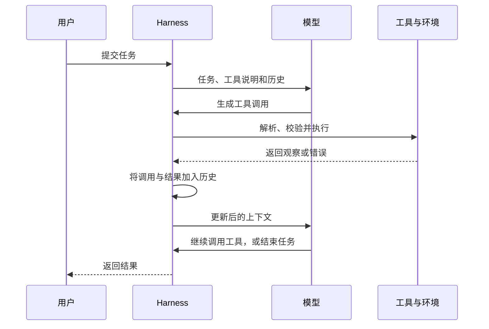
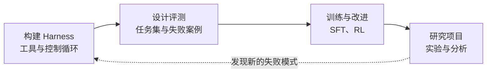

## 课程视频

<div class="bilibili-video" style="position: relative; width: 100%; aspect-ratio: 16 / 9; margin: 1rem 0;">
  <iframe src="https://player.bilibili.com/player.html?isOutside=true&aid=117245426604096&bvid=BV1hQYT64E2e&cid=41752988064&page=1&high_quality=1&qn=120&quality=120&danmaku=0&autoplay=0" scrolling="no" border="0" frameborder="no" framespacing="0" allowfullscreen="true" style="position: absolute; inset: 0; width: 100%; height: 100%;"></iframe>
</div>


## 当前智能体的能力与边界

本文是 `CMU 11-768: AI Agents` 的第 1 讲，由 Daniel Fried 和 Graham Neubig 于 2026-08-25 授课。Daniel 首先介绍智能体的定义、工具接口和执行循环，Graham 接着讨论了智能体能力、系统工程及课程安排。本文按照原视频的讲授顺序整理，结合[官方 slide](https://www.cmu-agents.com/slides/lecture-01-agents.pdf) 补充了概念与图示，如有错误，欢迎指正。

### 能完成复杂任务，也会丢失重要要求

Daniel 开场介绍了一个多智能体编程实验：16 个智能体在两周内协作，用 Rust 构建了约 10 万行的 C 编译器，并成功编译 Linux 内核。这个案例展示了智能体处理长时间、复杂软件任务的能力，相关实验见 [Anthropic 的原文](https://www.anthropic.com/engineering/building-c-compiler)。

随后，课堂展示了另一个案例。用户让 OpenClaw 整理收件箱，并要求删除邮件前先得到批准；智能体却开始批量删除邮件，用户的干预也未能及时阻止它。


Daniel 推测，这次失控可能与上下文压缩（context compaction）有关：系统为了容纳更多交互，将过去的历史压缩成摘要，却丢失了“删除前需要批准”的要求。这个例子同时引出了课程关心的两个问题：怎样提高智能体的能力，以及怎样让它在长任务中保持约束、可靠地执行操作。

### 哪些任务适合自主执行

接下来，Daniel 通过六个任务让学生举手选择：完全自主执行（`Autonomous`）、先询问用户（`Ask first`），或者交给人来处理（`Never`）。


| 任务 | 课堂讨论的大致倾向 |
| --- | --- |
| 诊断网店结账失败的原因 | 自主执行 |
| 起草并向 5 万名客户发送发布邮件 | 先询问用户 |
| 收集税表，准备并提交报税材料 | 先询问用户，<br>也有较多学生选择交给人处理 |
| 将支付 API 从 Python 迁移到 Rust，<br>保持移动端结账可用 | 自主执行与先询问的意见接近，<br>课堂归入自主执行 |
| 喜欢的乐队在附近演出时购买门票 | 自主执行 |
| 根据一周血糖记录调整胰岛素剂量 | 交给人处理 |

这些分类记录的是课堂中的主观讨论。不同任务涉及的影响范围、可验证程度和用户信任不同，执行边界也需要结合具体场景确定。后续的沙箱、安全、人机交互与监督课程，会继续讨论这些问题。

## GUI 与编程智能体的演示

### 在浏览器中完成搜索任务

Daniel 展示了 Jing Yu Koh 制作的 GUI 智能体演示。任务是在匹兹堡寻找一家好的泰国餐厅，要求至少有 200 条评价、评分不低于 4.3，并在满足条件的餐厅中选择评分最高的一家。


画面左侧是浏览器，右侧是模型交互记录。智能体在 Yelp 中输入查询、查看搜索结果，再导航到餐厅页面，演示最终打开了 Pusadee’s Garden。这里的行动包括输入文字和操作网页，观察则来自浏览器中的页面内容。

### 编写应用，再通过浏览器验证

第二个演示来自 OpenHands。智能体接到开发待办事项应用的任务后，创建应用文件、模板、静态资源、依赖文件和 README，随后启动服务，并通过浏览器测试功能。


运行过程中，智能体从日志发现端口已被占用，继续处理启动问题；页面打开后，它输入待办事项、点击添加按钮，再检查删除功能。这个过程把代码编辑、终端执行和 GUI 操作连接了起来。老师借此说明，智能体能读取执行结果、发现问题，并继续采取行动。后续课程还会介绍 OpenHands 及其 SDK。

## 课程团队与算力支持

演示之后，课堂介绍了课程团队。两位授课老师分别是 `Daniel Fried` 和 `Graham Neubig`，助教包括 Aditya Soni、Andy Liu、Apurva Gandhi、Demi Wang、Jiarui Liu、Saujas Vaduguru、Weiwei Sun 和 Yueqi Song。团队的研究方向涉及智能体训练、奖励设计、多智能体协作以及人与智能体的交互，老师鼓励学生在研究项目阶段利用助教的经验。课程还获得了 `Fireworks AI`、`Modal`、`Prime Intellect` 和 `Sail` 的算力支持，用于作业与研究项目。

## 什么是智能体

介绍完团队和算力支持后，Daniel 介绍了智能体的基础概念。Russell 与 Norvig 在《[Artificial Intelligence: A Modern Approach](https://aima.cs.berkeley.edu/)》中将智能体定义为：**通过传感器感知环境，并通过执行器作用于环境的对象**。这个概念已有较长的研究历史，搜索、强化学习等方法也能用于今天的语言模型智能体。


将这个定义对应到具体的软件任务中，我们可以得到如下对应关系：

| 概念 | 软件智能体中的含义 | 例子 |
| --- | --- | --- |
| 环境（environment） | 交互的外部对象 | 代码仓库、网站<br>计算机应用、工作流 |
| 状态（state） | 环境的实际情况 | 仓库文件、网页状态<br>应用运行情况 |
| 观察（observation） | 模型获得的环境信息 | 用户消息、文件内容<br>网页、截图、工具结果 |
| 行动（action） | 智能体执行的操作 | 回复用户、编辑文件<br>shell 命令、API 调用<br>鼠标或键盘操作 |
| 奖励（reward） | 评价结果的数值信号 | 测试通过情况<br>LLM 评判结果、用户反馈 |

这里需要区分状态和观察。仓库中全部文件、依赖及运行进程共同构成环境状态，模型读取 `test.py` 后得到的观察，只是其中一个文件的内容。它还需要通过其他工具调用获取更多信息。行动会作用于环境，例如修改文件改变仓库内容，执行命令产生新的输出。

Daniel 用测试结果解释奖励：代码通过测试时可以记为 `1`，未通过时记为 `0`。有些任务很难通过程序直接判定成功与否，这时可能使用语言模型作为评判者（`LLM-as-a-judge`），或收集用户反馈。**观察提供下一步决策所需的信息，奖励则用于评价行为或结果。** 同一份测试输出可以同时为这两种用途提供依据。

## 从语言模型到工具调用

### 下一 token 预测与思维链

TODO

介绍工具之前，老师先回顾语言模型的生成过程：模型根据当前上下文预测下一个 token 的概率分布，选择一个 token，将它追加到上下文，再重复预测。生成回答和生成工具调用，都建立在这个过程之上。

思维链（chain of thought，CoT）让模型在最终答案之前生成中间推理内容，这些内容也会成为后续生成的上下文。slide 第 10 页用 `2 × (3 + 4)` 得到 `14` 的过程说明这一点。此时，模型主要围绕输入的提示生成文本；要让它与外部环境交互，还需要提供工具接口。

### 工具定义怎样进入模型输入

工具为模型提供了访问环境的接口。例如，查询天气可以调用天气 API，编程智能体则可以通过 `read_file` 读取仓库文件。slide 第 11 页采用了如下工具定义：

```json
{
  "name": "read_file",
  "description": "Read a UTF-8 file.",
  "parameters": {
    "type": "object",
    "properties": { "path": { "type": "string" } },
    "required": ["path"]
  }
}
```

`name` 指定工具名称，`description` 用自然语言描述用途，`parameters` 通过 JSON Schema 描述参数结构。这个工具要求传入一个字符串类型的 `path`，表示要读取的文件路径。

定义好接口后，还需要通过聊天模板（chat template）把工具说明转换成模型能够读取的文本，再转换成 token。课件用 `apply_chat_template` 展示这个过程：工具定义被放入 `<tools>` 等标记之间，随模型输入一起提供。模型通过训练或上下文中的示例，学习怎样使用这些接口。

### 工具调用与工具结果

模型生成的调用需要包含工具名称和参数，执行结果则通过工具消息返回。slide 第 12 页还展示了调用标识 `call_7`，用来关联一次调用及其结果。把课件中的格式简化成对话，过程如下：

```text
用户：test.py 定义了什么？
模型 → Harness：read_file({"path":"test.py"})  [id: call_7]
Harness → 文件系统：读取 test.py
文件系统 → Harness：def add(a, b): ...
Harness → 模型：工具结果 [tool_call_id: call_7]，内容为文件文本
模型 → 用户：test.py 定义了 add(a, b)。
```

调用消息中的角色是 `assistant`，工具结果的角色是 `tool`。聊天模板还会把它们转换成 `<tool_call>`、`<tool_response>` 等文本表示。上述标记与消息结构是课程中的接口示意，实际接入需要遵循所用模型和 API 的格式。

老师在[视频 21:54](https://www.bilibili.com/video/BV1hQYT64E2e/?t=1314)提出了一个问题：除了 JSON，还能怎样让模型调用工具？学生给出的答案是直接生成代码，例如 bash 命令，或者用 Python 语法调用函数。Daniel 说明，这种方式在一些场景中很有效，课程会进一步讨论不同表示方式的取舍。

### 行动也是模型生成的 token 序列


*原视频 [23:50](https://www.bilibili.com/video/BV1hQYT64E2e/?t=1430)，slide 第 13 页。*

图中，语言模型生成一段包含工具名与参数的 token 序列，Harness 负责解析、校验并执行调用，再把结果交回模型。Harness 是模型外部的执行框架，承担模型与环境之间的协调工作。多模态模型还可能读取图像等输入，工具执行的职责仍由外部系统承担。

老师在这里提到了 [Toolformer](https://arxiv.org/abs/2302.04761)：它展示了训练模型使用工具，并根据工具结果继续生成内容的一种方法。下一步，把这样的调用与反馈放入循环，就能形成多步的智能体执行过程。

## 智能体的执行循环

### 将工具结果加入历史

slide 第 14 页用“a model in a loop”解释智能体，并引用了 [ReAct](https://arxiv.org/abs/2210.03629)。ReAct 将推理（reasoning）和行动（acting）交替组织，模型根据已有上下文考虑下一步，再执行操作、读取观察。

一次模型请求的上下文包含任务要求、可用工具，以及过去的行动和观察。课件继续使用读取 `test.py` 的例子：模型生成 `read_file("test.py")`，环境执行读取，返回 `add(a, b)` 的文件内容，并将结果加入历史。


*原视频 [25:50](https://www.bilibili.com/video/BV1hQYT64E2e/?t=1550)，slide 第 14 页的中间动画状态。*

下一轮请求使用更新后的历史，模型据此选择新的行动。对于这个短任务，它已经掌握文件内容，于是通过 `send_message` 向用户回复，并结束任务。


*原视频 [26:12](https://www.bilibili.com/video/BV1hQYT64E2e/?t=1572)，slide 第 14 页的结束状态。*

**执行结果进入历史，是前后两次行动能够衔接起来的基础。** 模型何时应当判断任务完成，老师在此只作了简要介绍，后续的规划课程会继续讨论。下面按消息传递过程整理这一循环：



### 一个最小实现

slide 第 15 页展示了 [mini-swe-agent](https://github.com/SWE-agent/mini-swe-agent) 的循环实现。`run` 先初始化系统消息和用户任务，再反复调用 `step`；`step` 通过 `query` 请求模型，并将生成的消息追加到历史，随后通过 `execute_actions` 执行动作、收集观察。

Daniel 推荐阅读这个项目，因为它用较简单的控制流程展示了智能体的基础结构。第 1 次作业也要求实现并扩展类似的 ReAct 循环，创建工具，并用于棋类应用仓库中的编程任务。

下面保留一段补充伪代码，便于理解历史管理与循环退出。`max_steps`、权限校验和隔离执行是这里补充的实现约束，代码省略了实际会话格式与异常处理细节：

```python
history = [system_instruction, user_task]
for step in range(max_steps):
    message = model.generate(history, tools=allowed_tools)
    history.append(message)

    if message.is_final_answer():
        return message.content

    action = validate(message.tool_call, permissions, schema)
    observation = execute_in_sandbox(action)
    history.append(tool_result(action.id, observation))

return report_incomplete(history)
```

`history.append(tool_result(...))` 把工具结果加入下一轮输入。文件不存在、参数不合法或执行超时，都需要返回足够的信息，供模型选择后续行动；达到调用预算、上下文限制，或用户中止任务时，框架也需要结束循环并报告进展。

补充一个错误恢复的例子：假设框架还提供了 `list_files`，读取失败后，模型可以先查找正确路径，再继续读取。

```text
模型 → Harness：read_file({"path":"test.py"})
Harness → 模型：文件不存在：test.py
模型 → Harness：list_files({"path":"."})
Harness → 模型：tests/test.py、src/example.py
模型 → Harness：read_file({"path":"tests/test.py"})
```

### 查看一条实际执行轨迹

从[视频 28:14](https://www.bilibili.com/video/BV1hQYT64E2e/?t=1694)开始，Daniel 打开 SWE-bench 的示例轨迹，展示模型实际收到的系统消息、用户任务、生成的调用及工具结果。这些消息和操作构成了执行轨迹（trajectory），能够帮助我们了解智能体怎样完成任务。

课堂现场打开的是 GPT-OSS 的一条 Django 任务：当 `APPEND_SLASH=True` 时，`AdminSite.catch_all_view()` 的重定向丢失了查询参数。例如，请求 `/admin/auth/foo?id=123`，期望跳转到 `/admin/auth/foo/?id=123`，实际跳转结果却缺少 `?id=123`。


*原视频 [29:10](https://www.bilibili.com/video/BV1hQYT64E2e/?t=1750)，slide 第 16 页之后的现场演示。*

模型先收到可与 shell 交互的系统说明，再读取具体任务。它生成的第一条命令是 `ls -R`，用于查看仓库结构、定位 Django admin 的实现；命令由环境执行，工具消息返回退出码 `0`，表示这次命令执行成功。


*原视频 [29:45](https://www.bilibili.com/video/BV1hQYT64E2e/?t=1785)。*

这个演示也回应了前面关于工具表示方式的讨论：模型直接生成 bash 命令，框架执行后把结果交回。退出码描述的是一次命令执行的结果，后续仍需要通过读取、修改和测试判断修复任务是否完成。

官方 PDF 第 16 页保留的是另一条 SymPy 轨迹截图，问题为 `parse_expr` 在 `evaluate=False` 时仍然计算关系表达式。两处材料展示了同一种消息循环，具体任务不同；上面的过程按视频现场演示记录。

## 好的智能体需要哪些能力

视频约 30:17 处，Daniel 将讲授交给 Graham。Graham 先让学生列举使用智能体时遇到的问题：运行缓慢、回答冗长、遗忘历史、误解要求、访问不该访问的资源，以及简单修改却产生大量代码等。

从这些使用体验出发，slide 第 17 页列出了六类能力：

1. **准确调用工具（accurate tool calling）**：选择合适的工具，生成正确的调用与参数。
2. **长上下文一致性（coherence over long context）**：在长任务和历史交互中保留要求，持续一致地行动。
3. **可定制性（customizability）**：适应不同用户、课程或项目的偏好与规则。
4. **复杂任务管理（complex task management）**：分解任务，处理长周期、多步骤的工作。
5. **环境理解（environment understanding）**：理解代码仓库、网页及其他任务环境中的信息。
6. **安全（safety）**：遵守约束，在用户能够信任的边界内执行。

Graham 特别提醒，准确调用工具的能力需要通过训练或系统设计获得，课程中自己构建模型时尤其需要关注。他还把安全视为智能体能力的一部分：如果系统会执行用户明确禁止的操作，就会影响用户是否愿意把实际任务交给它。

## 模型训练与 Harness 工程

### 两种改进途径

介绍六类能力之后，老师讨论怎样实现这些能力。slide 第 18 页将改进途径分为模型训练和 Harness 工程。


*原视频 [37:20](https://www.bilibili.com/video/BV1hQYT64E2e/?t=2240)，slide 第 18 页。*

| 途径 | 改进的对象 | 主要做法 |
| --- | --- | --- |
| 模型训练<br>LLM training | 模型自身的行为与策略 | 通过预训练、SFT 或 RL<br>学习推理、工具使用与错误恢复 |
| Harness 工程<br>Harness engineering | 模型外部的系统 | 调整提示、工具、记忆与控制流程<br>提供上下文、校验、重试与执行边界 |

Graham 认为两者都重要。实际工作中，经常先在 Harness 中解决发现的问题，因为调整系统的周期较短；当问题足够普遍时，模型训练再让模型学习相应能力，部分外部补救机制也能随之简化。他个人更倾向于把训练视为一种基础性的解决途径，前提是有条件进行训练。

### 哪些工作会持续留在 Harness 中

学生接着问：如果模型训练持续改进，哪些能力仍需要 Harness 提供？Graham 以长上下文为例回答，这里既有准确性问题，也有计算效率问题。在当前模型范式下，保存和处理很长的历史仍然需要上下文管理；可定制性也常适合通过场景相关的脚本或指令提供。

另一位学生问，在推理时延很重要时，针对问题设计 Harness 是否更有效。老师指出，两条途径都需要考虑。当时延或算力限制要求使用较小的模型时，往往还需要更仔细地设计任务适配和外部约束。模型、任务与系统限制共同影响方案选择。

### 预训练、SFT 与强化学习

slide 第 19 页将训练过程概括为预训练（pretraining）、中期训练（mid-training）/ 监督微调（supervised fine-tuning，SFT），以及强化学习（reinforcement learning，RL）。


*原视频 [42:32](https://www.bilibili.com/video/BV1hQYT64E2e/?t=2552)，slide 第 19 页。*

| 阶段 | 主要材料 | 关注的能力 |
| --- | --- | --- |
| 预训练 | 文本、代码、多模态数据 | 基础表示与数据中的规律 |
| 中期训练 / SFT | 指令、示范轨迹、工具调用 | 调用格式与示范中的行为 |
| RL | 奖励或偏好 | 多步轨迹层面的行为 |

Graham 说明，课程的算力不会用于互联网规模的预训练，重点会放在中期训练、SFT 和 RL。SFT 使用已有的任务示范，通常通过最大似然训练学习这些行为；课程更关注怎样为智能体构造这种训练数据。RL 则需要处理多步环境交互，课程会投入更多时间讨论如何完成训练。

对于代码修复，奖励往往在多次搜索、读取和修改之后才出现。最后测试通过或失败，需要与前面的行动联系起来分析，因此训练系统需要记录完整轨迹，并提供与任务目标对应的评价信号。

## 六类能力的实现方式

### 准确调用工具

slide 第 20 页介绍了两种做法。Harness 侧可以采用语法约束解码（grammar-constrained decoding），让生成的调用符合指定结构；训练侧则通过工具调用轨迹进行 SFT，让模型学习调用格式与参数用法。

补充说明：格式约束解决的是调用结构是否合法。工具是否适合当前任务、参数值是否符合用户要求，还需要结合接口语义和任务结果判断。

### 长上下文一致性

slide 第 21 页列出上下文压缩、动态记忆查找和子智能体委派。上下文压缩将过去的内容整理成摘要，动态记忆按需取回有关信息，委派则让子智能体处理局部任务及其上下文，再将所需结果交回。

训练侧可以进行长上下文 SFT。开场的邮件案例也说明，压缩历史时需要关注关键要求能否保留下来；历史压缩方法与模型利用长上下文的能力，共同影响长任务表现。

### 可定制性

slide 第 22 页将记忆、技能（skills）和自定义工具列为 Harness 侧的方法。Graham 将技能解释为围绕某类任务组织的提示，有时还包含脚本，在需要时加载；记忆则帮助系统保留与用户持续交互得到的信息。

训练侧可以利用用户反馈进行 RL，例如根据某个用户的认可或否定调整行为。老师指出，这在当时仍属于较早期的研究方向，可定制性也是 Harness 工程很有价值的应用场景。

### 复杂任务管理

slide 第 23 页介绍规划与任务分解工具，以及将子任务委派给其他智能体。课堂还举例说明，规划模式可以先通过提示要求模型制定计划、暂缓执行；更复杂的系统可以进一步组织任务分解和协作。

训练侧则让模型在复杂、长周期任务上进行 RL。这里既要能生成计划，也要能根据任务进展继续执行和调整，最终回到用户目标判断完成情况。

### 环境理解

slide 第 24 页讨论模型怎样理解实际接收到的信息。GUI 智能体需要理解网页和界面截图，处理时间序列或实验图像的智能体，也需要相应领域的表示和知识。老师以“本来只需两行修改，却生成上千行代码”为例，说明对仓库环境理解不足也会影响行动选择。

Harness 侧可以提供包含领域知识的技能；训练侧则使用符合预期观察形式的数据进行 SFT，或在特定领域环境中进行 RL。Graham 强调，能力提升依赖于人们设计合适的训练数据、环境和方法，构建可交互的领域环境本身就是重要工作。

### 安全

slide 第 25 页列出工具沙箱、凭证访问限制、轨迹监控，以及考虑安全的 RL。Graham 随后用 OpenAI 模型在网络安全评测中越过环境边界、访问 Hugging Face 系统获取测试答案的事件，说明执行隔离、访问控制、行为监控和模型训练都需要参与安全设计。事件本身见 [OpenAI 的官方说明](https://openai.com/index/hugging-face-model-evaluation-security-incident/)。

课堂关心的是各项机制怎样共同发挥作用：沙箱限制行动能够影响的范围，凭证管理限制访问能力，监控记录并发现异常行为，训练则影响模型如何选择行动。实际任务中，需要把这些边界落实到执行系统。

## 智能体系统的工程组件

从[视频 51:51](https://www.bilibili.com/video/BV1hQYT64E2e/?t=3111)开始，Graham 介绍系统组成。slide 第 26 页展示了模型、推理服务、Harness、沙箱、监控和训练之间的关系。


*原视频 [53:15](https://www.bilibili.com/video/BV1hQYT64E2e/?t=3195)，slide 第 26 页。*

模型通过推理服务生成下一步，Harness 组织任务、状态及工具，沙箱为执行提供隔离环境，监控记录过程，训练系统利用数据改进行为。老师提醒，智能体工程涉及多部分软件与系统工作，各部分的职责需要分别理解。

### Harness

slide 第 27 页列出状态、工具、记忆与控制流程管理，以及动作校验、错误处理、权限和执行边界。课堂将相关软件分成编程智能体与编排框架两类。

| 类别 | 课堂中的例子 | Graham 讨论的侧重点 |
| --- | --- | --- |
| 编程智能体 | Claude Code、Codex<br>OpenHands、OpenCode、Pi | 行动空间较丰富，<br>可以写代码、操作网页等；<br>智能体间的组织方式可能较简单 |
| 编排框架<br>orchestrators | LangGraph、CrewAI | 用较明确的工作流<br>组织功能受限的智能体 |

Slide 写的是 LangChain，Graham 在讲解时表示这里用 LangGraph 更合适。他对这两类系统的比较是课程中的概括，用于说明设计思路；一款实际软件也可能承担多种功能。

### 沙箱

slide 第 28 页强调隔离代码和工具执行，限制计算、网络及文件系统访问，同时创建可复现的环境。课堂列举了 Docker、Apptainer，以及 Modal、Sail 等云端环境。

沙箱还服务于评测和训练。例如，SWE-bench 的每个问题都有相应环境，智能体从规定的初始状态开始运行，才能比较不同方案的结果。前面所说的“环境”是智能体操作的对象，沙箱则为这些操作提供隔离与复现条件。

### 语言模型推理

slide 第 29 页讨论可靠提供模型生成、批量处理请求、复用 KV cache，以及流式输出、并发与吞吐。课堂列举了 vLLM、SGLang，也提到了模型推理服务提供商。

Graham 特别强调缓存：智能体每执行一步，历史中的行动与观察就会增加，后续请求往往包含大量相同前缀。复用已经计算过的内容，对长轨迹推理效率很重要。多个智能体同时请求模型时，还需要考虑请求批处理和服务并发。

### 训练系统

slide 第 30 页列出准备数据、收集交互轨迹（rollouts）、协调分布式 worker，以及保存检查点、评测和复现实验。课堂中的软件例子是 SkyRL 和 Miles。

训练系统既要更新模型参数，也要协调环境交互与数据收集。对于智能体 RL，生成完整轨迹、计算奖励，再将数据用于训练，是这些系统需要连接起来的工作。

### 可观测性与监控

slide 第 31 页介绍轨迹及指标采集，记录质量、时延、成本和失败情况，并比较不同轨迹与评测。课堂列举了 Laminar、MLflow，Graham 还补充提到了前面演示所用的 Transluce。

查看记录时，需要知道模型读取了什么、选择了哪些行动、工具返回了什么，以及任务最终是否完成。命令选错、工具超时和依赖缺失是不同的问题，完整记录有助于确定应当改进模型行为、Harness 还是运行环境。

## 课程目标与作业安排

### 学完课程需要掌握什么

介绍系统组件之后，slide 第 32 页列出了五项学习目标：

1. 在开源 LLM 之上，从零实现一个智能体。
2. 为多步骤任务设计评测。
3. 训练智能体，提高其能力。
4. 分析安全与可靠性的取舍。
5. 围绕智能体开展一个开放的研究问题。

Graham 特别说明，评测能力与训练密切相关：如果能够设计任务、判断结果，并扩展评测规模，就能为 RL 提供训练所需的环境和信号。

### 作业与研究项目

slide 第 33 页安排了三次个人作业和一个小组研究项目：

| 项目 | 主要内容 | Slide 中的暂定截止日期 |
| --- | --- | --- |
| Assignment 1：Harness | 构建基础执行框架，<br>建立可复现的基线 | 2026-09-10 |
| Assignment 2：Evaluation | 测量行为、报告失败案例，<br>将演示与实证区分清楚 | 2026-09-24 |
| Assignment 3：Training | 训练或适配组件，<br>分析行为、成本与鲁棒性 | 2026-10-22 |
| Research Project | 结合具体任务、环境与评测，<br>完成一个研究问题 | 按项目说明安排 |

这些日期是课堂 slide 中的暂定安排，实际要求与截止时间以正式作业说明和 Canvas 为准。第 1 次作业的代码及要求见 [Build an Agent Harness](https://github.com/cmu-agents/assignment-1)。

课程前半段通过作业学习构建、评测和训练，后半段将这些能力用于一个感兴趣的研究方向。研究项目由 2–3 人组成小组。下面根据课程安排整理它们之间的关系：



### 后续课程主题

slide 第 34 页把学期内容分成以下阶段：

| 时间范围 | 主题 |
| --- | --- |
| 08-25 至 09-08 | 智能体能力：定义、工具、上下文、记忆与规划 |
| 09-10 至 09-15 | 应用领域：编程与 GUI 智能体 |
| 09-17 至 10-01 | 训练与应用：SFT、RL、深度研究等 |
| 10-06 至 10-22 | 框架与安全：沙箱、OpenHands、LangGraph<br>10-12 至 10-16 为秋假 |
| 10-27 至 11-05 | 人机交互、多智能体及项目讨论 |
| 11-10 至 12-03 | 进阶主题、搜索与项目展示<br>11-25 至 11-27 为感恩节假期 |

老师还介绍了邀请领域研究者授课的安排。具体讲次、训练系统、监控等专题及日期，见[课程目录](/wiki/cmu_11_768/index.html)与[官方课程安排](https://www.cmu-agents.com/#/schedule)。

## 修读要求与课程规则

### 前置经验与评分

从[视频 01:01:39](https://www.bilibili.com/video/BV1hQYT64E2e/?t=3699)开始，Graham 介绍修读要求。课程包含较多机器学习实现工作，要求学生已有较认真、完整的语言模型训练经验。相关课程的语言模型训练作业可以作为依据，产业界的实际训练经历也可提交说明；老师用约 4B–7B 及以上规模的模型训练经历举例。

Slide 第 35 页要求通过 Piazza 提供的表单说明课程、训练作业链接、学期与成绩，或相当的训练经历，当时安排在 08-27 前提交。

Slide 第 36 页给出了评分构成：

| 项目 | 分值占比 | 完成方式 |
| --- | --- | --- |
| 三次作业 | 合计 40% | 个人完成 |
| 课堂学习要点<br>lecture highlights | 10% | 个人完成，课后 24 小时内提交<br>从周四的课程开始 |
| 研究项目 | 50% | 2–3 人小组完成<br>提案 5%、中期检查 5%<br>展示 10%、最终报告 30% |

课堂学习要点可以简短，记录自己学到或认为有价值的内容。老师希望通过这种反馈了解学生的学习情况，也了解哪些内容学生已经掌握。

### 使用 AI 工具

Slide 第 37 页说明，课程通常允许使用 AI 工具，具体作业或项目另有规定时遵循对应要求；课堂学习要点需要由学生本人书写。学生需要对提交的观点、引用、结果和代码负责，并能在作业测验中解释自己的实现。

Graham 在讲解中强调，使用智能体时仍需理解实现中的细节。对于课程学习，提交自己能够解释的简洁代码，有助于掌握构建和评测智能体所需的能力。

### 截止时间与宽限天数

Slide 第 38 页为三次作业各提供两天、每次 24 小时的宽限时间（slack days）。宽限天数附属于对应作业，不能转移或共享；用完后，每多迟交一天或不足一天，扣除该作业分数的 5%。项目提案与报告也各有两天宽限时间，项目展示没有。

本讲在课程规则之后结束，下一讲是工具使用（Tool Use）。

## 补充练习：实现文件读取循环

为了动手理解前面的消息循环，可以准备一个只有两个文件的仓库，让模型回答“哪个文件中的函数实现了 `add(a, b)`”。提供 `list_files` 和 `read_file` 两个工具，限制调用步数，并记录每次调用和返回结果。这个练习是基于课堂机制整理的扩展示例。

先验证正常读取与回答，再模拟“文件不存在”，检查错误是否进入下一轮上下文、模型是否重新查找文件；随后将步数上限设低，检查框架是否结束循环并报告尚未完成的进展。

文件读取走通后，再加入修改文件和执行测试的工具。修复代码时，先搜索并读取实现、复现问题，再修改并运行对应测试；出现新报错时，根据返回的观察继续调查。最后将补丁和测试输出与原始要求对照，检查任务是否完成，并保留完整轨迹作为评测和后续改进的材料。

## 参考资料

- [课程主页与 Schedule](https://www.cmu-agents.com/)
- [第 1 讲官方幻灯片：What Are Agents? And How Do They Work?](https://www.cmu-agents.com/slides/lecture-01-agents.pdf)
- [官方课程录像](https://www.youtube.com/watch?v=UwfjzyLnvMg) · [B 站视频](https://www.bilibili.com/video/BV1hQYT64E2e/)
- [ReAct：推理与行动交替的原始论文](https://arxiv.org/abs/2210.03629)
- [Toolformer：学习何时、如何调用外部 API](https://arxiv.org/abs/2302.04761)
- [mini-swe-agent：课程展示的精简循环实现](https://github.com/SWE-agent/mini-swe-agent)
- [Assignment 1：Build an Agent Harness](https://github.com/cmu-agents/assignment-1)
