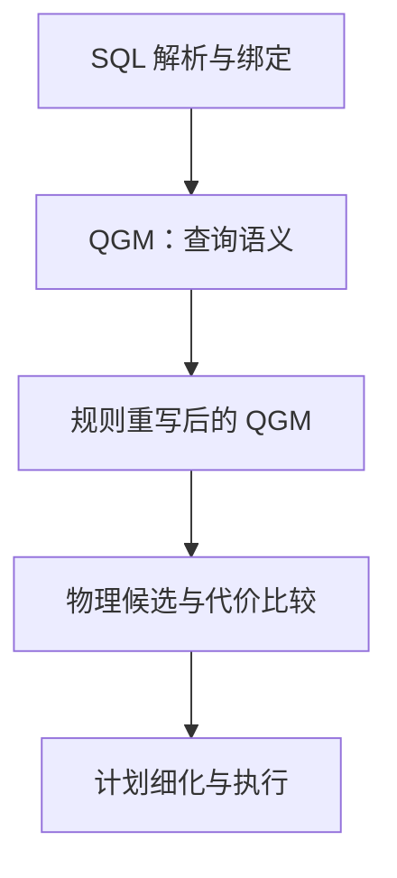

## 课程视频

<div class="bilibili-video" style="position: relative; width: 100%; aspect-ratio: 16 / 9; margin: 1rem 0;">
  <iframe src="https://player.bilibili.com/player.html?isOutside=true&aid=116836398011692&bvid=BV1y7Ko6UEVD&cid=39519650255&page=1&high_quality=1&qn=120&quality=120&danmaku=0&autoplay=0" scrolling="no" border="0" frameborder="no" framespacing="0" allowfullscreen="true" style="position: absolute; inset: 0; width: 100%; height: 100%;"></iframe>
</div>

[B 站高清观看：03 - Lecture 03 - IBM Starburst](https://www.bilibili.com/video/BV1y7Ko6UEVD)

本页截图取自上方 B 站课程录像，标注时间可跳回对应位置；图中细字可配合文末的高清课件查看。正文里的教学数据与原课示例分别说明。

## 从 System R 的固定算法到可扩展优化器

第 03 讲关注 IBM Starburst。前一讲的 System R 用动态规划比较访问路径和 Join 顺序，已经建立了基于代价的优化思路。继续扩展数据库时，我们还会遇到另一类问题：新增一种数据类型、索引或 Join 算法，优化器怎样知道它存在，又怎样把它与已有能力组合起来？

Starburst 希望把这些扩展写成规则，将“有哪些合法实现”与“怎样搜索和比较实现”分开。数据库实现者提供算子、适用条件、属性和代价计算，通用搜索引擎负责组合。这也是优化器生成器（Optimizer Generator）的出发点。[Starburst 原论文](https://15799.courses.cs.cmu.edu/spring2025/papers/03-starburst/haas-sigmodrec1989.pdf)介绍了这种扩展需求，以及查询语言处理器 Corona 与数据管理器 Core 的边界。

### 先重写，再选择物理实现


[视频 27:00：Starburst 的完整优化流水线](https://www.bilibili.com/video/BV1y7Ko6UEVD/?t=1620)。先区分黑色控制流箭头和红色数据流箭头。Parser/Binder 产生 QGM，Query Rewriter 修改逻辑表示，Plan Optimizer 生成 Physical Plan，Plan Refinement 还能同时读取逻辑与物理信息。因此 QGM 贯穿多个阶段，不能简单理解成只在解析之后使用一次的临时对象。


Starburst 的编译过程分为几个阶段。解析和绑定确定表、列、类型与名字的含义，生成 Query Graph Model（查询图模型，简称 QGM）；重写器整理逻辑查询；计划优化器枚举并比较物理方案；最后的计划细化再处理执行相关的调整。



这种分层搜索（Stratified Search）让逻辑重写先把查询整理成更容易优化的形式。比如合并允许合并的查询块、消除冗余表达式。物理阶段再决定使用索引、排序或具体 Join 实现。前一个阶段主要依靠语义和规则条件，后一个阶段依靠统计信息与代价模型。

这里要区分两个判断。一个重写是否保持结果，由 SQL 语义决定；保持结果的多个方案中哪个更快，由数据和执行方式决定。表达式更简单的方案也可能限制后面的选择，因此分阶段设计仍需要仔细选择重写规则。

## QGM 怎样保存查询语义


[视频 40:30：QGM 中的 Box、迭代器与量词](https://www.bilibili.com/video/BV1y7Ko6UEVD/?t=2430)。左侧图把存储表、内层查询与外层查询连接起来，右侧 SQL 给出相应的列与谓词。圆圈里的 F 表示形成输出元组的输入，∀ 对应 ALL 的全称量化；上方 Head 记录输出列和去重要求。读图时先从底部 inventory、quotations 找输入，再向上追踪 q1、q2、q3、q4 的引用。


关系代数树通过父子节点表达处理顺序。例如 `Project(Filter(Scan))` 表示先扫描、再过滤、再投影。QGM 采用接近关系演算的表示方式，先描述输出应满足什么关系，再由优化器决定具体执行策略。

下面用一个教学示例理解 QGM。假定 `customers.id` 是主键：

```sql
SELECT c.id, c.name
FROM customers AS c
WHERE EXISTS (
    SELECT 1
    FROM orders AS o
    WHERE o.customer_id = c.id
      AND o.amount > 1000
);
```

查询要求返回至少有一笔大额订单的客户。即使一个客户有五笔符合条件的订单，外层也只保留该客户原来的行。这个存在性语义必须进入中间表示，后续规则才能正确选择半连接。

QGM 中，Box 表示一个基本表或查询块，每个 Box 分为 Head 和 Body：

| 组成 | 保存的信息 | 在示例中的含义 |
| --- | --- | --- |
| Head | 输出列、类型及结果属性 | 外层输出 `c.id`、`c.name` |
| Body | 输入的元组变量及它们的关系 | 客户输入、订单输入与相关条件 |
| Quantifier | 输入的使用方式，如遍历或存在量化 | `EXISTS` 只判断订单是否存在 |
| Predicate / Qualifier | 单表和跨输入条件 | 客户编号相等、金额大于 1000 |

量词（Quantifier）描述查询怎样使用输入。普通过滤与存在判断看起来都涉及一个谓词，但后者还影响重复行语义。QGM 同时记录重复行约束，因此规则不能只盯着表名和 Join 条件。

课件中的 `price <= ALL (...)` 则体现了全称量化：比较必须对内层结果中的所有值成立。学习这个例子时需要同时考虑内层为空、出现 `NULL`、出现重复报价等情况。把它直接替换成一次普通 Join，通常无法保留全部语义。

### 从元组变量读出一条 QGM 查询

可以把前面的客户查询抽象为两个 Box。外层 Box 的元组变量 `c` 遍历客户输入，Head 选择 `c.id` 与 `c.name`；内层 Box 的变量 `o` 遍历订单输入，Body 约束 `o.customer_id = c.id` 与 `o.amount > 1000`。外层通过存在量词引用内层 Box。这里的描述是教学拆解，省略了 QGM 的具体对象编号与类型字段。

假定客户输入为 `(1, 'Alice')`、`(2, 'Bob')`，订单输入中客户 1 有金额 1200、1500 的两笔订单，客户 2 只有一笔 100 元订单。绑定 `c.id = 1` 时，内层有两个满足条件的元组，存在判断返回真；绑定 `c.id = 2` 时，没有满足条件的元组，存在判断返回假。结果只有 Alice 一行。

如果先做普通内连接，再投影客户列，Alice 会出现两次。给结果加 `DISTINCT` 虽然能处理这个例子，却可能删除外层原本合法的重复行。半连接直接表达“保留符合存在条件的外层行”，外层一行匹配内层多行时仍输出一行，因而更贴近原来的量化语义。

这就是中间表示需要记录输入使用方式的原因。优化器看到的应当包括“订单输入用于存在判断”，才能在合法候选中选择索引探测、Hash Semi Join 等实现。后面的去嵌套章节会进一步解释相关条件怎样从内层移动到 Join 中。

### ALL 的三个边界：空集、NULL 与反例

继续看课程里的全称量化。假定外层待比较的 `price = 10`，内层返回价格列表，表达式为 `10 <= ALL (...)`：

| 内层结果 | 判断过程 | 表达式结果 |
| --- | --- | --- |
| 空集 | 没有违反条件的元素，全称条件成立 | TRUE |
| `12, 15` | 两次比较都成立 | TRUE |
| `8, 15` | `10 <= 8` 已经提供反例 | FALSE |
| `12, NULL` | 一次 TRUE，一次 UNKNOWN | UNKNOWN |
| `8, NULL` | 已有 FALSE，足以否定全称条件 | FALSE |

`WHERE` 只保留 TRUE，因此 UNKNOWN 的行也会被过滤。若外层价格本身为 `NULL`，对非空内层的比较通常为 UNKNOWN；内层为空时，全称条件仍成立。这些结果来自 SQL 三值逻辑，可对照 [PostgreSQL 的 ALL 子查询语义说明](https://www.postgresql.org/docs/18/functions-subquery.html#FUNCTIONS-SUBQUERY-ALL)。

把 `ALL` 改成 `MIN` 聚合时尤其要检查空集：空集上的 `MIN` 返回 `NULL`，直接比较会得到 UNKNOWN，和空集上的 `ALL` 不同。规则还要检查内层 `NULL` 是否被聚合忽略。这个例子让我们看到，正确的重写需要维护量词、空值和空输入的完整语义。

## 重写器怎样处理规则


[视频 53:00：SELECT Merge 的条件与动作](https://www.bilibili.com/video/BV1y7Ko6UEVD/?t=3180)。画面中的规则先检查上下层 SELECT、谓词和 distinct 状态，再进行合并。ENFORCE、PRESERVE、PERMIT 描述重复行处理约束。它展示了规则的两个部分：匹配条件决定是否允许合并，动作再更新输入与属性；本文后面的半连接例子用于展开相同的语义检查思路。


一个重写规则包含匹配和动作。匹配先寻找目标结构，再判断前提是否成立；动作构造等价的 QGM。下面的伪代码只说明接口分工：

```text
rule MatchExists(outer_box, inner_box):
    检查内层引用的外层列
    检查存在量词及相关谓词
    检查重复行、聚合、NULL 和作用域约束
    条件满足时构造等价的半连接表示
```

在前面的客户查询中，内层金额过滤只使用订单列，能够留在订单一侧；客户编号相等则成为跨输入的匹配条件。重写为半连接后，物理阶段就有机会一次构建订单客户集合，再检查所有客户，而无需逐个客户重复扫描订单。

规则之间还存在依赖。一次查询块合并可能使谓词移动规则出现新的匹配，一次表达式化简也可能暴露可用索引条件。因此 Starburst 的重写器允许控制规则应用顺序，并记录应用历史。[查询重写论文](https://15799.courses.cs.cmu.edu/spring2025/papers/03-starburst/pirahesh-sigmodrec1992.pdf)讨论了这类规则及控制机制。

循环规则需要终止策略。比如两条规则分别把表达式从 A 改成 B、从 B 改成 A，如果持续执行就无法完成编译。实际系统需要规范化方向、应用记录或预算；预算耗尽时，仍应留下语义完整的查询表示。

## STAR 与 LOLEPOP：从策略到执行算子


[视频 65:30：访问路径候选的递归展开](https://www.bilibili.com/video/BV1y7Ko6UEVD/?t=3930)。从顶部 AccessRoot(T) 沿绿色分支向下看：SCAN 是一条访问候选，其他策略继续展开索引访问、FETCH、SORT 等组合。最底层可以执行的低层算子组成计划，中间策略描述替代选择。图来自课程引用的 DB2 示例，具体规则名称与原型 Starburst 有差异。


Starburst 的物理规划使用两层对象：STAR（Strategy Alternative Rule，策略候选规则）描述可选择的执行策略，LOLEPOP（Low-Level Plan Operator，低层计划算子）构成可执行计划。后者包括访问、排序、存储和数据传输等操作，也能通过参数指定具体实现。

下面是对原论文规则思路的简化示意，名称和格式用于教学：

```text
Access(customers)
  → TableScan(customers)
  → IndexAccess(customer_name_idx)

Join(left, right, predicate)
  → NestedLoop(left, right, predicate)
  → HashJoin(left, right, equality_keys)
  → MergeJoin(sorted_left, sorted_right, equality_keys)
```

每个候选都必须经过适用条件检查。Hash Join 需要合适的等值键；Merge Join 需要满足输入排序要求；索引访问要检查谓词与索引键的关系。搜索引擎随后组合子方案并计算代价。[函数式规则论文](https://15799.courses.cs.cmu.edu/spring2025/papers/03-starburst/p18-lohman.pdf)说明了如何用类似文法的表达描述这些候选。

规则解释器负责执行规则、展开候选和调用辅助函数；查询执行器负责运行最终的低层计划。两者处在不同阶段。阅读“解释执行”时，先确认被解释的对象是优化规则还是查询计划。

## 为什么计划属性必须参与比较

同样访问一张表，顺序扫描可能更便宜，索引扫描可能自然按某个键输出。父算子需要排序时，后者就可能节省一次 `Sort`。因此候选计划要携带属性，至少区分关系属性、物理属性和估计属性。

| 属性类别 | 例子 | 参与的判断 |
| --- | --- | --- |
| 关系属性 | 输出列、涉及的表、唯一性 | 重写是否保持语义 |
| 物理属性 | 输出顺序、数据位置 | 是否满足父算子的执行要求 |
| 估计属性 | 基数、累计代价 | 候选中哪个更合适 |

Starburst 的 Glue 是一类特殊 STAR，用来选择满足所需属性的便宜方案，必要时加入排序等低层算子。设下面代价均为人为设定的抽象单位：顺序扫描花费 10，排序花费 12，有序索引扫描花费 17。父节点要求有序输出时，应比较 `10 + 12` 与 `17`；父节点没有排序要求时，顺序扫描仍有优势。

这个例子也说明，扩展一个物理算子时，除了给出局部代价，还要说明它要求哪些输入属性、产生哪些输出属性。后续的 Volcano 和 Cascades 会把这种需求进一步变成搜索状态。

### Glue 怎样把属性要求带入策略展开

设一个 Join 策略需要左、右输入都按连接键排序。它向输入的 Glue 提出“给定逻辑输入、要求该排序”的请求。Glue 比较有序索引访问与无序扫描加排序，返回满足需求的低成本实现；父策略再把两个输入与 Merge Join 自身的成本相加。

这与只挑出最便宜扫描再在根部补排序有不同的搜索效果。排序可能在较小输入上完成，有序输入还可能同时服务于 Join 和后续聚合。属性补齐放在哪一层，会影响总成本。设计一个新的 STAR 时，需要说明对子输入的要求；设计一个新的 LOLEPOP 时，需要说明它能保留或产生什么属性。

可扩展性也依赖规则之间的接口契约。一个自定义扫描即使本地速度很快，若输出列不完整、排序声明不真实，组合出的计划仍会失败。Starburst 把实现知识放进可替换的规则和算子，同时要求扩展提供正确的语义、属性和估计信息。

## 对照课程材料阅读

第一遍阅读时，沿“SQL → QGM → 重写 → 物理策略”追踪同一个查询。第二遍再看规则系统：重写规则如何保证正确，STAR 如何表达选择，Glue 如何补齐属性。最后回到原论文的系统边界，判断新增一个索引类型需要向优化器提供哪些信息。

继续阅读 [Volcano](/wiki/cmu_15_799/volcano.html)，可以比较分层处理与面向目标的搜索怎样组织同一批候选。

## 参考资料

- [Extensible Query Processing in Starburst](https://15799.courses.cs.cmu.edu/spring2025/papers/03-starburst/haas-sigmodrec1989.pdf) (L.M. Haas et al., SIGMOD Record 1989) *(Primary)*
- [EQOP Book](https://www.microsoft.com/en-us/research/publication/extensible-query-optimizers-in-practice/) (Chapter 3.1) (Optional)
- [Grammar-like Functional Rules for Representing Query Optimization Alternatives](https://15799.courses.cs.cmu.edu/spring2025/papers/03-starburst/p18-lohman.pdf) (G. Lohman, SIGMOD Record 1988) (Optional)
- [Extensible/Rule Based Query Rewrite Optimization in Starburst](https://15799.courses.cs.cmu.edu/spring2025/papers/03-starburst/pirahesh-sigmodrec1992.pdf) (H. Pirahesh et al., SIGMOD Record 1992) (Optional)
- [Implementing an Interpreter for Functional Rules in a Query Optimizer](https://15799.courses.cs.cmu.edu/spring2025/papers/03-starburst/lee-vldb1988.pdf) (M.K Lee et al., VLDB 1988) (Optional)
- [Query Optimization in the IBM DB2 Family](https://15799.courses.cs.cmu.edu/spring2025/papers/03-starburst/gassner-icdebul1993.pdf) (P. Gassner et al., IEEE Data Engineering Bulletin 1993) (Optional)

- [课程 Schedule](https://15799.courses.cs.cmu.edu/spring2025/schedule.html)
- [课程 Slides](https://15799.courses.cs.cmu.edu/spring2025/slides/03-starburst.pdf)
- [课程 Notes](https://15799.courses.cs.cmu.edu/spring2025/notes/03-starburst.pdf)
- [课程 Video](https://www.youtube.com/watch?v=iXMiG1vdnyc&list=PLSE8ODhjZXjYCZfIbmEWH7f6MnYqyPwCE&index=3)
- [B 站视频](https://www.bilibili.com/video/BV1y7Ko6UEVD)
