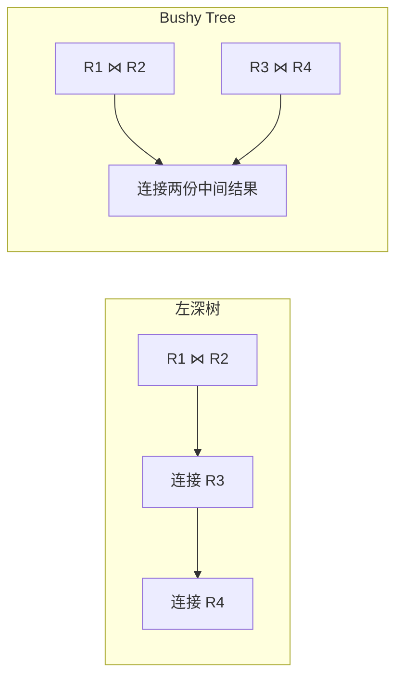

## 课程视频

<div class="bilibili-video" style="position: relative; width: 100%; aspect-ratio: 16 / 9; margin: 1rem 0;">
  <iframe src="https://player.bilibili.com/player.html?isOutside=true&aid=116836381234765&bvid=BV1XcKo68Egm&cid=39519522023&page=1&high_quality=1&qn=120&quality=120&danmaku=0&autoplay=0" scrolling="no" border="0" frameborder="no" framespacing="0" allowfullscreen="true" style="position: absolute; inset: 0; width: 100%; height: 100%;"></iframe>
</div>


## 背景


在关系模型出现以前的 20 世纪 60 时代，早期的 `DBMS` 要求开发者编写如上图所示的存储过程，来实现各种查询需求。开发者需要基于当前的数据内容，自己选择数据访问路径，以及执行的顺序，当 `DBMS` 发生变化时，这些存储过程代码必须重写，开发成本巨大。


基于这样的背景，关系模型应运而生。关系模型具有 3 个原则：**1. 数据物理层和逻辑层之间的独立性**；**2. 完整性约束**，确保用户不会插入错误数据，或者破坏数据；**3. 声明式数据操作**，即 SQL 语言，以便更好地查询数据。

### 早期 RDBMS


| 系统 | 机构 | 早期优化策略 |
| --- | --- | --- |
| Peterlee Relational Test Vehicle（PRTV） | IBM Research UK | 关系模型实验系统 |
| System R | IBM Research San Jose | 启发式规则 + 基于代价的 Join 搜索 |
| INGRES | U.C. Berkeley | 启发式规则与查询分解 |
| Oracle | Larry Ellison | 早期长期使用启发式优化 |
| Mimer | Uppsala University | 早期关系数据库实现 |

这些系统共同面对的问题是：声明式语言只描述“要什么结果”，具体访问哪条索引、先连接哪两张表，要交给数据库自己决定。因此，关系模型的实现最终都需要查询优化器。

老师依次介绍了这些系统的来历：PRTV 是 IBM 英国研究机构的早期关系模型原型；System R 来自 IBM San Jose；Stonebraker 团队在 Berkeley 开发 INGRES，采用的查询语言是 QUEL。Postgres 的名字也体现了它与 INGRES 的承接关系。Oracle 采用 SQL，瑞典的 Mimer 也是这一时期的关系数据库实现。这里介绍的是不同系统对关系模型的探索，不能把它们都看成一开始就采用同一种 SQL 语言或同一种优化算法。

System R 的代表性工作，是将统计信息、代价模型和 Join 搜索结合起来，比较不同访问路径与连接顺序。老师没有确认 Mimer 当时的具体优化算法，因此这里也不把它归入某种确定的优化路线。

### 查询优化器的演进路线

沿着查询优化器的发展，可以看到几条主要路线：


| 路线 | 代表系统 | 核心思路 |
| --- | --- | --- |
| 启发式优化 | INGRES、早期 Oracle | 依靠预先编码的经验规则改写计划 |
| 启发式 + 基于代价的 Join 搜索 | System R、早期 DB2 | 逻辑规则先简化计划，再用代价模型选择访问路径和 Join 顺序 |
| 分层搜索（Stratified Search） | IBM Starburst、后续 DB2 | 将不同优化阶段分层，并提高规则系统的可扩展性 |
| 统一搜索（Unified Search） | Volcano、Cascades、SQL Server、Greenplum | 在统一搜索框架中管理逻辑等价表达式与物理属性 |
| 随机化搜索 | 学术系统、PostgreSQL GEQO | 在大规模 Join 场景中用随机化方法控制优化耗时 |

System R 处在纯启发式方法与现代可扩展优化器之间：逻辑改写仍由一组固定规则完成，物理计划则交给代价模型和动态规划选择。

这些路线并不是互不相容的五个盒子。老师特别提醒，统一搜索也可以分阶段执行，分层与统一的界线并不总是清晰。后面学习实现时，更需要追踪搜索是怎样自下而上构造计划，或者怎样自上而下转换已有计划。

## 启发式查询优化

启发式优化按照固定规则改写逻辑计划。规则来自关系代数等价式和数据库实践经验，应用时并不计算两种计划各自要花多少成本。

### 关系代数等价规则

#### 选择运算

当谓词引用的列仍然处于作用域内时，选择运算可以在计划树中移动。合取谓词还可以拆分：

```text
σ(p1 ∧ p2 ∧ ... ∧ pn)(R)
    = σp1(σp2(...σpn(R)))
```

谓词拆开后，便能分别向数据源方向下推。优化器还会做一些直接的表达式化简：

```text
X = Y AND Y = 3        -> X = 3 AND Y = 3
X = 1 + 1              -> X = 2
X = YEAR('2025-01-15') -> X = 2025
```

#### Join 运算

Inner Join 具有交换律和结合律：

```text
R ⋈ S = S ⋈ R
(R ⋈ S) ⋈ T = R ⋈ (S ⋈ T)
```

借助这些等价式，优化器可以调换 Join 的输入顺序，重新组织 Join 树。但表一多，候选计划会迅速膨胀。对于包含 `n` 个关系的二元 Join，逻辑 Join 树数量随关系排列和 Catalan 数共同增长：

```text
O((n - 1)! × C(n - 1))
```

优化器不可能无限搜索，只能在计划质量和优化时间之间划定边界。

### 常见启发式规则

以课程中的三表查询为例：

```sql
SELECT ARTIST.NAME
FROM ARTIST, APPEARS, ALBUM
WHERE ARTIST.ID = APPEARS.ARTIST_ID
  AND APPEARS.ALBUM_ID = ALBUM.ID
  AND ALBUM.NAME = 'Mooshoo Tribute'
ORDER BY ARTIST.ID;
```

#### 拆分合取谓词


初始计划先对三张表做笛卡尔积，再把整个 `WHERE` 条件作为一个选择算子。这个计划表达了查询语义，却没有利用各个条件的作用范围。


将 `AND` 连接的三个条件拆开后，每个选择算子只处理一个谓词，就可以分别移动。这里没有根据选择率给条件排序：此时还没有引入代价模型和统计信息，拆分只是为后面的等价变换创造条件。

#### 谓词下推


`ALBUM.NAME = 'Mooshoo Tribute'` 只依赖 `ALBUM`，因此可以一直下推到这张表的扫描之上。`ARTIST.ID = APPEARS.ARTIST_ID` 依赖两张表，必须等它们的列都可见时才能计算，不能再推入任意一个单表扫描。下推的边界由谓词引用的列决定，并不是把所有选择算子一律移动到树底部。

#### 用 Join 替换笛卡尔积


当笛卡尔积上方紧接着引用两边输入的连接条件时，可以把二者合并为 Inner Join。这样仍然保持结果等价，同时为后续选择具体 Join 实现提供了入口。此时还没有确定 Nested Loop Join 或 Merge Join，图中表达的是逻辑连接。

#### 投影下推


最终只输出 `ARTIST.NAME`，但中间节点还需要连接键，最终排序还需要 `ARTIST.ID`。因此，扫描 `ARTIST` 时需要保留 `ID` 和 `NAME`，扫描 `APPEARS` 时需要保留两侧连接键，`ALBUM` 完成名称过滤后仍要保留 `ID`。只有后续不再使用的列才能删除。

投影下推主要减少排序、物化等流水线阻塞点需要保存的数据宽度。老师强调，这条规则的收益取决于行存或列存、表的宽度，以及单机或分布式执行方式；不能因为列数变少就断言每次扫描一定更快。

以上几步都可以依靠关系代数等价规则完成，不需要先估算每个候选计划的成本。但三张表的 Join 顺序仍然没有经过代价比较，这就引出了 INGRES 与 System R 的不同处理方式。

### INGRES 的查询分解

早期 INGRES 处理多表查询的办法很直白：把复杂查询拆成一串“单变量查询（Single-Variable Query）”。每一步只访问一张真实表，并读取上一步生成的临时表。

前面的三表查询大致会被拆成这样。下面沿用课堂中的临时表命名，列名统一使用前面定义的 `ARTIST.ID`：


```sql
-- 第一步：找到目标专辑
SELECT ALBUM.ID AS ALBUM_ID INTO TEMP1
FROM ALBUM
WHERE ALBUM.NAME = 'Mooshoo Tribute';

-- 第二步：找到专辑中出现的艺人
SELECT APPEARS.ARTIST_ID INTO TEMP2
FROM APPEARS, TEMP1
WHERE APPEARS.ALBUM_ID = TEMP1.ALBUM_ID
ORDER BY APPEARS.ARTIST_ID;

-- 第三步：查询艺人姓名
SELECT ARTIST.NAME
FROM ARTIST, TEMP2
WHERE ARTIST.ID = TEMP2.ARTIST_ID;
```

执行从最内层开始，结果再代入下一层。课上的例子先查出 `ALBUM_ID = 9999`，然后把这个值代入 `APPEARS` 的查询，得到 `ARTIST_ID = 123` 和 `456`。最后对两个艺人分别执行一次姓名查询，得到 O.D.B. 和 DJ Premier。


这不是先生成一个完整三表物理计划再统一执行，而是用已经得到的值把下一步问题缩小成单关系查询。老师用 SQL 展示分解结果，真正的分析与变换发生在逻辑计划层。这种办法实现了连接，却缺少用代价模型比较整体 Join 顺序的能力，还可能重复执行查询、频繁读写临时结果。

### 启发式方法的能力边界

启发式方法容易实现和调试，处理简单查询时也足够快。但规则一多，问题就逐渐暴露出来：

- 固定规则经常依赖经验阈值或“魔法常量”；
- 多条规则之间存在依赖时，规则应用顺序难以控制；
- 缺少统计信息和代价模型时，优化器无法可靠判断两个合法计划中哪一个更快；
- Join 顺序对中间结果规模影响巨大，仅凭固定规则难以做出稳定选择。

## System R 查询处理流程

课程接下来引入“启发式规则 + 基于代价的搜索”。先用静态规则完成逻辑到逻辑的改写，再枚举访问路径、Join 算法和物化方式，以代价模型比较逻辑到物理的不同实现。索引是否可用与索引是否划算，是这里需要分开的两个问题。

System R 先把 SQL 拆成查询块（Query Block）。每个查询块包含一个 `SELECT`、引用一张或多张关系的 `FROM`，以及表示谓词的 `WHERE`；嵌套子查询形成独立的查询块，分别进行优化。

对每个查询块，优化器先生成逻辑算子，再枚举能够实现它们的物理算子，比较访问路径与 Join 算法。单关系查询主要比较顺序扫描和索引访问；涉及多个关系时，再通过动态规划逐步确定 Join 顺序。是否物化临时结果，也属于物理执行策略的一部分。

## SARG：能够用于访问路径的谓词


SARG 是 Search Argument 的缩写。在 System R 中，能够整理成下面这种形式的谓词称为 Sargable Predicate：

```text
column comparison-operator value
```

例如：

```sql
WHERE val >= 123 AND val <= 456
```

如果 `val` 上有索引，Index Scan 可以直接定位到第一个匹配键，沿叶子链读到范围终点，无需扫描整个索引。

课程在这里强调，应先识别哪些索引能够支持给定谓词，再通过代价模型判断它们是否比顺序扫描更便宜。存在索引只代表多了一种候选访问路径，并不意味着优化器一定选择它。

## System R 代价模型

### 总体公式

System R 的代价公式很简单：


```text
COST = PAGE FETCHES + W × RSI CALLS
```

- `PAGE FETCHES`：预计读取的页面数，用来近似 I/O 成本；
- `RSI CALLS`：预计从存储层返回的元组数，用来近似 CPU 成本；
- `W`：CPU 相对于 I/O 的权重，可以随硬件调整。

Cost 是优化器内部比较计划的相对值。`W` 把 RSI 调用折算到能够与页面读取相加的尺度；只要候选计划的排序大体正确，这个数值就达到了目的。

只数页面，会漏掉谓词计算、元组构造和接口调用等 CPU 工作；只数元组，又分不出顺序 I/O、随机 I/O 和数据布局的差别。这个简单的加权公式把两类开销放进了同一个比较尺度。

## 与现代 PostgreSQL 的对照

课程视频用 PostgreSQL 作了对照。它的计划 Cost 同样采用相对单位，并以 `seq_page_cost` 为常用基准。课上展示的文档将顺序读取一页设为 `1.0`、随机读取一页设为 `4.0`，再叠加这些参数。这是课程中的参数示例，具体系统需要结合版本、存储设备和配置解释：

- `random_page_cost`：随机读取页面的相对成本；
- `cpu_tuple_cost`：处理一行的 CPU 成本；
- `cpu_index_tuple_cost`：处理一个索引项的 CPU 成本；
- `cpu_operator_cost`：执行一个运算符或函数的 CPU 成本；
- 并行启动、并行元组传递等额外成本。

参数和公式比 System R 丰富了许多，思路仍是一脉相承：把不同资源的消耗换算成相对代价，用总成本给候选计划排序。

## 统计信息与选择率

代价公式需要估算扫描时读取多少页面、向上层返回多少元组，这些值来自系统目录维护的表和索引统计信息。老师提到，统计信息可以在批量加载时收集，也可以通过专门的统计更新操作维护。优化器使用的是数据摘要，不会为了优化每条查询都先完整执行一次扫描。

谓词的选择率因子（Selectivity Factor，记为 `F`）表示预计有多大比例的元组满足条件。课程借原论文中的公式说明，优化器怎样把谓词与统计信息联系起来：

| 条件 | 估算方式 |
| --- | --- |
| `column = value`，有索引键值统计 | `F = 1 / ICARD(index)`，其中 `ICARD` 是不同索引键值的数量 |
| 缺少对应统计信息 | 使用 `F = 1 / 10` 这样的默认估计 |

第一个公式假设每个不同键值对应的元组数量近似相同。老师用美国邮编举例：洛杉矶地区与蒙大拿州不同邮编下的人口规模并不相同，因此均匀分布假设很容易偏离真实数据。第二个公式则直接使用固定常量；它能让优化继续进行，但没有提供关于当前数据分布的新证据。

这些估算会影响下一个算子处理多少数据，以及整个计划需要做多少工作。课程后面还会继续讨论均匀分布与谓词独立性假设造成的问题。

## 课堂演示：表达式怎样影响索引选择

老师随后用一张约一千万行的 `xxx` 表演示访问路径选择。表中有 `id` 和 `val`，并在 `val` 上建立索引。首先查看范围查询：

```sql
EXPLAIN SELECT id
FROM xxx
WHERE val >= 123 AND val <= 456;
```

课堂中的 PostgreSQL 计划通过 `Bitmap Index Scan` 找出候选记录，再通过 `Bitmap Heap Scan` 读取数据页。随后执行下面两条排序查询：

```sql
EXPLAIN SELECT id FROM xxx ORDER BY val LIMIT 20;
EXPLAIN SELECT id FROM xxx ORDER BY val + 0 LIMIT 20;
```


第一条使用 `Index Scan`，按索引顺序取得前 20 行；第二条在排序键上增加 `+ 0`，画面中的计划变成 `Parallel Seq Scan`、`Sort` 和 `Gather Merge`，最上层再执行 `Limit`。这里展示的是优化器选出的计划，不是两条查询的实际执行耗时对比。

老师接着检查 DuckDB：当时的范围查询可以使用索引，但 `ORDER BY` 与 `LIMIT` 的组合没有选择他期望的索引路径，加上 `+ 0` 也没有改变这个结果。SQL Server 的对照采用 `SET SHOWPLAN_ALL ON` 查看计划，并以 `TOP 20` 表达行数限制：

```sql
SELECT TOP 20 id FROM xxx ORDER BY val + 0;
```


画面中的 SQL Server 计划保留了 `ORDERED FORWARD` 的索引扫描，并通过 `Compute Scalar` 处理表达式，上层是 `Top`。这个对照要说明的是：**识别访问路径需要理解表达式，不能只按列名做字符串匹配**。常量折叠、表达式等价性与排序属性能否联系起来，会影响索引的使用。

这些结果只描述 2025 年课程演示中的环境，没有据此断言各数据库的所有版本都会如此。老师没有展示 MySQL 的结果，也没有在这一段测量各系统运行时间，不能把它补成跨数据库性能比较。

## Interesting Orders

### 为什么“最便宜的子计划”可能导致昂贵的完整计划


课程先从 `ORDER BY` 与 `GROUP BY` 的顺序要求进入：如果一个访问方法已经产生所需顺序，就可能省掉后面的排序。在当时讨论的实现中，分组同样依靠排序，不能忽略这项成本。

因此，不能只比较顺序扫描和索引扫描本身的成本。如果上层需要有序结果，还要把顺序扫描之后的 Sort 计入总成本，再与直接提供所需顺序的索引访问比较。

### System R 的处理方式

System R 把后续可能派上用场的输出顺序称为 `Interesting Order`。它可能来自：

- `ORDER BY` 指定的最终输出顺序；
- `GROUP BY` 需要的分组顺序；
- 等值 Join 列需要的 Merge Join 输入顺序。

对于每个关系集合，优化器保留：

1. 最便宜的无序计划；
2. 每一种 Interesting Order 下成本最低的计划。

当查询要求最终有序时，优化器比较：

```text
已有目标顺序的最低成本计划

VS.

最低成本无序计划 + 最终 Sort 成本
```

多表连接时，Join 谓词也会带来值得保留的输入顺序。课程指出，原始逻辑计划没有统一表达这些物理属性，需要为有序和无序方案额外保留状态，再检查最终是否还要排序。后面的 Volcano、Cascades 会进一步处理物理属性。

## 多表 Join 优化

### System R 支持的 Join 算法

课程中的 System R 主要考虑 Nested Loop Join 和 Merge Scan Join：前者对 Outer 的每个元组访问 Inner，后者利用按连接键排序的两个输入向前扫描。两者处理的数据量与输入顺序不同，因此需要结合 Outer、Inner 的元组数量估算成本。

老师提醒，这版系统还没有使用 Hash Join。不能把今天常见的全部 Join 实现都当作图中的候选算法。

### 为什么选择左深树

System R 把 `n` 表 Join 拆成连续的二表 Join，前一步的结果始终作为下一步的 Outer：

```text
(((R1 ⋈ R2) ⋈ R3) ⋈ R4)
```

这种形状叫作左深树（Left-Deep Tree）。它适合当时的系统，原因有两点：

1. 搜索空间显著小于包含 Bushy Tree 的完整空间；
2. 前一个 Join 的输出可以直接流水线传给下一个 Join，只有排序等阻塞操作需要物化中间结果。

Bushy Tree 则可以分别计算 `(R1 ⋈ R2)` 和 `(R3 ⋈ R4)`，最后连接两个中间结果。有些查询用这种树更快，代价是往往要同时保留或物化多份中间结果。受当时的内存和优化时间限制，System R 只搜索左深树。

### 延迟笛卡尔积

扩展当前关系集合时，System R 优先加入有 Join 谓词相连的表。只有剩下的表都连不上，才会考虑笛卡尔积。

例如，若 Join Graph 为：

```text
T1 -- T2 -- T3
```

那么 `T1 -> T3 -> T2` 会过早产生 `T1 × T3`，通常不会进入候选集合。`T1 -> T2 -> T3` 和 `T3 -> T2 -> T1` 每一步都有 Join 谓词，可以正常扩展。

### 自下而上的动态规划

System R 用关系集合作为状态，从单表开始，逐层构造更大的 Join 子计划。

每一层比较当前关系集合的候选实现，保留后续构造计划仍然需要的低成本方案。涉及输出顺序时，还需要区分 Interesting Order，不能把不同物理属性的计划直接合并为一个赢家。

搜索过程是：

1. **初始化单表计划**：枚举每张表的 Segment Scan 和各个 Index Scan；
2. **保留单表赢家**：为无序状态和每一种 Interesting Order 分别保留最低成本访问计划；
3. **扩展关系集合**：把一个新关系作为 Inner，连接到已有的 `k - 1` 表 Outer 计划；
4. **枚举物理实现**：比较不同 Inner 访问路径、Nested Loop Join、Merge Scan Join，以及必要的 Sort；
5. **估算代价与输出属性**：计算结果基数、累计成本和输出顺序；
6. **按等价状态剪枝**：对于相同的关系集合与输出顺序，仅保留成本最低的计划；
7. **迭代到完整集合**：重复以上步骤，直到计划包含 Query Block 中的全部关系；
8. **处理最终顺序**：比较天然满足 `ORDER BY` / `GROUP BY` 的计划和“最低成本无序计划 + Sort”。

课堂用图展示了这个逐层构造的过程。这里的“无需维护历史”是相对于后面自上而下搜索的历史管理而言：较小子问题的结果已经包含在当前构造出的子计划中，不代表实现动态规划时不需要保存各层的候选结果。

### 三表查询示例


回到课程中的 `ARTIST`、`APPEARS`、`ALBUM` 查询。假设目录统计与索引信息表明：

```text
ARTIST  -> Sequential Scan
APPEARS -> Sequential Scan
ALBUM   -> Index Lookup on NAME
```

优化器会这样展开搜索：

1. 为三张表分别准备访问计划，其中 `ALBUM` 可通过名称索引过滤；并不预先认定完整计划一定从它开始；
2. 枚举 `ALBUM ⋈ APPEARS`、`APPEARS ⋈ ARTIST` 等有 Join 边连接的二表计划；
3. 对每个关系集合分别比较 Nested Loop Join 与 Merge Scan Join；
4. 为无序输出、按 `ARTIST.ID` 排序的输出以及 Join Key 顺序分别保留低成本计划；
5. 将剩余关系加入二表计划，生成完整三表计划；
6. 比较保序计划与“无序计划 + Sort”，满足最终 `ORDER BY ARTIST.ID`。

课堂接着把搜索过程展开成逻辑节点和物理节点：灰色节点表示尚待实现的逻辑子问题，黑色节点表示 Nested Loop Join 或 Merge Join 等物理选择。


先为同一二表连接生成多个实现，再比较它们的估算成本。例如 `ARTIST ⋈ APPEARS` 可以分别考虑 Nested Loop Join 和 Merge Join；输入关系相同并不意味着具体工作量相同。


剪枝之后，使用留下来的二表方案继续加入第三张表。下一层的选择建立在上一层结果之上，而不是每次重新从三张表的全部组合开始计算。


最后还要处理 `ORDER BY ARTIST.ID`。图中的逻辑节点没有表达完整的排序属性，因此不能只沿一条最低成本的无序路径走到最后；仍需比较有序方案与“无序方案 + Sort”。这正是前面保留 Interesting Order 的原因。

这里没有哪项决策是孤立的：`ALBUM` 的过滤选择率影响 Join 顺序，Join 顺序改变中间结果规模，访问路径带来的顺序又会改变后续 Merge Join 和最终 Sort 的成本。

### 自下而上搜索与 Bushy Tree

课堂将前面的过程称为生成式、自下而上搜索（Generative / Bottom-Up）：从小的子问题开始，一层层加入物理算子，构造完整计划。后面的转换式、自上而下搜索（Transformative / Top-Down）则从要实现的目标进入，逐步寻找能够实现目标的子计划。这个区别会影响搜索状态、历史结果和重复工作的管理。

有同学问，自下而上能否搜索 Bushy Tree。老师的回答是可以：四表查询中，可以分别构造两组二表连接，再连接它们的输出。**只枚举左深树是 System R 对搜索空间的限制，不是动态规划或自下而上搜索本身的限制。**

下面根据这段解释整理两种树形，四表名称只用于示意：



左深树便于把前一个 Join 的输出流水线传给下一个 Join。课堂用当时内存有限的背景解释，Bushy Tree 可能需要先将一侧结果写盘，腾出空间计算另一侧，再读回来连接。这是当时选择较小搜索空间的工程理由，不能由此推导出 Bushy Tree 总是更慢。

## 嵌套查询

System R 会把嵌套查询拆成独立的 Query Block。课程在这里再次联系 INGRES 的分解办法：找出内外查询的依赖，先处理内部查询，再将结果代回外部查询。对于不依赖外层行的子查询，这可以表现为优化外层查询之前先求出内层结果；依赖外层值的相关子查询则不能直接提前执行一次。

### 非相关标量子查询


```sql
SELECT name
FROM employee
WHERE salary > (SELECT AVG(salary) FROM employee);
```

内部 Query Block 只执行一次。假设结果是 `100000`，System R 会把这个值代入外层谓词：

```sql
SELECT name
FROM employee
WHERE salary > 100000;
```

### 子查询结果与外层规划

如果内部查询产生多个值，可以先将结果物化成临时表，再供外层查询使用。这与前面 INGRES 将复杂问题拆成若干单关系查询的做法相似：先求出一部分结果，再继续处理依赖它的部分。

老师明确提醒，这里是在解释早期系统怎样实现嵌套查询，而不是推荐今天照搬这套策略。课程后面会单独讨论怎样将嵌套查询重写为 Join，使它进入更大的关系表达式中优化。本讲没有展开相关子查询的完整算法。

## 启发式规则与代价搜索的优点和局限

这套方法通常能够在合理的时间内找到较好的计划，无需遍历全部可能的执行方式。老师引用原论文提到，当时八表查询已经能在数秒内完成优化；这个数值属于当时的软硬件环境，不能用于比较现代系统的优化速度。

它仍然存在几项限制：

- **规则实现难以维护**：启发式变换仍由过程式的 `if/else` 控制，规则多了之后，应用顺序与依赖关系会纠缠在代码中。下一讲的 Starburst 将继续讨论规则如何声明和管理。
- **左深树限制了搜索空间**：它简化了问题，也可能排除代价更低的 Bushy Tree。
- **物理属性缺少统一表示**：输出顺序需要额外维护；到了分布式环境，数据所在位置等属性也会影响后续选择。

## 小结

老师最后回到代价模型的简化假设。底层算子如果低估输出基数，这个估计就会成为上层算子的输入，上层再继续估算，误差会沿计划逐步传播。均匀分布与谓词独立性并不能总在真实数据上成立，这也是后面学习基数估计时需要继续解决的问题。

**即使枚举了全部 Join 顺序，错误的统计信息与代价估算仍可能让优化器选中很差的计划。** 因此，搜索得更全面与估算得更准确，是两个需要分别处理的问题。System R 为这一类优化器建立了基础，下一讲将沿着课程时间线进入 IBM Starburst。

## 参考资料

- [Access Path Selection in a Relational Database Management System](https://15799.courses.cs.cmu.edu/spring2025/papers/02-systemr/selinger-sigmod1979.pdf) (P. G. Selinger et al., SIGMOD 1979) *(Primary)*
- [课程 Schedule](https://15799.courses.cs.cmu.edu/spring2025/schedule.html)
- [课程 Slides](https://15799.courses.cs.cmu.edu/spring2025/slides/02-systemr.pdf)
- [课程 Notes](https://15799.courses.cs.cmu.edu/spring2025/notes/02-systemr.pdf)
- [课程 Video](https://www.youtube.com/watch?v=62cAdANFhBg&list=PLSE8ODhjZXjYCZfIbmEWH7f6MnYqyPwCE&index=2)
- [B 站视频](https://www.bilibili.com/video/BV1XcKo68Egm)
