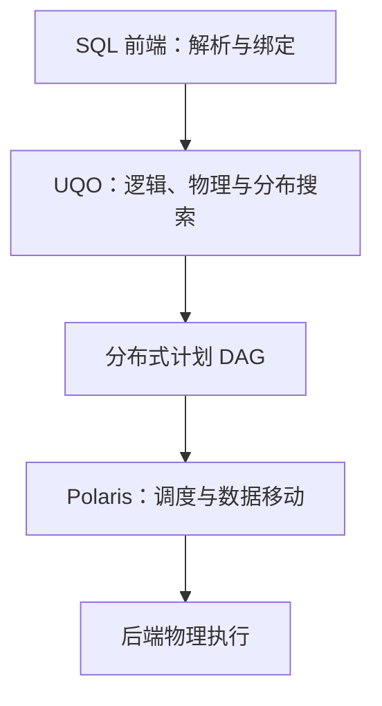

## 课程视频

截至 2026 年 10 月 2 日，所给 B 站收藏夹收录到第 14 讲，官网 Schedule 未提供本讲视频链接。本页依据指定论文整理。

## 分布式选择怎样进入同一次优化

第 23 讲依据 [Unified Query Optimization in the Fabric Data Warehouse](https://15799.courses.cs.cmu.edu/spring2025/papers/24-fabric/bruno-sigmod2024.pdf)整理。论文回顾从 PDW 到 Fabric Data Warehouse 的编译架构变化，重点是把局部计划、数据移动和后端实现放进更统一的优化过程。

本文以 2024 年论文描述的架构为范围。扩展阅读中的 QOaaS 是跨引擎优化服务方向，两者分别讨论，避免把研究方案直接当作已经完整落地的产品能力。

## PDW 的多次优化怎样分工

原有 PDW 架构先利用 SQL Server 生成局部候选和搜索表示，再由分布式优化器选择分布策略与数据移动。执行时把分布式步骤还原为 SQL，发给后端节点，后端再次优化自己的片段。

```text
前端局部候选搜索
  → 分布式优化：选择移动与执行步骤
  → 片段转换为 SQL
  → 后端重新优化并执行
```

这种方式复用了成熟组件，但存在视野边界：前端做某个局部决策时，可能还不知道分布式总成本；分布式层安排步骤后，后端又可能选择不同局部实现。重复编译和多套搜索边界也增加了维护复杂度。

论文结合生产经验讨论这些限制，以及存算分离、云端资源与 Polaris 执行架构带来的需求。

## UQO 与物理计划下发

Fabric DW 的 UQO（Unified Query Optimizer，统一查询优化器）将原来多个阶段的优化工作整合，生成分布式物理计划。计划交给 Polaris 分布式计算平台调度，后端接收物理计划并执行，减少原架构中把片段恢复为 SQL 再优化的过程。



DAG（Directed Acyclic Graph，有向无环图）表达任务依赖，独立分支可以并行执行。论文也说明部分运行决策仍能延迟绑定，例如算子的内存授权；统一搜索并不要求执行前固定所有环境相关信息。

## 分布属性也是优化上下文

UQO 沿用 Cascades 风格的 Memo 与目标搜索，把分布放进所需属性和推导属性。例如 Serial、Control、Replicated、Hash(C) 与 Any(C) 表达不同约束。

`Hash(C)` 指具体按列集合 C 的哈希分布；`Any(C)` 表达相同 C 值的行需要处在同一分区的较抽象需求。哪些实际分布能够满足某项需求，需要明确定义蕴含关系。

按 `a` 分布时，所有相同 `a` 的行聚在一起，因此相同 `(a,b)` 的行也聚在一起；按 `(a,b)` 分布时，相同 `a`、不同 `b` 的行却可能被分开。属性匹配必须保留这个方向。

## Join 两侧必须采用兼容分布

考虑教学查询：

```sql
SELECT *
FROM T
JOIN U ON T.a = U.a AND T.b = U.b AND T.c = U.c;
```

若两表都按 `(a,b)` 以兼容哈希和分区布局分布，可以本地执行，因为匹配行具有相同 `(a,b)`。无需一定按所有 Join 列 `(a,b,c)` 重新分布。

但若 T 按 `(a,b)` 分布，U 按 `c` 分布，虽然它们各自都满足某些“Join 键组合聚在一起”的抽象条件，匹配行仍可能落在不同节点。因此两侧属性分别可接受，还不足以证明本地 Join 正确，必须检查布局兼容。

这一点会影响输入需求的生成。为 Join 枚举全部键子集会产生指数数量的分布选择；论文通过 interesting distributions（有用分布）保留来自已有输入布局或有价值键集的候选，控制搜索规模。

### 属性蕴含与两侧兼容性的一个反例

设只有两个分区，T 按 a 分布，U 按 b 分布，连接条件是 `T.a=U.a AND T.b=U.b`。T 内同一个 a 的行必在一起，因而同一个 `(a,b)` 的行也在一起；U 对同一个 `(a,b)` 也满足类似的聚集性质。但是 T 的 `(1,2)` 可能在分区 1，U 的 `(1,2)` 可能在分区 0，本地 Join 会错过这对匹配。

两侧各自满足“连接键组合不被拆开”这种抽象要求，仍不能推出彼此匹配的行在同一分区。Join 需要生成兼容的输入布局，例如两侧都采用相同的 a 哈希与分区映射，或把其中一侧复制到所有相关分区。

这项约束影响搜索实现：优化左输入时得到的具体分布，可能决定右输入下一步需要什么；父节点不能只分别请求两个宽泛属性，再默认它们可直接连接。论文把这种关系纳入物理属性和输入需求推导。

## 聚合的位置与数据移动一起比较

教学查询按客户汇总订单：

```sql
SELECT customer_id, SUM(amount)
FROM orders
GROUP BY customer_id;
```

若订单按订单编号分片，同一客户订单可能散布各节点。可以先在每个节点计算局部和，再按客户重分布中间结果，最后合并局部和；也可以先移动原始行，再做全局聚合。

局部聚合能否明显减少传输，取决于分组 NDV 与输入行数。如果每行几乎都是不同客户，局部结果仍很大；如果一个客户对应许多订单，则可能减少大量传输。统一搜索需要同时考虑行数估计、部分聚合状态、分布属性与移动成本。

已有合适分布时，全局聚合可能无需重新分布。类似逻辑也影响 Join 顺序：先过滤或聚合再移动数据，与先移动再处理，可能具有不同总成本。

### 部分聚合怎样减少移动量

假定 orders 有一亿行，每行参与聚合与移动的字段占 24 字节，直接按客户重新分布需要处理约 2.4 GB 原始数据。若各节点的局部聚合总共只产生一百万个中间组，每组键与 SUM 状态仍占约 24 字节，移动中间结果约为 24 MB。数字用于说明数量差异，忽略协议、编码和压缩。

最后一次全局聚合不能省掉：同一个客户在多个节点可能各有一个局部和，必须按客户合并这些状态。如果分组几乎没有压缩，一亿行变成九千万个局部组，额外预聚合未必划算。

AVG 需要移动总和与非 NULL 计数，最终再相除；不同值聚合还需要可正确合并的去重状态。部分聚合规则先判断函数与类型语义，再由组数、行宽、网络和 CPU 成本比较收益。

### 为什么统一搜索还要控制属性组合

含 k 个等值连接键的 Join，理论上有大量可作为分布键的子集，再叠加排序、访问方式和 Join 树，候选上下文会快速增加。把所有属性组合完整展开，会消耗大量编译时间与 Memo 内存。

Interesting Distributions 用输入已有布局和可能被父节点复用的分布提供有价值的候选。它与 System R 的 interesting orders 有相似动机：保留可能节省后续属性补齐的实现，同时控制状态规模。它的候选策略也会限制实际搜索范围，需要按论文的选择规则理解“最优”的边界。

Polaris 运行时再把选出的分布式 DAG 映射到可用资源。编译阶段决定物理结构与数据依赖，运行时处理调度和部分延迟绑定，两层信息共同影响端到端性能。解释一个云数仓计划时，应区分优化器为何选择结构，以及执行平台怎样安排该结构的任务。

## 从统一优化器到 QOaaS

扩展阅读 [Towards Query Optimizer as a Service](https://15799.courses.cs.cmu.edu/spring2025/papers/24-fabric/alotaibi-cidr2025.pdf)讨论在 Lakehouse 生态中提供跨引擎优化服务。Substrait 作为可交换计划表示，让不同优化器与执行体系有机会连接。

论文提出的 QOaaS 架构包括简化、基于代价的探索和后处理，并讨论 Query Insight Store、外部调优插件与配置存储。历史计划和运行统计可以帮助调整后续优化，这与前面反馈章节相连。

统一格式只是其中一层。服务还需要知道每个引擎支持哪些算子、函数和物理属性，哪些统计可用，以及成本模型如何比较不同执行目标。否则即使都能解析同一种计划，也未必能正确执行或合理估价。

| 需要统一或映射的信息 | 目的 |
| --- | --- |
| 类型、表达式和空值语义 | 保证转换后的结果一致 |
| 算子与引擎能力 | 保证计划可执行 |
| 统计、分布与排序属性 | 支持合法组合和规模估计 |
| 成本与资源上下文 | 支持跨目标比较 |
| 配置、版本与反馈有效范围 | 保证缓存和历史信息适用 |

## 用分布属性回顾整门课

从 System R 的 interesting orders，到 Starburst 的属性和 Glue，再到 Volcano/Cascades 的需求上下文，优化器一直在回答“一个子结果以什么方式提供给父节点”。Fabric 把这个问题扩展到兼容分布、数据移动和后端执行。

阅读本讲时，可以给两张表设置不同分片键，列出本地 Join、广播和重分布候选，再加入一个分组操作，观察哪些已有属性能被复用。把语义、属性、基数、成本与搜索预算连起来，才能解释最后那条分布式计划为什么出现。

## 参考资料

- [Unified Query Optimization in the Fabric Data Warehouse](https://15799.courses.cs.cmu.edu/spring2025/papers/24-fabric/bruno-sigmod2024.pdf) (N. Bruno et al., SIGMOD 2024) *(Primary)*
- [Towards Query Optimizer as a Service (QOaaS) in a Unified LakeHouse Ecosystem: Can One QO Rule Them All?](https://15799.courses.cs.cmu.edu/spring2025/papers/24-fabric/alotaibi-cidr2025.pdf) (R. Alotaibi et al., CIDR 2025) (Optional)

- [课程 Schedule](https://15799.courses.cs.cmu.edu/spring2025/schedule.html)
