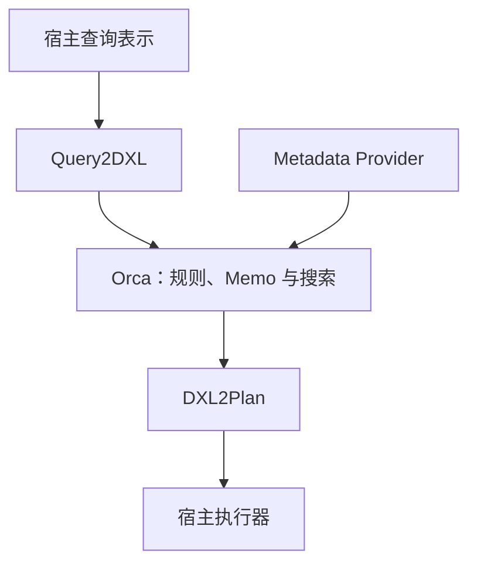

## 课程视频

截至 2026 年 10 月 2 日，所给 B 站收藏夹收录到第 14 讲，官网 Schedule 未提供本讲视频链接。本页依据指定论文整理。

## 让数据库通过明确接口使用优化器

第 21 讲依据 [Orca: A Modular Query Optimizer Architecture for Big Data](https://15799.courses.cs.cmu.edu/spring2025/papers/21-orca/p337-soliman.pdf)整理。论文以 Greenplum 与 HAWQ 的分析负载为背景，说明一个独立优化器如何接收逻辑查询和元数据，返回宿主能执行的分布式计划。

独立优化器需要明确边界：谁负责解析与绑定，谁提供统计和算子语义，谁把物理计划转成执行器对象。边界足够清楚，才有机会在不同宿主之间复用搜索框架。

## DXL 怎样连接宿主与 Orca

DXL 是论文中的 XML 交换表示，用于输入查询、输出计划和元数据。宿主通过 Query2DXL 将自己的查询结构转换为输入，通过 DXL2Plan 将优化结果转换为可执行对象。

Metadata Provider（元数据提供者）供 Orca 读取表、类型、函数、统计和分布等信息。查询与计划翻译器留在宿主一侧，优化器内部无需直接依赖每种数据库的系统目录和执行器结构。

接入仍需要语义完整的映射。宿主支持的类型、空值行为、比较函数与算子参数都要表达；输出计划中的属性也必须能被执行器兑现。

## Memo、Xform 与优化上下文

Orca 使用 Cascades 风格的 Memo 保存等价组。Xform 是变换规则，既能生成新的逻辑形式，也能生成物理实现。优化上下文包含 Group、所需属性及相关成本信息。

探索一个 Join Group 时，系统会安排逻辑探索、实现生成和子输入优化。任务调度显式管理依赖，独立分支可以并行推进；相同目标还需要避免重复搜索。这里可以对照[自上而下并行化](/wiki/cmu_15_799/parallelization_top_down.html)中的 SSDG。

## 分布属性怎样改变 Join 成本

MPP（Massively Parallel Processing，大规模并行处理）系统的数据分布在多个节点。假设 orders 与 customers 都按客户编号以兼容方式分片，Join 可以在对应分片本地执行。

若 orders 按订单编号分片，customers 按客户编号分片，两侧相同客户的数据未必位于同一节点。优化器需要考虑 Motion（数据移动）方案：

| 分布动作 | 效果 | 主要取舍 |
| --- | --- | --- |
| Redistribute | 按目标键重新分布行 | 两侧数据量、网络与倾斜 |
| Broadcast | 将一侧复制到各节点 | 小输入是否足够小、节点内存 |
| Gather | 汇聚到一个节点 | 全局操作需求与单点瓶颈 |

广播小客户表可以让各节点的订单都找到完整客户数据；重分布订单则按客户键形成兼容分区。设有 k 个节点，广播 B 字节的小表大致会产生随 `(k - 1) × B` 增长的传输量；这个教学近似还未计入协议、压缩与执行重叠。

因此比较 Join 实现时，需要同时比较分布调整。局部 CPU 更便宜的 Hash Join，如果之前要移动巨大输入，总体可能更贵。

## Required 与 Derived Properties

Required Properties 描述父节点要求什么，Derived Properties 描述子计划实际提供什么。例如全局分组需要同组数据能在合适位置合并，某个本地扫描只能提供分片内数据。

每个算子需要推导输入需求与输出属性。若子计划不满足需求，加入 Motion、Sort 等补齐操作，并计算额外成本。不同属性上下文可能得到不同最优子计划。

还要考虑数据倾斜。按一个热点客户键重分布后，少数节点可能承担大多数行，即使总传输量不高，执行时间仍受最慢分片影响。统计与分布属性需要共同解释这种风险。

### 广播与重分布的一次数量比较

设集群有 8 个节点，过滤后的客户表总共 10 MB，订单输入总共 8 GB。广播客户表使每个节点拥有客户输入，按理想化近似需要传输 `7 × 10 MB = 70 MB`。若把订单重新按客户编号分布，约有 7/8 的订单行需要离开当前节点，传输量约为 7 GB。这里假设原分布与目标分布近似独立、均匀，忽略压缩、协议和局部聚合。

小输入广播在这个例子中节省大量移动，但每个节点都要保存并处理一份客户数据。客户表如果增长到数 GB，广播的网络与内存成本就会迅速增加。Redistribute 能分摊构建状态，也可能因热点客户出现倾斜。

再加入后续 `GROUP BY customer_id`。按客户重分布后的 Join 输出可能直接满足分组需求，广播方案的输出却可能还要移动一次。优化器应比较从 Join 到 Aggregate 的完整路径，某个节点移动更少并不一定使整条计划更便宜。

这个例子把 Motion、Required Properties 与父节点需求连起来。父算子要求相同客户的行汇聚时，子目标可能选择更早重分布，以复用该属性；没有这项要求时，小表广播可能占优。

## 子查询与分区能力怎样进入框架

Orca 把子查询、分区选择等操作纳入逻辑和物理表示，规则可以据此去相关、生成分区访问或传递过滤信息。它们要与常规 Join 搜索结合，避免先固定局部选择后失去全局机会。

例如分区表按日期组织，过滤条件可以缩小需要访问的分区；如果相关条件直到 Join 后才确定，则需要相应的动态选择机制和属性传递。具体能力以论文及目标宿主支持为准。

## AMPERe 怎样重放优化器问题

优化器问题往往不能仅靠 SQL 复现：相同查询在不同统计、索引、配置和版本下会生成不同计划。论文中的 AMPERe（Automatic capture of Minimal Portable and Executable Repros）把复现所需信息保存成可移植转储。

转储包含输入查询、优化器配置与实际使用的元数据，发生异常时还可包含堆栈。重放时用文件型 Metadata Provider 提供同样输入，让独立 Orca 实例再次运行优化。

这有助于复现规则、计划选择或异常问题，无须复制完整生产数据库。若要验证真实运行成本，仍需相应数据与执行环境；元数据重放和查询执行重放承担不同任务。

### 一个可重放问题需要捕获哪些输入

假设同一条 SQL 今天生成 Broadcast，昨天生成 Redistribute。只保存 SQL 会缺少判定依据：过滤后的客户规模是否改变，订单分布是否相同，统计版本和节点数是否一致，优化器配置是否启用了不同 Xform，都可能影响结果。

AMPERe 的转储为优化器复现提供输入查询、配置和本次实际访问的元数据。读取转储以后，文件型 Metadata Provider 按同样标识提供对象，搜索就能在不复制整库数据的情况下重现原来的决策。

可以把复现目标分成三层。规则异常要求再次走到失败分支；计划选择复现要求相同候选与成本输入；运行时间复现还要求数据内容、网络、缓存和执行器环境。前两层适合优化器转储，第三层需要额外实验材料。

这也是宿主接口设计的检验：如果统计与分布只有隐藏的全局状态、没有进入元数据边界，离线重放就容易缺项。优化器的可移植性与可诊断性共同依赖完整的输入契约。

## 正确性与成本准确性分别验证

一条计划返回正确结果，说明它在测试输入上满足语义；另一条候选更快，则说明选择质量还有改进空间。论文因此同时讨论功能测试、基数估计与成本模型评估。

学习 Orca 时，可以先画出 DXL 边界，再给一个 Join 加上两种数据分布，记录必要 Motion 和属性需求。最后看转储中哪些信息决定计划，理解优化器为何需要可重放的完整输入。

## 参考资料

- [Orca: A Modular Query Optimizer Architecture for Big Data](https://15799.courses.cs.cmu.edu/spring2025/papers/21-orca/p337-soliman.pdf) (M.A. Soliman et al., SIGMOD 2014) *(Primary)*
- [Testing the Accuracy of Query Optimizers](https://15799.courses.cs.cmu.edu/spring2025/papers/21-orca/gu-dbtest2012.pdf) (Z. Gu et al., DBTest 2012) (Optional)

- [课程 Schedule](https://15799.courses.cs.cmu.edu/spring2025/schedule.html)
