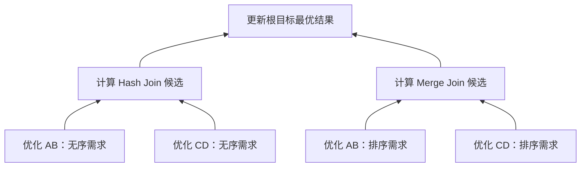

## 课程视频

<div class="bilibili-video" style="position: relative; width: 100%; aspect-ratio: 16 / 9; margin: 1rem 0;">
  <iframe src="https://player.bilibili.com/player.html?isOutside=true&aid=116836549072734&bvid=BV1pzKd61Emc&cid=39520370715&page=1&high_quality=1&qn=120&quality=120&danmaku=0&autoplay=0" scrolling="no" border="0" frameborder="no" framespacing="0" allowfullscreen="true" style="position: absolute; inset: 0; width: 100%; height: 100%;"></iframe>
</div>

[B 站高清观看：10 - Lecture 10 - Parallelization Top-Down](https://www.bilibili.com/video/BV1pzKd61Emc)

本页截图取自上方 B 站课程录像，标注时间可跳回对应位置；图中细字可配合文末的高清课件查看。正文里的教学数据与原课示例分别说明。

## 让任务的依赖显式可见

第 10 讲讨论自上而下优化器的并行化。Cascades 的任务对象已经保存了部分执行状态，单线程栈能够通过入栈顺序安排依赖；多个 worker 同时取任务时，需要另外知道哪些任务能运行、哪些任务还在等待输入。

主要依据 [Parallelizing Extensible Query Optimizers](https://15799.courses.cs.cmu.edu/spring2025/papers/10-parallelization2/waas-sigmod2008.pdf)。课程用 Search State Dependency Graph（搜索状态依赖图，SSDG）说明如何保存搜索任务之间的关系，并将这种设计联系到后来的 Orca。

## 从父目标产生多个搜索分支


[视频 38:00：Orca 示例中的并行任务依赖](https://www.bilibili.com/video/BV1pzKd61Emc/?t=2280)。左侧红色任务边从根优化延伸到规则探索和输入优化，右侧 Memo 给出对应的组表达式。独立分支可以同时推进，父候选成本仍要等待自己的必要输入。箭头表示任务依赖，Memo 引用表示结构共享，二者分别组织执行时机与候选内容。


假设根 Group 包含 `Join(G_AB, G_CD)`，并产生 Hash Join 与 Merge Join 两种实现。系统需要探索子组、生成实现、按不同属性需求优化输入，然后才能比较完整候选。



图中的箭头表示任务完成依赖。AB 和 CD 的搜索可能由不同 worker 推进，某个候选的父任务则需要等待对应输入。Group 相同、属性需求不同的任务可以共享表达式结构，同时保存各自的优化上下文。

父任务也可以先运行一段：创建子任务，记录恢复位置，再挂起。子任务完成后，它从保存的位置继续。这种可暂停、可恢复的任务避免 worker 把线程一直阻塞在等待上。

## 任务状态怎样变化


[视频 25:30：SSDG 中的四种任务状态](https://www.bilibili.com/video/BV1pzKd61Emc/?t=1530)。Runnable 可以分配给 worker，Running 已被执行，Inactive 等待依赖，Finalized 表示任务完成。挂起与恢复改变任务状态，不要求一个 worker 一直阻塞等待。结合正文状态表看父任务如何从等待子目标回到就绪状态。


| 状态 | 含义 |
| --- | --- |
| Runnable | 前置条件满足，可以分配给 worker |
| Running | 已由一个 worker 执行 |
| Inactive | 等待依赖完成，暂时不可推进 |
| Finalized | 工作完成，结果已发布 |

运行中的任务可能生成新依赖并转为 Inactive。最后一个依赖完成时，调度器把它重新设为 Runnable。没有遗漏唤醒、没有重复运行、没有过早完成，是任务调度正确性的基本要求。

一种教学调度框架如下：

```text
worker 取得 runnable 任务
任务推进到完成，或创建依赖并挂起
完成时发布 Memo 结果
通知依赖它的任务
将依赖已满足的任务重新放入 runnable 队列
```

具体实现还要考虑队列同步、任务销毁和异常处理。仅把单线程任务栈换成并发队列，并不能保证父子搜索按正确顺序完成。

## 相同目标怎样避免重复搜索

两个父候选可能同时请求 `Optimize(G_AB, ordered_by_a)`。如果都展开完整搜索，会浪费计算，还可能同时修改相同上下文。

课程中的办法是按目标识别重复任务：由一个活动任务负责推进目标，后来相同目标的请求等待它完成，再从 Memo 读取结果。这里的目标至少包含 Group 和需求上下文；仅按 Group 去重，会把有序与无序搜索混在一起。

同时，等待关系不能形成无法打破的循环。规则可能产生属性补齐或新的等价表达式，调度器需要配合搜索状态处理这些情况。Memo 的“正在探索”和“已经完成”具有不同含义。

### 两个父候选同时等待一个子目标

假设 Hash Join 分支与另一个物理实现都请求 `Optimize(G_AB, unordered)`。第一个 worker 在目标表中登记该状态并开始搜索；第二个 worker 发现它已经存在，可以登记为等待者，继续处理其他就绪任务。子目标完成后通知两个父任务，它们分别恢复自己的成本计算。

```text
目标状态：NEW → RUNNING → COMPLETE
等待列表：Parent-H、Parent-X
完成结果：满足 unordered 的计划指针、成本与状态
```

这里省略了实现中的失败状态与预算扩展。若第二个父任务要求更宽松的成本上限，第一次搜索的结果可能不足以回答它。目标复用需要比较属性、参数依赖、限制和完成程度，不能只检查 Group 编号。

一个常见竞态是“登记等待者”与“发布完成”相交：子目标先检查等待列表，父任务随后才把自己加入，结果父任务永远收不到通知。实现要把状态检查和等待登记纳入同一个正确的同步协议，或者在登记后重新检查完成状态。

发布结果时，计划对象应先构造完成，再把可见状态切换为 COMPLETE。其他 worker 读取完成标记以后，必须能看到一致的成本、计划与属性。这些步骤解释了并行搜索为什么需要目标级的状态机，而不仅是多个线程调用顺序优化函数。

## Memo 的共享边界

多线程会同时插入表达式、发现重复组、更新成本和标记规则应用。最简单的全局锁容易实现，但它会把热点操作串行化；细粒度锁增加并发，也增加了锁顺序和对象生命周期的复杂性。

实际设计可以按 Group、优化上下文或数据结构拆分保护范围。统计信息若在一次优化期间固定，可以作为只读快照共享；局部候选可以先在线程私有内存构造，再发布到 Memo。发布时需要保证其他线程读到的成本与计划一致。

Branch-and-Bound 使用的上界也会并发更新。若一个线程晚看到更小上界，通常只会多做搜索；若读到成本已经更新、对应计划尚未准备好，则可能破坏返回结果。保证安全发布比追求每次立刻看到最新上界更基础。

## 并行度随搜索过程变化


[视频 43:00：不同查询图上的加速与共享瓶颈](https://www.bilibili.com/video/BV1pzKd61Emc/?t=2580)。两组曲线对应星形和链形查询，横轴增加优化 worker，纵轴观察性能变化。读取时先确认这是论文的四核实验环境，再看不同策略的趋势。任务并行机会、Memo 锁竞争和调度开销共同决定收益，曲线不支持把 worker 数直接等同于加速倍率。


搜索初期，根查询的表示和少量规则准备常常是串行部分。候选展开后，独立任务增加；接近结束时，系统可能又只剩几个关键依赖。总任务数很多，并不保证每个时刻都有足够多可运行任务。

Promise 可以用于调度更有希望的任务，尽早找到低成本完整计划。不过并行搜索还要兼顾关键依赖和公平性，避免某个完成根目标所必需的任务长期排不上队。

课件的实验同时观察任务总数、可运行任务和核心数带来的加速。解释结果时，应考虑 Memo 锁竞争、调度开销、内存访问和串行初始化。这些因素会限制增加 worker 的收益。

### 工作窃取怎样应对依赖与倾斜

某个 worker 的队列可能充满正在等待输入的父任务，另一个队列却有大量可立即执行的规则应用。任务调度应优先选择依赖已经满足的工作；本地队列空时，再从其他 worker 取得就绪任务。挂起的父任务通过完成通知恢复，不宜占用线程持续等待。

拆分粒度也要控制。将每个极小的规则匹配都变成独立任务，会让入队、出队和同步成本超过计算收益；将整个巨大 Group 固定给一个 worker，则可能留下其他核心空闲。实际实现需要在表达式、规则绑定或输入优化等粒度之间选择，并通过运行数据调整。

当多个 worker 同时发现更便宜的完整方案，共享上界会逐步收紧。某个 worker 因为读取较旧的较宽上界而多做一些搜索，通常影响效率；读取了不可靠的更小数值并据此剪枝，则影响正确性。上界更新必须来自真正完整、满足当前需求的候选。

## 顺序变化会影响什么

在完整搜索、确定模型和安全剪枝条件下，任务调度顺序主要影响搜索耗时。存在时间预算、规则数预算或启发式提前终止时，顺序会影响截止前找到的候选，最终计划也可能不同。

因此验证并行实现时，一方面检查每条返回计划都完整且满足属性，另一方面比较固定预算下的结果稳定性。对任务依赖和中断状态做日志记录，也能帮助解释某次优化为何停止。

学完本讲后，可以把四个输入优化任务画成依赖图，按两名 worker 手工调度一次，观察父任务何时挂起、何时恢复。后面的 [Orca 实现](/wiki/cmu_15_799/implementation_orca.html)会将这些机制与模块化优化器接口联系起来。

## 参考资料

- [Parallelizing Extensible Query Optimizers](https://15799.courses.cs.cmu.edu/spring2025/papers/10-parallelization2/waas-sigmod2008.pdf) (F.M. Waas et al., SIGMOD 2009) *(Primary)*

- [课程 Schedule](https://15799.courses.cs.cmu.edu/spring2025/schedule.html)
- [课程 Slides](https://15799.courses.cs.cmu.edu/spring2025/slides/10-parallelization2.pdf)
- [课程 Video](https://www.youtube.com/watch?v=joc82ibs4Xo&list=PLSE8ODhjZXjYCZfIbmEWH7f6MnYqyPwCE&index=10)
- [B 站视频](https://www.bilibili.com/video/BV1pzKd61Emc)
