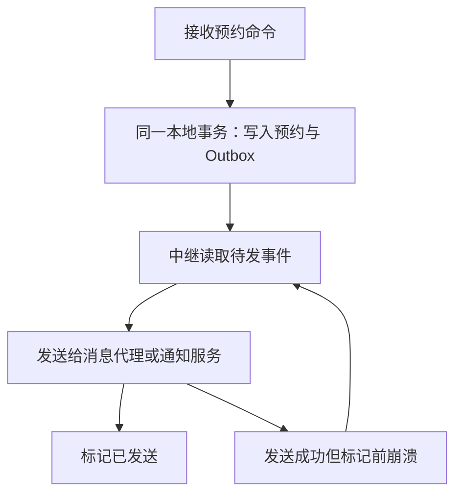

## 一次预约为什么收到三封邮件

第 18 讲从重复通知开始。第一次发送成功但回复丢失，生产者重试；消息又在消费者重启后重新投递。各个局部都执行了自己的规则，用户却收到三封邮件。

服务间调用引入网络延迟、消息丢失和部分失败。付款超时可能意味着请求未到，也可能意味着已扣款但回复未到，调用者无法仅凭超时区分。

课程借 CAP 讨论分区下的选择：在网络隔离期间，保持线性一致的行为会要求部分请求等待或失败；继续让两侧独立成功响应，则可能产生不一致。预约写入与房间说明读取，可以采用不同策略。

## 同步调用、队列和事件流

同步调用适合需要立即结果的交互，但调用者等待下游，也承受下游故障。异步任务让请求先返回，需要另有渠道报告最终结果。

队列让工作等待消费者处理，能够吸收突发流量；流保留日志，各个消费者记录自己的位置并支持重放；发布订阅让多个服务各自响应事件。

生产速度长期高于消费速度时，增加队列不能无限解决问题。需要容量上限和背压，决定阻塞、拒绝还是对允许丢弃的数据舍弃。分区与消费者组能够并行处理，但顺序通常只在规定分区范围成立。

命令要求做一件事，查询要求返回信息，事件则记录已经发生的事实。预约成功以后才能发布 `BookingMade`。CQRS 将写入模型与查询投影分开，也需要接受投影延迟和额外维护。

## 用事务 Outbox 连接数据与消息

先写数据库再发布消息，中间崩溃会丢事件；先发布再提交，又可能公布不存在的预约。事务 Outbox 把业务写入与待发送事件放在同一个本地事务里。

下面按课件的事务与发送步骤整理流程，箭头表示处理先后：

中继读取待发事件，发送后标记完成。发送成功但标记之前崩溃，会导致重复，因此该结构通常需要消费者处理至少一次投递，而不是自动获得端到端恰好一次。

只有一个后台消费者时，数据库 Outbox 自身就可能够用；需要多个独立订阅者与重放时，可以再连接消息代理。基础设施也有运行成本。

## 重试、熔断和幂等

重试适合暂时性失败，并应有退避、上限和不可重试错误分类。Decorator 能保持发送接口，在外围增加重试；它也可能让超时后的重复副作用变得不明显。

熔断器在错误过多时快速拒绝调用，经过等待再试探恢复，避免所有请求持续耗在失败服务上。

幂等要求重复操作不再增加额外效果。取消已取消预约容易做到；付款和发送邮件需要下游幂等键或其他业务方案。

课件展示“检查已处理事件，再增加奖励并记录事件”的伪代码。补充说明：业务更新与事件记录必须同一事务，还需要事件 ID 唯一性和并发冲突处理；事务外的预检查不能阻止两个消费者同时首次处理。邮件副作用也不能由普通数据库事务包住，先记后发可能丢邮件，先发后记则可能重复。

因此，恰好一次的承诺必须说明覆盖范围。代理内部的处理保证，不等于外部邮件与扣款也具有相同保证。

## 顺序与跨服务工作

取消事件可能先于创建事件到达。按实体分区、附带序列或版本，并定义旧事件处理方式，有助于维持语义。多生产者场景中，代理接收顺序也未必等于业务发生顺序。

长期失败的消息应在有限重试后转入死信处理，并明确责任人。Saga 则把跨服务业务拆成本地步骤与补偿：预约占位、扣款、确认；扣款失败后释放占位。补偿是新的业务记录，仍可能失败，也需要幂等与持久进度。

## 用故障条件检查协调代码

对每个处理器，应检查消息重复、乱序和关键步骤后崩溃。停止工作进程后重启，再核对预约、支付和通知的最终状态，才能观察正常路径测试看不到的问题。

消费者积压也提供运行信号：数量或等待时间持续增长，可能说明处理变慢、工作进程失效，或某条消息反复失败。

## 参考资料

- [第 18 讲官方课件](https://github.com/CMU-17-214/f2026/blob/main/slides/18-coordinating-systems.pdf)
- [Lab 11：事件、重放与退款](https://github.com/CMU-17-214/f2026/blob/main/labs/lab11.md)
- [课程资料与完整目录](/wiki/cmu_17_214/)
