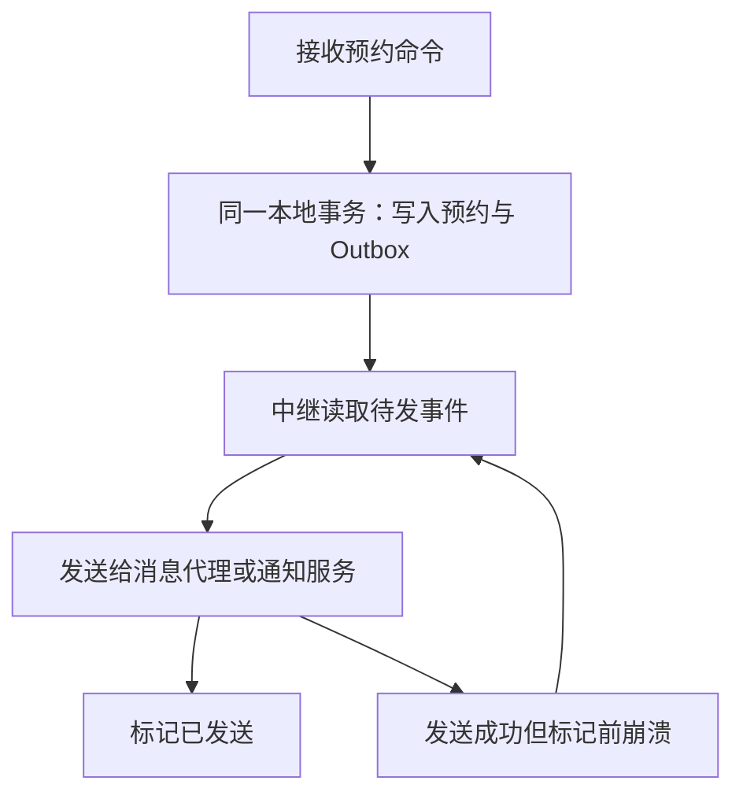

## 一次预约为什么收到三封邮件

第 18 讲从重复通知开始。第一次发送成功但回复丢失，生产者重试；消息又在消费者重启后重新投递。各个局部都执行了自己的规则，用户却收到三封邮件。

服务间调用引入网络延迟、消息丢失和部分失败。付款超时可能意味着请求未到，也可能意味着已扣款但回复未到，调用者无法仅凭超时区分。

课程借 CAP 讨论分区下的选择：在网络隔离期间，保持线性一致的行为会要求部分请求等待或失败；继续让两侧独立成功响应，则可能产生不一致。预约写入与房间说明读取，可以采用不同策略。

## 同步调用、队列和事件流

同步调用适合需要立即结果的交互，但调用者等待下游，也承受下游故障。异步任务让请求先返回，需要另有渠道报告最终结果。

队列让工作等待消费者处理，能够吸收突发流量；流保留日志，各个消费者记录自己的位置并支持重放；发布订阅让多个服务各自响应事件。

生产速度长期高于消费速度时，增加队列不能无限解决问题。需要容量上限和背压，决定阻塞、拒绝还是对允许丢弃的数据舍弃。分区与消费者组能够并行处理，但顺序通常只在规定分区范围成立。

命令要求做一件事，查询要求返回信息，事件则记录已经发生的事实。预约成功以后才能发布 `BookingMade`。CQRS 将写入模型与查询投影分开，也需要接受投影延迟和额外维护。

投递保证需要单独阅读。至多一次不因重试重复，却可能丢失；至少一次通过确认与重投减少丢失，但要求业务处理重复。具体保证依赖消息系统的持久化、故障和确认条件，不能仅凭“使用队列”推出不丢消息。

分区和消费者组还决定并发范围。同一房间的消息按键进入同一分区，一个组内由工作者分担分区，不同组各自消费同一日志。增加工作者达到分区数之后，未必继续提高并行度；跨分区也没有自然全局顺序。

课件的取消时序图中，邮件确认丢失导致重投，但没有保证候补晋升与邮件谁先完成。开放箭头表示异步消息，虚线表示回复。读这种图时，要区分业务事件已经发生与消费者已经处理完成。

选通信方式，可以从调用者是否需要立即结果、是否承担下游失败、是否需要历史、是否应知道接收者四方面比较。课堂练习中的整学期报表适合长任务，合规记录需要持久历史，过期占位清理需要可重试调度；学生等级检查则要先决定新鲜度要求，再选择查询或本地投影。这里是基于题目展开的分析，实际方案仍依赖契约。

## 用事务 Outbox 连接数据与消息

先写数据库再发布消息，中间崩溃会丢事件；先发布再提交，又可能公布不存在的预约。事务 Outbox 把业务写入与待发送事件放在同一个本地事务里。

下面按课件的事务与发送步骤整理流程，箭头表示处理先后：

中继读取待发事件，发送后标记完成。发送成功但标记之前崩溃，会导致重复，因此该结构通常需要消费者处理至少一次投递，而不是自动获得端到端恰好一次。

只有一个后台消费者时，数据库 Outbox 自身就可能够用；需要多个独立订阅者与重放时，可以再连接消息代理。基础设施也有运行成本。

## 重试、熔断和幂等

重试适合暂时性失败，并应有退避、上限和不可重试错误分类。Decorator 能保持发送接口，在外围增加重试；它也可能让超时后的重复副作用变得不明显。

熔断器在错误过多时快速拒绝调用，经过等待再试探恢复，避免所有请求持续耗在失败服务上。

幂等要求重复操作不再增加额外效果。取消已取消预约容易做到；付款和发送邮件需要下游幂等键或其他业务方案。

课件展示“检查已处理事件，再增加奖励并记录事件”的伪代码。补充说明：业务更新与事件记录必须同一事务，还需要事件 ID 唯一性和并发冲突处理；事务外的预检查不能阻止两个消费者同时首次处理。邮件副作用也不能由普通数据库事务包住，先记后发可能丢邮件，先发后记则可能重复。

因此，恰好一次的承诺必须说明覆盖范围。代理内部的处理保证，不等于外部邮件与扣款也具有相同保证。

熔断器可以沿三种状态读：Closed 正常放行，错误达到条件后进入 Open 并快速失败，等待后以 Half-open 放行少量探测，再根据结果恢复或重新打开。它减少持续等待，并没有恢复已经失败的业务。

Decorator 保留 `EmailSender` 接口，在内部委派原发送器并增加有限重试。调用者无需改动，却也可能看不到额外尝试；只有超时、限流等可恢复失败才值得重试。退避和上限需要与下游能力一起设定，权限或资源不存在等错误通常需要改变条件，而不是原样重复。

对于外部邮件，末尾记录 `processed_events` 不能消除“邮件已发、记录前崩溃”的空隙；把记录移到前面又会引入“已记、未发”的丢失。需要结合供应商幂等键、持久投递状态与业务容忍范围设计。有效一次处理强调的是可观察效果，不是每个字节只传输了一遍。

## 顺序与跨服务工作

取消事件可能先于创建事件到达。按实体分区、附带序列或版本，并定义旧事件处理方式，有助于维持语义。多生产者场景中，代理接收顺序也未必等于业务发生顺序。

长期失败的消息应在有限重试后转入死信处理，并明确责任人。Saga 则把跨服务业务拆成本地步骤与补偿：预约占位、扣款、确认；扣款失败后释放占位。补偿是新的业务记录，仍可能失败，也需要幂等与持久进度。

Saga 还要持久记录完成步骤。如果预约占位与扣款已完成，确认前进程崩溃，重启后应从保存的进度继续；但“确认成功、记录进度前崩溃”仍可能重做确认，所以每一步及补偿都需要能够安全重试。

死信也不是丢进另一个队列就完成了。需要保存错误、安排责任人，并决定修复后重投还是有依据地舍弃。消费者积压的数量与等待时间，则可以提前显示失败消息堵塞、工作者失效或生产长期超过处理能力。

## 用故障条件检查协调代码

对每个处理器，应检查消息重复、乱序和关键步骤后崩溃。停止工作进程后重启，再核对预约、支付和通知的最终状态，才能观察正常路径测试看不到的问题。

作业五把这些要求放进同一个场景：跨副本发送突发流量，中途停止一个副本，再核对通知承诺、私信保证与服务限流。通知记录需要说明待发工作存在哪里、实例停止后谁接手，以及方案为什么选择 Outbox、代理或其他持久路径。正常路径之外的条件，才会检验这些决定。

## 参考资料

- [第 18 讲官方课件](https://github.com/CMU-17-214/f2026/blob/main/slides/18-coordinating-systems.pdf)
- [Lab 11：事件、重放与退款](https://github.com/CMU-17-214/f2026/blob/main/labs/lab11.md)
- [课程资料与完整目录](/wiki/cmu_17_214/)
