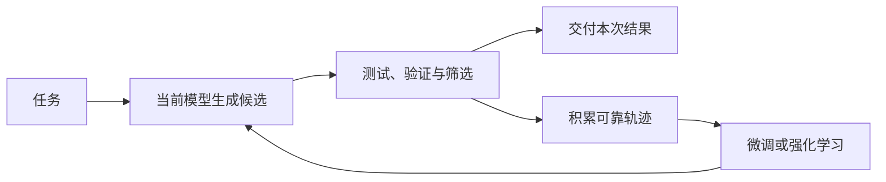

## 课程视频

  <iframe title="Stanford CS329：课程概览课程视频" src="https://player.bilibili.com/player.html?isOutside=true&bvid=BV1saWJ6xEhm&page=1&high_quality=1&qn=120&quality=120&danmaku=0&autoplay=0" scrolling="no" border="0" frameborder="no" framespacing="0" allowfullscreen="true" style="position: absolute; inset: 0; width: 100%; height: 100%;"></iframe>

[B 站中英文字幕](https://www.bilibili.com/video/BV1saWJ6xEhm/) · [Stanford 官方录像 Part 1](https://www.youtube.com/watch?v=6YnLB0XbTnI) · [课程目录](/wiki/cs329/)

对应官方 2025 年秋季课表第 1 次课（2025-09-22）：Course Overview。

## 从规模定律进入自我改进

本节由 Aakanksha Chowdhery 与 Azalia Mirhoseini 讲授，先回顾大语言模型的预训练与后训练，再把推理时计算、验证器和智能体连接起来。正文沿公开视频 Part 1 的顺序整理；其中模型表现和研究判断均放在 2025 年这次课程的语境下理解。

### 更多参数、数据与计算带来了什么

课程先展示预训练规模定律：在一定的数据分布和训练配置下，增加计算量、训练数据或模型参数，测试损失会呈现可描述的下降规律。这里的损失反映模型预测 token 的能力，不能直接等同于某个真实任务的完成率。

除了平均损失下降，大模型还表现出少样本学习（few-shot learning）能力。课堂用英译法说明：零样本提示只描述任务，少样本提示再提供若干输入与输出示例；两者都可以在推理阶段完成，不需要为这一条提示更新参数。

思维链（Chain of Thought，CoT）进一步把示例中的中间推导写出来。网球题里，Roger 原有 5 个球，购买 2 罐、每罐 3 个，示例先算出新增 6 个，再得到总数 11。模型接下来面对新问题时，可以参照这种分解过程。

老师强调，早期观察到的思维链收益与模型规模有关，小模型未必能从同一套示例中受益。今天专门训练的推理模型又加入了针对推理行为的后训练，不能把它们的全部能力都解释为早期提示实验中的“涌现”。

## 怎样把基础模型变成可用的助手

### 高质量数据与指令微调

预训练主要学习下一 token 预测。仅有这种能力，模型还不知道用户希望它怎样回答问题。课堂按顺序介绍了高质量数据上的继续训练、指令微调，以及人类偏好反馈。

指令微调（instruction tuning）使用任务说明和期望回答构成的数据。例如，“氮气的沸点是多少”需要对应合适的答案；需要推理的任务还可以包含解题步骤。数据的准确性、任务覆盖与表达方式，会影响模型之后的指令遵循能力。

### 人类偏好如何形成奖励

基于人类反馈的强化学习（RLHF）让人比较模型生成的不同回答，再从偏好数据中学习奖励模型。之后，语言模型通过优化奖励来调整自己的回答分布。课件把正确性、帮助程度、具体程度和无害性列为不同的评价维度。

因此，指令微调与 RLHF 使用的信息并不相同：前者示范怎样回答，后者提供回答之间的偏好或质量信号。奖励模型只是人类偏好的近似，优化其分数也不保证满足全部真实需求。

## 推理阶段还能继续增加计算吗

### Large Language Monkeys：生成与选择

课程接着介绍 Large Language Monkeys。对于同一道题，让模型以具有随机性的方式重复生成候选，再通过验证器挑选结果。代码题可以执行测试，形式化证明可以交给证明检查器；普通数学问答则需要另外考虑怎样验证。

这个过程拆出了两个问题：**能否生成至少一个正确答案，以及能否把它选出来。** 前者对应覆盖率或 `pass@k`，后者决定系统最后交付的准确率。知道标准答案的 oracle verifier 可以帮助研究候选覆盖，但不能直接拿到未知答案的线上任务中使用。

课堂展示了较小模型通过更多采样，在部分推理基准上达到甚至超过较强模型单次回答覆盖率的结果。比较时必须保留采样数量、验证方式与基准范围；它不意味着小模型一次回答就全面超过大模型。

增加采样还会增加总计算量。并行执行可以降低等待全部候选的时间，却依赖足够的并行资源，仍有算力、费用和尾延迟等约束。把温度调高可以增加多样性，调得过高也可能使候选失去连贯性。

### 把搜索得到的经验送回训练

推理时搜索能够产生一批候选轨迹。如果这些轨迹经过可靠筛选，就可以作为合成训练数据，再用于微调模型。这样，原来要多次尝试才能得到的行为，有机会被更新后的模型更容易地产生。

下面是根据本节内容整理的关系图，区分一次任务中的搜索与跨任务的参数更新：

老师用推理模型中的问题分析、任务分解、自我评估、自我修正和替代方案说明这种行为。矩阵转置脚本的例子中，模型需要先明确输入输出，再考虑如何解析矩阵、保存数据并输出结果。生成更长的思考过程仍是一种计算开销，是否值得要看任务的改善。

课堂问答还保留了一个开放问题：RL 是主要提高已有解法被采到的概率，还是能够扩展模型的能力边界？两位老师没有把它作为已经解决的结论。理解自我改进时，需要同时观察单次成功率、候选覆盖率和新任务上的泛化。

## 从回答问题到执行任务

到了视频约 41 分钟，课程从语言模型转向智能体。以租房调研为例，模型需要浏览不同网站、比较地点与条件，再综合结果；编程任务则需要搜索文件、修改代码、运行命令并读取测试结果。

智能体根据目标选择下一步操作，与环境交互，并用新观察修正后续行为。要持续完成任务，还需要保留目标、已完成工作和失败尝试等信息。开放循环中，模型动态决定下一步；预定义的 agentic workflow 则把大部分执行结构预先写好。

课堂依次列出提示链、路由、并行化、协调器、评判器和验证器等组织方式。它们可以组合使用：例如先并行调查若干来源，再由模型综合；也可以先生成一个方案，再由评判器指出问题，交回生成器修订。

编程智能体的反馈尤其具体：文件是否存在、命令是否执行成功、测试是否通过，都可以成为下一步的依据。不过，测试通过只覆盖测试所检查的条件；用户意图不明确时，系统还需要先弄清楚该修改什么，以及用什么标准验收。

随后介绍的应用包括客户支持、研究报告与 The AI Scientist。研究流程可以拆成资料检索、整理大纲、归纳证据和实验迭代。模型提出了很多想法，并不表示每个想法都正确；仍需要独立的评价过程。

## 课程项目怎样形成研究问题

课程最后介绍三次作业与课程项目。作业帮助理解自我改进、多步推理和工具使用；项目要求提出可以验证的问题，并通过实验分析。

可接受的方向包括构建评测数据集、分析智能体可靠性、改进现有基准表现，或检验课堂论文中的某个设计。纯综述以及没有明确评测标准的应用演示，不能替代研究项目。项目提案、中期展示、最终报告和海报展示共同要求学生逐步拿出实验结果。

对于自学，我们也可以沿用这个要求：先确定基线、任务和计算预算，再比较改动后的成功率与失败模式。下一节的[推理时计算扩展](/wiki/cs329/test_time_compute_scaling.html)会继续讨论，更多计算具体应当分给采样、修订还是验证。

## 参考资料

- [Stanford CS329A 官方课程主页与课表](https://cs329a.stanford.edu/)
- [Large Language Monkeys: Scaling Inference Compute with Repeated Sampling (Brown et al. 2024)](https://arxiv.org/abs/2407.21787)
