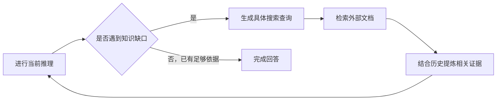

## 课程视频

  <iframe title="Stanford CS329：自我改进与深度研究智能体课程视频" src="https://player.bilibili.com/player.html?isOutside=true&bvid=BV1jUWJ6yEUP&page=1&high_quality=1&qn=120&quality=120&danmaku=0&autoplay=0" scrolling="no" border="0" frameborder="no" framespacing="0" allowfullscreen="true" style="position: absolute; inset: 0; width: 100%; height: 100%;"></iframe>

[B 站中英文字幕](https://www.bilibili.com/video/BV1jUWJ6yEUP/) · [Stanford 官方录像 Part 7](https://www.youtube.com/watch?v=Uni9dqyuuDM) · [课程目录](/wiki/cs329/)

对应官方 2025 年秋季课表第 8 次课（2025-10-17）：Self-Improvement and Deep Research Agents。

## 从程序候选到知识搜索

这篇笔记对应公开视频 Part 7，官方秋季课表中的第 8 次课。课程先介绍 AlphaCode 与 AlphaCode 2，再讨论 Search-o1。前半节关心怎样从大量程序里找出可靠解，后半节关心推理途中缺少知识时怎样继续检索。

本节标题中的“自我改进”包含系统使用反馈改善候选结果的过程。应当继续区分推理时筛选与重新训练参数，不能因为系统多次尝试就认定它在部署中持续学习。

## AlphaCode：采样之后还有哪些工作

竞赛编程不仅要补全代码，还需要理解题意、选择算法并在资源限制下通过隐藏测试。AlphaCode 将预训练、竞赛数据微调与大规模采样结合，再通过执行、筛选和聚类，从候选集合里挑出少量提交。

*来源：[Stanford 官方课程录像 Part 7，04:00](https://www.youtube.com/watch?v=Uni9dqyuuDM&t=240s)；[B 站对应位置](https://www.bilibili.com/video/BV1jUWJ6yEUP/?t=240)。*

课程先回顾 GitHub 代码与 CodeContests 题解数据，再介绍微调中的条件信息和目标设计。题目可能有多个正确程序，算法、实现方式和语言都不同，训练与采样必须考虑这种多解性。

大量采样提供探索，公开样例执行过滤明显错误；但通过少量样例不意味着通过全部隐藏测试。将行为相似的程序聚为一类，可以减少最后提交十份几乎相同解法的风险，保留不同候选思路。

### `pass@k` 与 `10@k` 不是同一个指标

*来源：[Stanford 官方课程录像 Part 7，10:30](https://www.youtube.com/watch?v=Uni9dqyuuDM&t=630s)；[B 站对应位置](https://www.bilibili.com/video/BV1jUWJ6yEUP/?t=630)。*

`pass@k` 衡量采样 `k` 个程序后，只要其中任何一个通过隐藏测试，该题就算成功。它主要观察搜索是否覆盖了正确程序。`10@k` 则从这 `k` 个候选中只提交 10 个，考察筛选和选择后还能解决多少题。

如果 `pass@k` 很高而 `10@k` 很低，说明正确程序可能已经生成，只是没有被最终选中。隐藏测试只能在最终评估时判定这些候选，不能在实际选择阶段当成已经知道答案的 oracle。

课件比较 CodeContests 离线评测与 Codeforces 实际竞赛。离线数据便于重复实验，但可能含误判或接受效率不足的程序；真实竞赛还检验时间限制、题目分布和有限提交次数。结果需要连同评价环境一起理解。

### 聚类为什么有帮助

假设剩余候选里有许多等价的错误实现，直接随机选十份可能反复提交同一错误思路。执行行为聚类希望把相似候选压缩，再从不同组里挑选。它增加的是最终提交集合的多样性，仍然依赖测试输入能否区分行为。

课堂展示在不同采样预算与模型规模下的结果，聚类能改善有限提交的成功率；同时指出百万级采样的计算成本很高。不能只报告一个最终解题率而忽略生成、编译、运行和筛选全部候选的开销。

## AlphaCode 2：更好的生成器与评分器

AlphaCode 2 使用 Gemini 系列模型进一步微调，构成多个模型的家族，以提高生成质量与多样性；另外训练评分模型预测程序通过测试的可能性。

*来源：[Stanford 官方课程录像 Part 7，28:30](https://www.youtube.com/watch?v=Uni9dqyuuDM&t=1710s)；[B 站对应位置](https://www.bilibili.com/video/BV1jUWJ6yEUP/?t=1710)。*

模型家族不是简单把完全相同的模型调用很多遍。不同微调阶段和配置提供不同候选分布，采样温度及元信息也参与多样化。评分器则利用题目和程序，估计候选的质量。

*来源：[Stanford 官方课程录像 Part 7，34:30](https://www.youtube.com/watch?v=Uni9dqyuuDM&t=2070s)；[B 站对应位置](https://www.bilibili.com/video/BV1jUWJ6yEUP/?t=2070)。*

流程依次执行大规模采样、编译与样例测试、行为聚类、组内评分及提交。执行先去掉大量明显不满足条件的程序，之后再用评分器处理无法仅靠公开测试分辨的候选。

课件比较了 AlphaCode 与 AlphaCode 2 的成功率和采样预算：更好的基础模型与筛选可以显著移动质量和计算量之间的曲线。这里比较的是完整系统组合，不宜把全部改善归因于某一个组件。

这一部分仍然针对竞赛题。维护真实仓库还涉及定位文件、版本兼容、交互需求和长期状态，不能把竞赛排名当作完整软件工程能力的直接排名。

## Search-o1：在推理途中补上知识

视频后半段转向知识密集型推理。模型可能善于逐步分析，却在中间遇到自己不知道的实体、公式或背景知识。继续猜测会让后面的推导建立在错误前提上。

固定 RAG（Retrieval-Augmented Generation）常在问题开始时检索一次，再将内容放入模型上下文。但多步问题的信息需求会变化，最初的问题未必包含后面才发现的关键词。

*来源：[Stanford 官方课程录像 Part 7，50:30](https://www.youtube.com/watch?v=Uni9dqyuuDM&t=3030s)；[B 站对应位置](https://www.bilibili.com/video/BV1jUWJ6yEUP/?t=3030)。*

Search-o1 允许模型在推理中发现知识缺口时生成搜索查询，获得资料，再接回原有推理。课堂用多步化学反应问题说明：如果不知道中间物质的结构，直接猜测原子数会污染后续计算；此时应该先获取必要知识。

### 为什么还需要 Reason-in-Documents

直接把长篇搜索结果插进推理链，会带入重复、无关内容，甚至使模型丢失原问题。Reason-in-Documents 模块单独处理当前查询、既有推理与检索文档，提炼与当前步骤相关的信息，再交回主推理过程。

*来源：[Stanford 官方课程录像 Part 7，56:30](https://www.youtube.com/watch?v=Uni9dqyuuDM&t=3390s)；[B 站对应位置](https://www.bilibili.com/video/BV1jUWJ6yEUP/?t=3390)。*

这相当于把“找到文档”与“从文档里取得所需证据”分开。模块输出仍需能追溯来源，摘要遗漏或误读也可能成为新的错误入口。扩大检索 `top-k` 只能增加可用材料，并不保证模型有效利用它们。

下面根据课堂内容整理这种执行关系：

### 看检索与整合各自带来的收益

实验比较不检索的直接推理、固定 RAG、动态检索，以及加上文档提炼的完整方法，覆盖科学推理和单跳、多跳问答。增加文档的效果取决于问题和信息整合方式，不能只用返回文档数量衡量检索质量。

课末还出现 Search-R1 的相关训练结论。需要区分：**Search-o1 的主要内容是动态检索与 Reason-in-Documents，检索 token 掩码和基于结果奖励训练搜索策略属于另外的 Search-R1 工作**，不把二者的训练设置与收益混写。

本节把验证器的选择问题推进到两个具体系统：代码要从许多候选中筛出有效程序，研究智能体要在不断变化的知识需求中取得有效证据。下一节的[智能体评估与长时程任务](/wiki/cs329/agentic_evaluations_and_long_horizon_tasks.html)进一步讨论，应当怎样评价系统最终完成的工作。

## 参考资料

- [Stanford CS329A 官方课程主页与课表](https://cs329a.stanford.edu/)
- [Competition-Level Code Generation with AlphaCode](https://arxiv.org/pdf/2203.07814)
- [AlphaCode 2 Technical Report](https://storage.googleapis.com/deepmind-media/AlphaCode2/AlphaCode2_Tech_Report.pdf)
- [Search-o1: Agentic Search-Enhanced Large Reasoning Models](https://arxiv.org/pdf/2501.05366)
