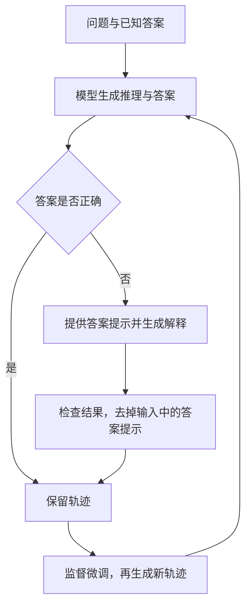

## 课程视频

  <iframe title="Stanford CS329：训练时扩展与强化学习课程视频" src="https://player.bilibili.com/player.html?isOutside=true&bvid=BV1iUWJ6yEdr&page=1&high_quality=1&qn=120&quality=120&danmaku=0&autoplay=0" scrolling="no" border="0" frameborder="no" framespacing="0" allowfullscreen="true" style="position: absolute; inset: 0; width: 100%; height: 100%;"></iframe>

[B 站中英文字幕](https://www.bilibili.com/video/BV1iUWJ6yEdr/) · [Stanford 官方录像 Part 6](https://www.youtube.com/watch?v=yVnmHSAy3ck) · [课程目录](/wiki/cs329/)

对应官方 2025 年秋季课表第 6 次课（2025-10-10）：Train Time Scaling/Scaling RL。

## 从本次搜索转向模型更新

本节由 Aakanksha Chowdhery 讲授。开场回顾推理时扩展，然后依次介绍 STaR、DeepSeekMath 与 DAPO。关注点从“同一道题多试几次”转向“怎样利用这些尝试，让模型下一次更容易答对”。

推理时计算改变当前任务的搜索过程，训练时计算还会更新参数。增加训练轮数本身并不保证持续改进：基础模型要能产生有用尝试，奖励要能区分它们，采样与优化也必须稳定。

## STaR：从少量推理示例开始自举

思维链示例能够提示模型逐步回答，但人工编写大量高质量推理轨迹成本很高。STaR（Self-Taught Reasoner）从少量示例出发，让模型为更多问题生成推理过程，只保留最终答案正确的轨迹，再做监督微调并重复。原论文每轮使用重新生成、筛选的数据，从原始预训练模型开始微调；需要区分产生数据的当前模型与本轮微调的初始化模型。

### 只保留成功轨迹，会卡在哪里

如果模型只会解决容易题，筛选得到的训练数据也主要是容易题。对一直答错的问题，系统得不到新的正向示范。STaR 的 rationalization 为这些失败尝试提供另一条路径：给出标准答案作为提示，让模型倒推生成能解释该答案的推理。

*来源：[Stanford 官方课程录像 Part 6，19:00](https://www.youtube.com/watch?v=yVnmHSAy3ck&t=1140s)；[B 站对应位置](https://www.bilibili.com/video/BV1iUWJ6yEdr/?t=1140)。*

例如，提示阶段告诉模型“答案是 42，请说明怎样得到它”，随后训练输入仍然只有原问题，目标输出是生成的推理和答案。这个过程利用了已知答案，不能称为从完全没有外部监督的信息中学习。

*来源：[Stanford 官方课程录像 Part 6，26:50](https://www.youtube.com/watch?v=yVnmHSAy3ck&t=1610s)；[B 站对应位置](https://www.bilibili.com/video/BV1iUWJ6yEdr/?t=1610)。*

下面根据本节整理 STaR 的两个数据来源：

### 正确答案只是推理质量的代理

STaR 的筛选假设最终正确与推理质量有关，但最后答对不代表每一步都成立；倒推过程也可能只是凑出一个看似合理的解释。课堂因此保留了对基础模型能力、提示设计和推理风格漂移的讨论。

如果给出答案后仍生成不了可信推导，自举仍会受限。对于无法轻易提供答案提示的任务，rationalization 也不一定直接适用。STaR 说明生成与筛选可以形成训练循环，却不能代替对数据质量和泛化的检查。

## DeepSeekMath：基础能力与 RL 一起改进

课程随后强调，RL 不是脱离基础模型的数据处理能力独立工作的。DeepSeekMath 从具备代码能力的模型出发，通过数学数据建设、监督微调和 RL 改善数学推理。

*来源：[Stanford 官方课程录像 Part 6，42:10](https://www.youtube.com/watch?v=yVnmHSAy3ck&t=2530s)；[B 站对应位置](https://www.bilibili.com/video/BV1iUWJ6yEdr/?t=2530)。*

数据部分从 OpenWebMath 等种子出发，训练 fastText 分类器筛选数学网页，再在 Common Crawl 中扩大数据范围。课上用这一过程解释，为什么不能只把 arXiv 论文等同于所有有用的数学训练材料：解题说明、网页教材和代码等内容，可能提供不同形式的推理信号。

有一点需要结合[原论文](https://arxiv.org/abs/2402.03300)区分：DeepSeekMath 报告的 `51.7%` 是 MATH 基准结果，不能与本节开场并列提到的 AIME 成绩混为同一个指标。不同数据集的难度、评分与采样设置也不相同。

## GRPO：用同题采样组构造基线

PPO 往往需要维护策略、参考模型、价值模型和奖励计算等组件，大模型训练中的显存及通信开销很高。Group Relative Policy Optimization（GRPO）用同一个问题下多条输出的相对奖励估计优势，从而避免训练独立的 critic 价值模型。

*来源：[Stanford 官方课程录像 Part 6，46:30](https://www.youtube.com/watch?v=yVnmHSAy3ck&t=2790s)；[B 站对应位置](https://www.bilibili.com/video/BV1iUWJ6yEdr/?t=2790)。*

对同一道题采样 `G` 个回答，奖励为 `r_1,...,r_G`，常用的组相对优势为：

$$
\hat A_i=\frac{r_i-\operatorname{mean}(r_1,\ldots,r_G)}{\operatorname{std}(r_1,\ldots,r_G)}
$$

这个式子解释优势怎样来，不是完整的 GRPO 目标；实际更新还涉及新旧策略概率比、裁剪以及参考策略约束等项。奖励来自什么、在 token 还是完整回答上聚合，也会改变训练行为。

以 `[1,1,0,0]` 为例，均值和标准差都是 `0.5`，优势为 `[1,1,-1,-1]`。相比只保留成功轨迹，组相对更新还可以降低相对较差回答的概率。

### 全对和全错为什么没有比较信号

如果同组全部答对或全部答错，中心化后的差异为零，标准差也为零。实现需要处理数值稳定性，但仅加入一个很小的分母常数并不能凭空制造学习信号。太容易的题和当前模型完全不会的题，都可能让有效训练批次变小。

课程还比较在线与离线采样：当前策略产生的候选更贴近正在优化的分布。关于 `Maj@k` 与 `pass@k`，前者衡量多数答案能否选对，后者衡量候选里是否至少有一个正确解。观察到其中一个指标提高，不代表另一个也提高；“RL 只提高一致性”也只能作为具体实验的分析，不能推广为所有模型和任务的定理。

## DAPO：让大规模 RL 训练保持有效

最后一部分讨论 DAPO 的训练细节，尤其是探索、有效批次和长回答的权重。论文以 Qwen2.5-32B 为基础模型，在其 AIME 2024 评估设置下得到 50 分；需要和 DeepSeekMath 的 MATH 结果分别看待。

### Clip-Higher：保留低概率行为的探索空间

*来源：[Stanford 官方课程录像 Part 6，54:30](https://www.youtube.com/watch?v=yVnmHSAy3ck&t=3270s)；[B 站对应位置](https://www.bilibili.com/video/BV1iUWJ6yEdr/?t=3270)。*

对新旧策略概率比做对称裁剪时，低概率 token 即使获得正优势，可提高的绝对概率仍可能很小。Clip-Higher 将上下边界解耦，为有希望的低概率行为留出更大的增长空间。

课件用生成分布的熵观察探索是否过早塌缩。熵过低时，策略越来越确定地重复少数行为；熵过高也不等于好探索，输出可能失去结构。因此要结合奖励、成功率和实际样本判断。

### Dynamic Sampling：补足有差异的训练组

*来源：[Stanford 官方课程录像 Part 6，55:50](https://www.youtube.com/watch?v=yVnmHSAy3ck&t=3350s)；[B 站对应位置](https://www.bilibili.com/video/BV1iUWJ6yEdr/?t=3350)。*

动态采样对题目继续采样，并过滤全对或全错的组，直到获得足够具有奖励差异的数据。课件使用每题 64 次尝试解释这一过程，这属于示例设置，不能当作所有任务的固定最优值。

“过滤没有信号的组”不同于把所有错误回答删掉。在保留下来的混合组中，失败回答仍然用于相对比较；全错题则说明当前采样没有形成足够的成功对照。

### Token-Level Loss：控制不同长度回答的权重

*来源：[Stanford 官方课程录像 Part 6，58:30](https://www.youtube.com/watch?v=yVnmHSAy3ck&t=3510s)；[B 站对应位置](https://www.bilibili.com/video/BV1iUWJ6yEdr/?t=3510)。*

先对每条回答求平均、再对回答求平均，会给长短回答近似相同的总权重；先汇总整个批次的有效 token 再归一化，则改变每条回答及每个 token 的相对贡献。DAPO 使用 token 级聚合改善长推理中的训练行为。它是损失加权方式的变化，不等于简单加一个“回答越长惩罚越大”的规则。

补充说明：[DAPO 论文](https://arxiv.org/abs/2503.14476)还讨论 overlong reward shaping，处理由于长度上限而被截断的回答，避免把截断统一当成普通错误来施加强烈惩罚。它与 token 级归一化处理的是不同问题。

## 训练过程中还应该观察什么

课末比较三类方法的适用条件：少量推理示例和较少基础设施可以先研究 STaR；具备合适基础模型、领域数据和可靠奖励后，再研究在线 RL；更大规模训练则需要同时处理采样、长序列与探索。

除了 loss，还要观察回答长度、熵、全对与全错组比例、有效批次以及独立测试结果。课堂中的具体长度与熵范围来自所讨论设置，不能直接搬成其他模型的报警阈值。下一节的[自我改进与深度研究智能体](/wiki/cs329/self_improvement_and_deep_research_agents.html)会把生成、执行和搜索连接到更完整的任务系统。

## 参考资料

- [Stanford CS329A 官方课程主页与课表](https://cs329a.stanford.edu/)
- [STaR: Bootstrapping Reasoning With Reasoning (Zelikman et al. 2022)](https://arxiv.org/pdf/2203.14465)
- [DeepSeekMath: Pushing the Limits of Mathematical Reasoning in Open Language Models](https://arxiv.org/abs/2402.03300)
- [DAPO: An Open-Source LLM Reinforcement Learning System at Scale](https://arxiv.org/abs/2503.14476)
