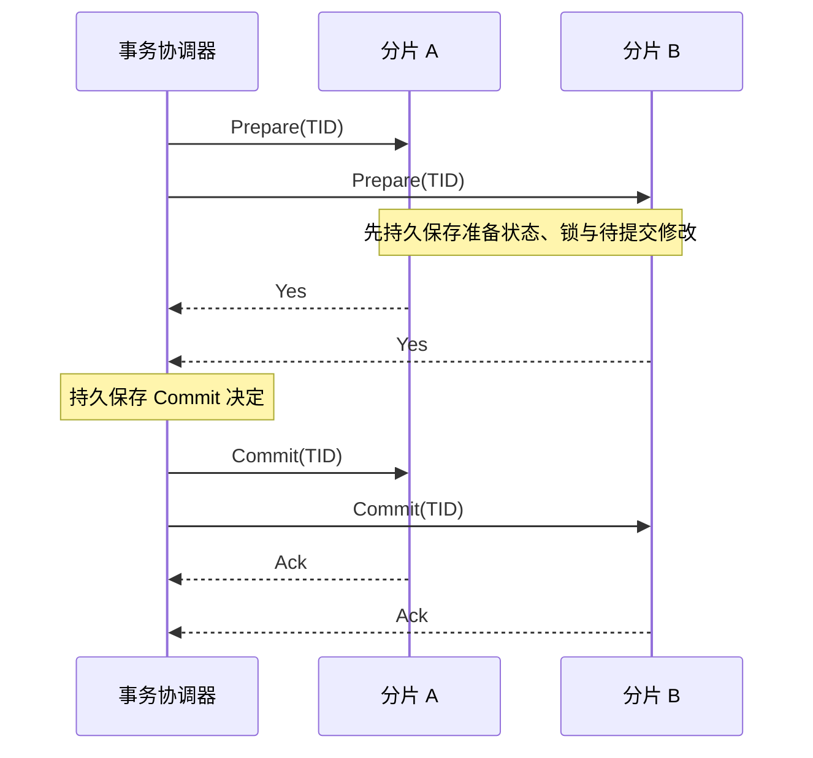

## 课程视频（2021 年公开录像）

  <iframe title="MIT 6.824 2021 · 分布式事务：并发控制与两阶段提交" src="https://www.youtube-nocookie.com/embed/B6btpukqHpM" loading="lazy" referrerpolicy="strict-origin-when-cross-origin" allow="accelerometer; autoplay; clipboard-write; encrypted-media; gyroscope; picture-in-picture; web-share" allowfullscreen style="position:absolute;inset:0;width:100%;height:100%;border:0;"></iframe>

## 分片以后，单条操作不再足够

复制让多台机器看起来像一台可靠服务器，分片则把不同记录交给不同服务器以扩大容量。转账同时修改两个账户时，这两个方向会相遇：既要防并发干扰，又要防某个分片只完成一半工作。

讲义用初始余额都为 10 的 x、y 说明问题。转账从 y 减 1、向 x 加 1，审计读取总额。合法串行执行都应得到 20；若审计夹在两次修改之间，就可能看到 19 或 21。

## 并发控制与原子提交分别负责什么

可串行化要求并发事务的结果等价于某个串行顺序。原子提交要求事务涉及的修改全部生效或全部放弃。两者需要配合：只有锁不能解决机器崩溃后的半提交，只有提交投票也不能阻止并发读到不合法组合。

本讲先采用强严格两阶段锁：访问记录前取得相应锁，直到 commit 或 abort 后统一释放。这样一个事务不能在修改了一半时把锁交给另一个事务。互不冲突的记录仍可并行处理。

锁也可能造成死锁。例如事务 A 先锁 x 再要 y，B 先锁 y 再要 x。系统需要检测等待环、超时终止或采用有次序的冲突处理；不能通过提早释放事务锁来绕过问题，否则可能破坏串行化。

## 两阶段提交的正常路径

事务协调器 TC 为事务分配唯一 TID，将读写请求发给不同参与者。参与者持有锁，把修改暂存在私有状态中，进入提交时再共同决定是否发布。

下面按讲义整理两阶段提交，不省略持久化所处的位置：

任意参与者投 No，协调器就应 abort；全部投 Yes，协调器才能决定 commit。参与者收到最终决定后安装或丢弃修改，再释放锁。TID 帮助区分事务和过滤重复消息。

## 投 Yes 以后为什么不能自行退出

参与者投 Yes 前可以放弃，因为协调器尚未具备全体同意的条件。投 Yes 后若等不到决定，却不能单凭超时 abort：另一参与者可能已经收到 commit 并生效。同样，它也不能自行 commit，因为某个同伴可能投了 No。

这就是 2PC 的阻塞点。恢复时，处于 prepared 状态的参与者还要保留必要锁并查询决定。协调器在发出任何 commit 前持久化决定，也是为了重启后能够继续发送同一个结果。

确认与遗忘也要有协议。协调器收到所有参与者的确认后，才知道它们不再依赖该决定记录；不能只在给客户端回了成功后立即删去恢复所需的信息。

## Raft 与 2PC 为什么会同时出现

Raft 让保存同一份状态的副本达成一致，多数可用即可推进；2PC 协调承担不同修改的参与者，不能跳过任意一个必要分片。二者解决的条件不同。

可以把协调器和每个分片分别复制，再在这些复制组之间运行 2PC。这样单台机器失败不必让整个事务永久等待，但某个必要复制组失去多数，事务仍可能停顿。下一讲 Spanner 就把复制、跨分片事务和时间戳放到同一个系统中。

## 参考资料

- [Distributed Transactions](https://pdos.csail.mit.edu/6.5840/notes/l-2pc.txt)
- [论文讨论 FAQ](https://pdos.csail.mit.edu/6.5840/papers/chapter9-faq.txt)
- [Principles of Computer System Design：在线教材，第 9 章](https://ocw.mit.edu/courses/res-6-004-principles-of-computer-system-design-an-introduction-spring-2009/pages/open-textbook/)：课程指定阅读 9.1.5、9.1.6、9.5.2、9.5.3 和 9.6.3 节。
