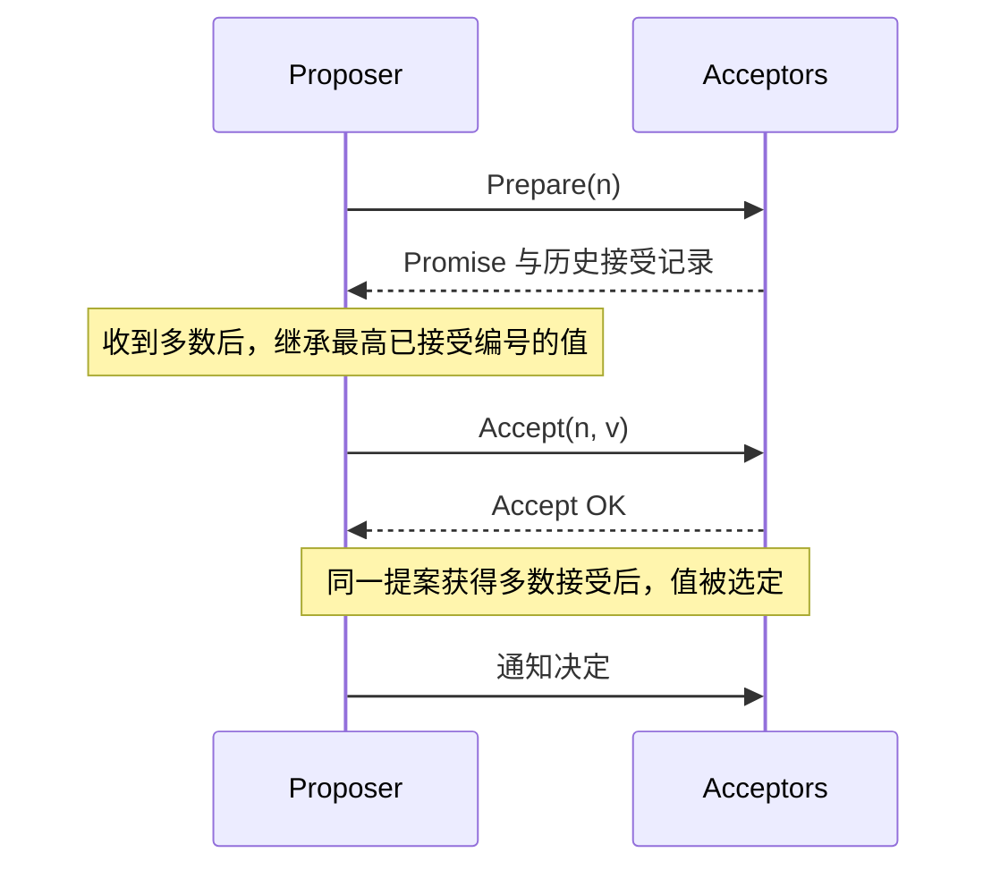

## 从主备切换走向共识

上一讲的 master 决定谁是 primary，但 master 自己失败后由谁决定接替者？若两个服务器都把对方的无响应解释成故障，就可能在网络分区两侧各自提供服务，形成 split brain。

Paxos 让一组参与者为同一个共识实例选择一个值。即使出现延迟、丢包或少数机器崩溃，也不能选择出两个不同的值。基本 Paxos 只解决一次选择；复制状态机通常把多个实例串成有序日志。

## 多数派交集只是起点

在 `2f + 1` 个 acceptor 中，任意 `f + 1` 个构成多数派，两个多数派一定相交。这里的多数基于固定配置的总成员数，不能在故障时临时改成“活着的机器中的多数”。

交集使新一轮有机会发现旧决定，但相交节点还必须记住状态并遵守协议。某个值一旦被多数接受，后续轮次就必须保留它；如果这些承诺在重启后丢失，数学上的交集也保护不了已经选择的值。

## Prepare：先问已有的承诺

proposer 选择唯一且递增的提案编号 n，向 acceptor 发送 `Prepare(n)`。acceptor 记录它承诺过的最大编号 `n_p`，只有 n 更大时才作出新承诺，同时返回自己接受过的最高编号和值 `(n_a, v_a)`。

proposer 收到多数回复后，如果有人报告接受过值，必须使用其中 **`n_a` 最大的那一个值**；全部没有接受记录时，才使用自己的候选值。某个 acceptor 的记录并不证明旧值已经被选定，但它可能是旧多数留下的唯一可见证据，协议必须保守地继承。

## Accept：让同一提案获得多数

proposer 随后发送 `Accept(n, v)`。acceptor 仅在 `n >= n_p` 时接受，并更新承诺与接受记录。相同 `(n, v)` 获得多数接受时，v 就成为 chosen；通知所有节点这个结果可以发生得更晚。

下面按官方伪代码整理正常路径：

例如，三台机器中两台已经接受 `(1, X)`，proposer 随后宕机。新 proposer 即使想提议 Y，Prepare 的多数仍会与旧多数相交，得到 X 的记录，并继续提议 X。没有发出决定通知，不会把已经发生的选择撤销。

## 为什么不能只数相同的值

不同编号中出现相同的值，并不等于某一个提案已经获得多数接受。判断 chosen 需要看同一编号和值，而不是把各轮零散记录合并计数。选择最高已接受编号，也避免新 proposer 错误地恢复被后续合法轮次替换过的旧候选。

多个 proposer 可以不断用更大编号抢占对方，安全性仍然成立，进展却可能暂停。实际系统通常通过稳定 leader、重试退避等办法减少竞争；最终取得进展还依赖多数节点能够持续通信。Paxos 的安全保证不能解释成在任意网络条件下都能立即完成。

## 参考资料

- [Paxos](https://pdos.csail.mit.edu/6.5840/notes/l-paxos.txt)
- [Paxos 官方伪代码](https://pdos.csail.mit.edu/6.5840/notes/paxos-code.html)
- [论文讨论 FAQ](https://pdos.csail.mit.edu/6.5840/papers/paxos-faq.txt)
- [Paxos](https://pdos.csail.mit.edu/6.5840/papers/paxos-simple.pdf)
