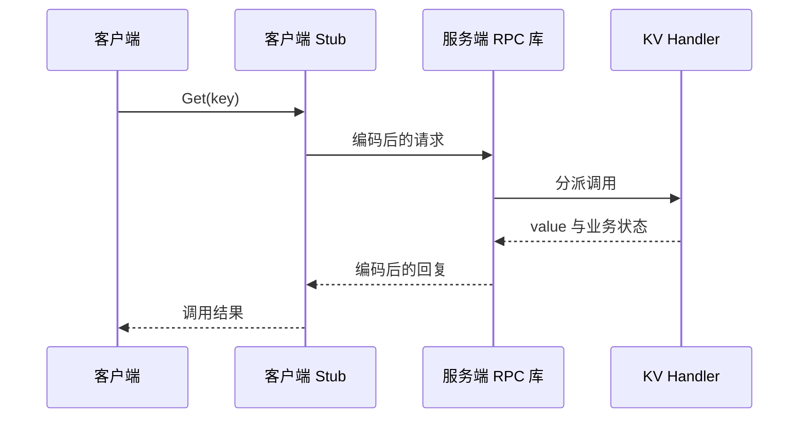

## 课程视频（2021 年公开录像）

  <iframe title="MIT 6.824 2021 · RPC、线程与并发控制" src="https://www.youtube-nocookie.com/embed/oZR76REwSyA" loading="lazy" referrerpolicy="strict-origin-when-cross-origin" allow="accelerometer; autoplay; clipboard-write; encrypted-media; gyroscope; picture-in-picture; web-share" allowfullscreen style="position:absolute;inset:0;width:100%;height:100%;border:0;"></iframe>

## 从串行爬虫到并发爬虫

这一讲先用 `crawler.go` 展示并发控制，再转到 RPC。爬虫需要沿网页链接递归抓取，同时避免重复访问和链接环。串行深度优先实现容易判断何时结束，但每次都要等待网络；加入 goroutine 后，可以让多个网络请求同时等待。

直接给递归调用加 `go` 仍然不够。两个页面可能指向同一个 URL，两个 goroutine 都读到“尚未访问”，随后重复抓取。检查 `fetched[url]` 与设置已访问状态必须组成同一个临界区，单独保护写入无法消除这段竞争。

共享状态版本用 Mutex 保护 visited 集合，并通过 WaitGroup 等待子任务。访问 Go map 时也必须遵守同步约定，即使一次运行看起来正确，内部并发读写仍然可能有数据竞争。原课推荐使用 `go run -race crawler.go` 观察问题，race detector 能发现没有直接表现为错误输出的竞争。

## 用 channel 集中管理状态

channel 版本把 `fetched` 集合交给 coordinator 独占，worker 只负责抓取并把链接列表发回。这样共享 map 不再被多个 goroutine 同时访问，状态所有权也更容易辨认。

coordinator 每启动一个 worker 就增加未完成计数，每收到一个结果就减少计数，并为新 URL 派生任务。只有待完成数归零，才能结束。这种计数依赖一个约定：每个启动的 worker 最终恰好发送一份结果，失败路径同样需要通知。

无缓冲 channel 的发送需要接收者配合。把发送写在错误的位置，可能让 coordinator 等待自己才能继续的动作。理解这段示例时，应该沿着“谁在发送、谁会接收、接收之前是否还需要发送者做事”逐步检查，而不是把 channel 当成自动消除死锁的工具。

## RPC 隐藏了哪些工作

`kv.go` 用 `Put` 和 `Get` 展示远程调用。客户端 stub 构造参数，RPC 库把参数编码成网络字节，服务端 dispatcher 根据方法名调用 handler，再把回复编码发回。

下面按讲义整理调用路径：

Go RPC 为请求创建 handler goroutine，因此服务器中的 KV map 也要加锁。参数和回复结构体中需要传输的字段应导出；指针传输的是它指向的数据，不能把本机指针、channel 或函数直接当作远程共享对象。

## 超时留下的不确定性

RPC 超时可能对应三种情况：请求未到达、服务端尚未完成，或者操作已经完成但回复丢失。客户端仅凭超时无法区分它们。重试可以改善可用性，却可能重复执行写操作。

讲义用两次 `Put` 说明乱序重试：先写 10、再写 20，早先请求若在很晚才重新执行，结果可能退回 10。把操作写成幂等只能解决部分问题；同一个赋值夹在其他更新之间再次执行，仍可能改变客户端观察到的历史。

Go `net/rpc` 自身不会自动重发失败调用，但返回错误也不代表服务端一定没有执行。跨副本重试需要另外设计请求身份、去重和恢复规则，这些会继续出现在后续 KV 与 Raft 实验中。

## 参考资料

- [RPC and Threads](https://pdos.csail.mit.edu/6.5840/notes/l-rpc.txt)
- [crawler.go](https://pdos.csail.mit.edu/6.5840/notes/crawler.go)
- [kv.go](https://pdos.csail.mit.edu/6.5840/notes/kv.go)
- [论文讨论 FAQ](https://pdos.csail.mit.edu/6.5840/papers/tour-faq.txt)
