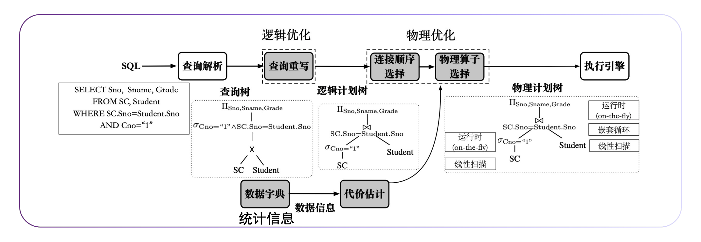

## 课程视频

  <iframe title="清华数据库：查询优化课程视频" src="https://player.bilibili.com/player.html?isOutside=true&bvid=BV15u4y1Q71R&cid=1254109271&page=11&high_quality=1&danmaku=0&autoplay=0" loading="lazy" scrolling="no" frameborder="no" allowfullscreen="true" style="position: absolute; inset: 0; width: 100%; height: 100%; border: 0;"></iframe>

## 查询优化的流程

查询优化在 SQL 的声明式语义与实际执行算法之间建立联系。逻辑优化重写等价表达式，物理优化选择连接顺序、访问路径和算子实现，物化视图则让部分工作可以提前完成。

优化器比较的是搜索空间中找到的候选及其估算成本，实际效果取决于重写是否正确、基数是否准确、物理属性是否保留，以及搜索预算是否足够。

## 逻辑重写

课程从查询 1 号课程学生的学号、姓名和成绩出发：初始表达式先做 Student 与 SC 的笛卡尔积，再过滤连接条件和课程号；随后拆分复合谓词，将 Cno=1 下推到 SC，最后把笛卡尔积与等值条件转换成 Join。

投影下推提前移除无用列，但仍保留后续连接、过滤与输出需要的列。交换律、结合律扩展连接顺序，常量传播和冗余谓词消除减少重复计算。MAX 不受重复次数影响，SUM、COUNT 则通常不能随意移除去重或重复值处理。

子查询改写还要保留重复行和 NULL 语义。例如 `IN` 常对应半连接，直接改成普通连接，只有满足相应唯一性或去重条件时才不会额外复制外侧记录。外连接谓词下推也需要单独证明等价，不能照搬内连接规则。

## 基数估计

统计信息包括行数、不同值数、范围与频率。等宽直方图固定值域宽度，等深直方图调整桶宽以容纳近似数量的记录；热点值与列间相关性决定了均匀、独立假设是否合理。

在均匀且忽略 NULL 等简化条件下，A 等于某值的输出约为 $T(R)/V(R,A)$。独立 AND 谓词可以相乘选择率，OR 则需要扣除交集；实际相关条件不能直接相乘。

连接估计还需要考虑两侧不同值数、值域重叠和主外键约束。在均匀及包含等假设下，常见估计为：

$$
|R\bowtie S|\approx\frac{T(R)T(S)}{\max(V(R,A),V(S,A))}
$$

如果下层估计出错，误差会沿连接树传播，进而影响算法、内存需求和连接顺序。

## Sketch 与采样

Count-Min 使用多组哈希计数器估计频率，碰撞可能使计数偏大；HyperLogLog 利用哈希位模式估计不同值数量。它们用较小空间近似保存不同的统计问题，不能互相替代。

蓄水池采样维护固定大小 k 的样本：前 k 个元素初始化，第 i 个元素以 k/i 的概率进入样本，再随机替换一个位置。这样不必预先知道数据总量，也可以得到等概率样本。统计更新频率还需要结合业务负载和数据变化安排。

## 连接顺序与动态规划

左深树限制每次只在已有结果上连接一个基本关系，搜索空间小于一般 Bushy Tree。动态规划记忆关系子集的较优计划，复用重复子结构；贪心每轮选择当前较便宜的扩展，搜索快但可能陷入局部选择；遗传等随机化方法则在更大空间中寻找较好候选。

Selinger 风格还保留 Interesting Order：某个子计划虽然当前更贵，但它的有序输出可能减少上层排序或连接成本。因此状态不能只记录一个与属性无关的最低价格。

## 优化器组织与 Cascades

自底向上从访问路径逐步构造较大计划，自顶向下从目标表达式和属性要求递归寻找实现。分层优化先做一轮逻辑重写，再在较固定的空间中搜索物理计划；统一搜索则通过规则把两类探索结合起来。

Cascades 的 Group 表示等价表达式集合，表达式引用子 Group，Memo 保存这些组以及已探索的候选。逻辑规则产生等价表达式，实现规则产生物理算子，任务调度控制优化、规则应用与子问题求解。

物理属性不足时需要 Enforcer；已有可行计划给出上界，候选下界超过它时可以剪枝。时间、成本阈值和候选穷尽等条件决定何时停止。Memo 避免重复搜索，但不能弥补错误的等价规则或统计估计。

## 物化、流水线与视图维护

流水线减少中间存储，排序、某些聚合和连接阶段则需要积累输入，形成边界。物化可以复用结果，也可能增加内存和 I/O，执行器需要结合依赖安排。

物化视图保存结果，基表变化后可以立即或延迟维护，也可以全量重算或只计算增量。简单选择可以把新增记录过滤后加入视图；投影、去重和聚合往往还需计数或其他辅助状态，才能正确处理重复值和删除。视图是否可用于改写，还必须保证查询语义与数据新鲜度要求。

## 参考资料

- [第 11 章官方课件](https://dbgroup.cs.tsinghua.edu.cn/ligl/courses/slides11.pdf)
- [李国良教授课程主页](https://dbgroup.cs.tsinghua.edu.cn/ligl/courses_cn.html)
